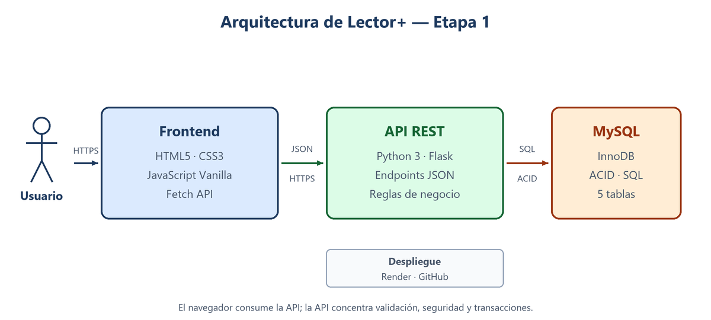
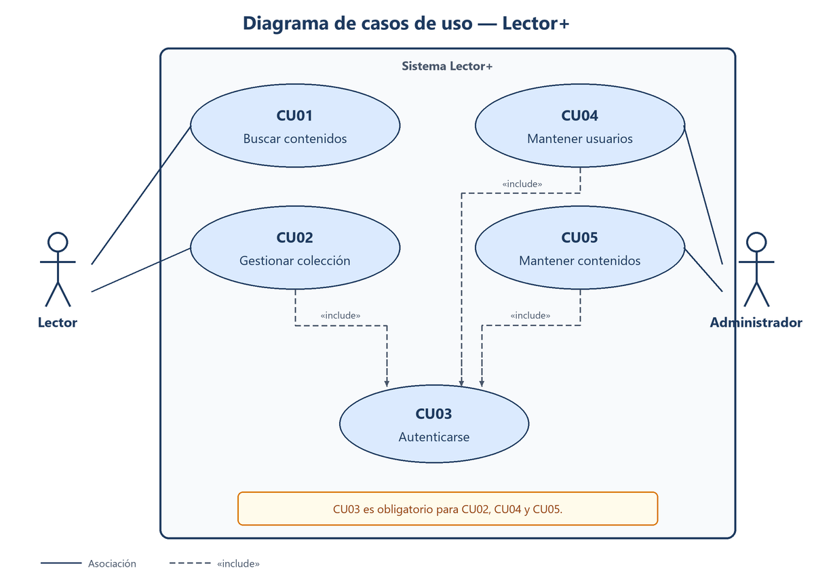
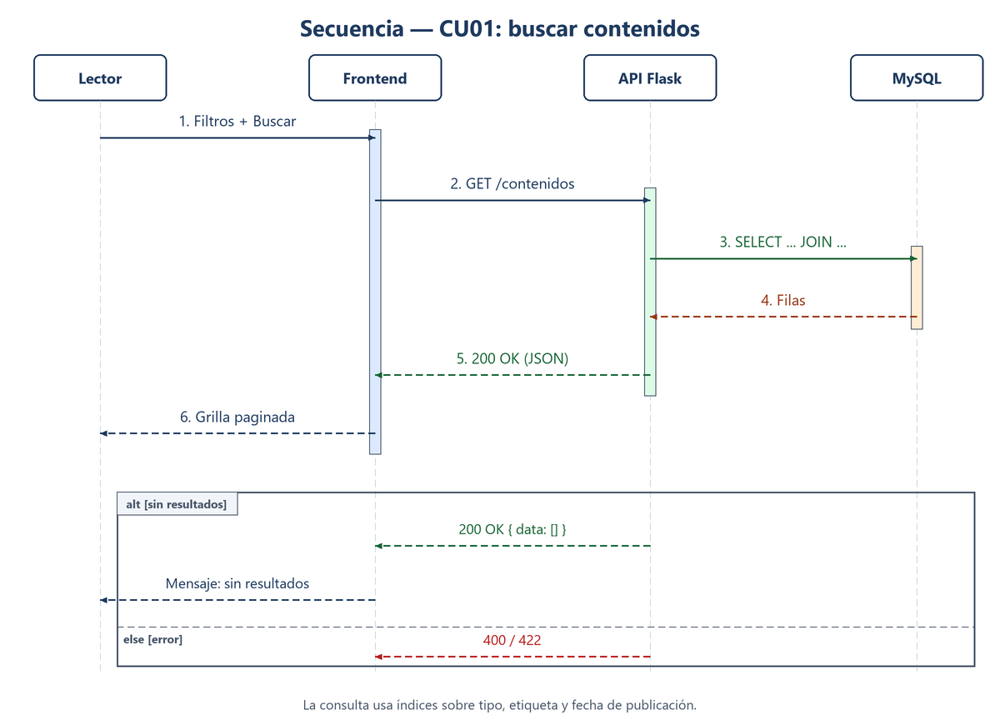
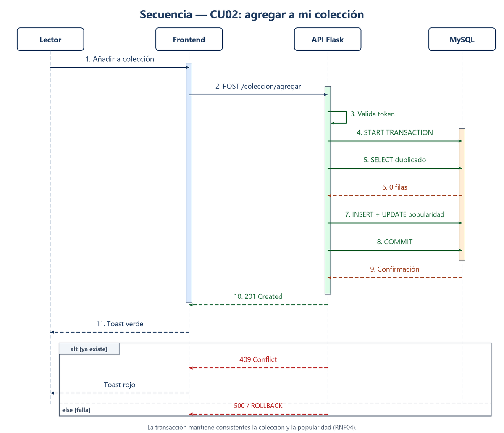
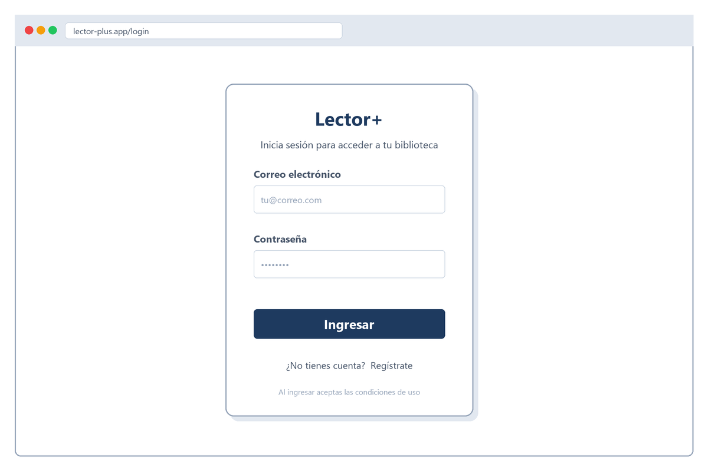
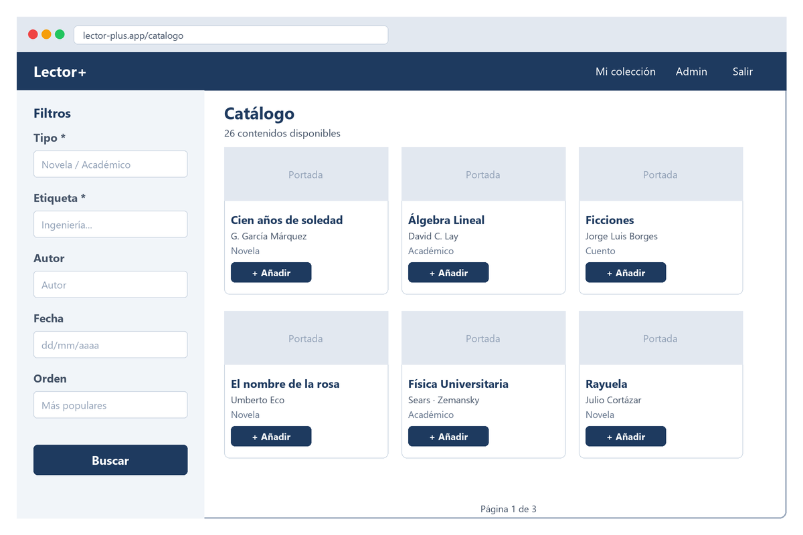
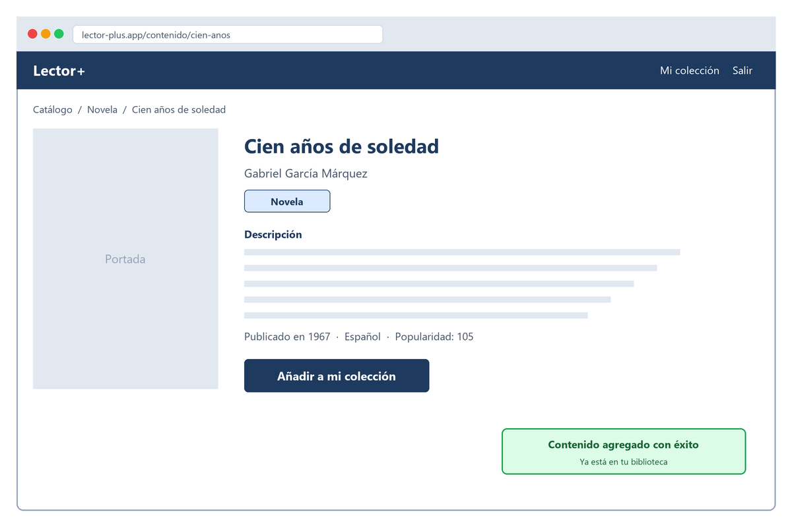
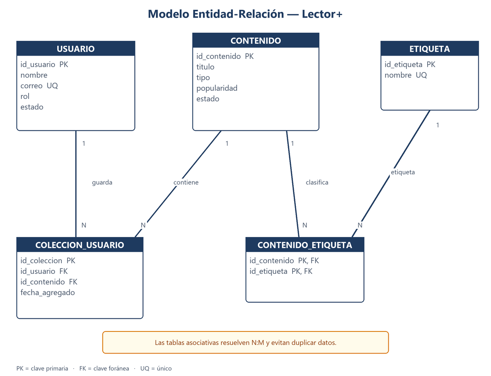

# 1. Problema y solución

## 1.1 Contexto

El acceso a material bibliográfico y académico crece de forma sostenida, pero su organización no avanza al mismo ritmo. Los lectores acumulan PDFs, enlaces, apuntes y referencias en correos, carpetas locales, mensajería y plataformas distintas. Esa dispersión encarece tres tareas cotidianas: encontrar un texto, recordar dónde se guardó y reconstruir la propia biblioteca.

## 1.2 Problema

Estudiantes, investigadores y lectores frecuentes pierden tiempo buscando textos que ya conocían o que sabían que existían. Las búsquedas por título, autor, tipo o tema no están unificadas, los filtros disponibles son pobres y no existe un lugar único para conservar lo consultado. El resultado es duplicación de esfuerzos, pérdida de material y baja continuidad en el estudio. Para una institución, el problema se amplifica: el catálogo no se aprovecha y no hay métricas de uso que orienten la compra o la curación de contenidos.

| Dimensión | Situación actual | Consecuencia | Necesidad |
|---|---|---|---|
| Búsqueda | Filtros dispersos y poco combinables | Resultados irrelevantes o búsquedas repetidas | Filtros por tipo, etiqueta, autor, fecha y orden |
| Organización | Cada lector guarda en su propio formato | Duplicados y pérdida de referencias | Colección personal única y consultable |
| Continuidad | No se registra qué se consultó | Se repite el trabajo | Historial y popularidad como señal |
| Administración | Catálogo sin control central | Datos inconsistentes | Mantenedores con roles y borrado lógico |

*Tabla 1 — Dimensiones del problema y necesidades asociadas.*

## 1.3 Solución propuesta

Lector+ es una aplicación web que centraliza la consulta y la organización de contenidos bibliográficos y académicos. El lector busca con filtros combinables —tipo y etiqueta obligatorios; autor, fecha y orden opcionales—, revisa resultados paginados y guarda títulos en una colección personal. El administrador mantiene usuarios, contenidos y etiquetas, con borrado lógico y control de acceso por roles. La solución se apoya en una API REST (Flask) sobre MySQL, de modo que la interfaz web y cualquier cliente futuro consuman los mismos servicios.

El valor diferencial no es solo el catálogo: es la trazabilidad entre búsqueda, selección y colección personal, junto con una métrica de popularidad que retroalimenta el catálogo y permite priorizar contenidos.

| Componente | Función | Usuario beneficiado |
|---|---|---|
| Catálogo y buscador | Filtros combinables y grilla paginada | Lector |
| Colección personal | Guardar y remover contenidos | Lector |
| Autenticación | Inicio de sesión y token de acceso | Lector y administrador |
| Mantenedores | CRUD de usuarios, contenidos y etiquetas | Administrador |
| Métrica de popularidad | Contador de veces que un contenido fue guardado | Administrador y lector |

*Tabla 2 — Componentes de la solución.*

## 1.4 Objetivos

### 1.4.1 Objetivo general

Diseñar y construir la primera etapa de Lector+, una plataforma web que permita buscar contenidos con filtros y gestionar una colección personal, sobre una arquitectura REST con persistencia relacional.

### 1.4.2 Objetivos específicos

- Definir requerimientos funcionales y no funcionales con criterios verificables.
- Especificar los casos de uso, sus actores y flujos alternativos.
- Diseñar el MER y el modelo relacional normalizado hasta tercera forma normal (3FN).
- Documentar el diccionario de datos y las restricciones de integridad.
- Implementar 13 consultas SQL de definición y manipulación de datos.
- Validar la interfaz con prototipos de las pantallas críticas.

## 1.5 Alcance de la etapa

| Dentro del alcance | Fuera del alcance |
|---|---|
| Autenticación con correo y contraseña | Reseñas y calificaciones |
| Búsqueda con filtros y paginación | Progreso de lectura |
| Colección personal transaccional | Almacenamiento y visor de PDFs |
| Mantenedores de usuarios, contenidos y etiquetas | Notificaciones y aplicación móvil |
| Modelo de datos, diccionario y consultas SQL | Recomendaciones basadas en historial |

*Tabla 3 — Límites del alcance de la Etapa 1.*

# 2. Tecnologías utilizadas

## 2.1 Stack tecnológico

| Capa | Tecnología | Función en Lector+ |
|---|---|---|
| Presentación | HTML5, CSS3, JavaScript Vanilla | Estructura, estilos responsivos y consumo asíncrono de la API con Fetch |
| Lógica de negocio | Python 3 + Flask | API REST, validación, reglas de negocio y emisión de tokens JWT |
| Persistencia | MySQL 8.x con InnoDB | Datos relacionales, transacciones ACID, claves foráneas e índices |
| Seguridad | JWT + hash bcrypt/Argon2 | Sesiones sin estado y almacenamiento seguro de contraseñas |
| Control de versiones | Git + GitHub | Historial, ramas y revisión del código |
| Despliegue | Render | Hosting del backend con HTTPS |

*Tabla 4 — Stack tecnológico de la Etapa 1.*

## 2.2 Arquitectura de la solución



El navegador no accede a la base de datos: toda operación pasa por la API. La API valida el token, aplica las reglas de negocio y abre transacciones. MySQL garantiza atomicidad, consistencia, aislamiento y durabilidad. La comunicación usa HTTPS y JSON; los métodos HTTP se asignan según la operación (GET para consulta, POST para creación, PUT para actualización y DELETE para eliminación lógica).

| Capa | Responsabilidad | Artefactos |
|---|---|---|
| Presentación | Renderizar vistas, validar formularios y consumir la API | HTML, CSS, JavaScript, Fetch |
| Aplicación | Exponer endpoints, autenticar, autorizar y orquestar transacciones | Flask, rutas, JWT, validaciones |
| Datos | Persistir, indexar y garantizar integridad referencial | MySQL, InnoDB, `proyecto_db.sql` |

*Tabla 5 — Responsabilidades por capa.*

## 2.3 Justificación de las decisiones tecnológicas

- **Flask** es un microframework con una curva de aprendizaje baja y suficiente para una API REST. Permite separar rutas, validaciones y acceso a datos sin imponer una estructura pesada, y se despliega con facilidad en Render.
- **MySQL con InnoDB** ofrece integridad referencial, transacciones ACID e índices maduros. El modelo de Lector+ es relacional por naturaleza: usuarios, contenidos, etiquetas y dos relaciones N:M.
- **JavaScript Vanilla** evita dependencias de compilación y mantiene el frontend liviano. Fetch API cubre la comunicación asíncrona con la API sin frameworks adicionales.
- **JWT** permite sesiones sin estado: el token viaja en la cabecera `Authorization` y la API valida firma, expiración y rol en cada petición.
- **Git, GitHub y Render** separan el control de versiones del despliegue. Render entrega HTTPS y un entorno reproducible; GitHub conserva el historial y facilita la revisión.

## 2.4 Entornos y despliegue

| Entorno | Configuración |
|---|---|
| Local | Flask en `http://localhost:5000`; MySQL en `localhost:3306`; frontend servido desde el mismo origen o desde un servidor estático |
| Producción | Backend en Render con HTTPS; base de datos MySQL gestionada; variables de entorno para credenciales y clave JWT |
| Datos | Script `proyecto_db.sql` con el esquema y los datos de prueba |

*Tabla 6 — Entornos de ejecución.*

Las credenciales y la clave de firma no se versionan: se leen desde variables de entorno. El script de base de datos se ejecuta una vez para crear el esquema y los datos iniciales.

# 3. Requerimientos

## 3.1 Requerimientos funcionales

| ID | Requerimiento | Descripción | Criterio de aceptación |
|---|---|---|---|
| RF01 | Búsqueda y filtrado avanzado | Permite buscar material bibliográfico con filtros obligatorios (tipo y etiqueta) y opcionales (autor, fecha y orden). Los resultados se muestran en una grilla paginada. | Con tipo y etiqueta válidos, la API responde 200 en ≤2 s y devuelve una página de resultados; si falta un filtro obligatorio, responde 400 con un mensaje claro. |
| RF02 | Gestión de colecciones personales | Permite al lector agregar o remover contenidos de su biblioteca personal. Al guardar, vincula usuario y contenido y actualiza la popularidad. | Agregar un contenido crea una fila en COLECCION_USUARIO, incrementa popularidad en 1 y responde 201; si ya existe, responde 409 sin modificar datos. |
| RF03 | Mantenedor de cuentas de usuario | Permite al administrador crear, listar, editar y desactivar perfiles, gestionando credenciales y roles. | El administrador completa el CRUD y la desactivación deja estado=0; un lector recibe 403 en las rutas administrativas. |
| RF04 | Mantenedor del catálogo de contenidos | Permite registrar, editar, categorizar con etiquetas y eliminar lógicamente contenidos. | El administrador crea y edita contenidos, asigna etiquetas y desactiva con estado=0; las filas no se borran físicamente. |
| RF05 | Autenticación y control de acceso por roles | Exige credenciales válidas y restringe los mantenedores al rol Administrador. | Credenciales válidas emiten un JWT con rol y expiración; sin token o con rol insuficiente, la API responde 401 o 403. |

*Tabla 7 — Requerimientos funcionales.*

## 3.2 Requerimientos no funcionales

| ID | Requerimiento | Métrica o criterio | Verificación |
|---|---|---|---|
| RNF01 | Rendimiento de búsqueda | ≤2 s para 10.000 contenidos registrados | Prueba con 10.000 filas y plan de ejecución con índices |
| RNF02 | Seguridad de contraseñas | Hash bcrypt o Argon2; nunca texto plano | Revisión de la columna `password` y prueba de login |
| RNF03 | Control de acceso por roles | Lector solo su colección; Administrador mantenedores | Pruebas de 403 en rutas administrativas y de acceso cruzado |
| RNF04 | Integridad de las operaciones | Todo o nada en la colección | Fallo inducido en INSERT/UPDATE y verificación de ROLLBACK |
| RNF05 | Interoperabilidad de la API | REST/JSON/HTTPS con GET, POST, PUT y DELETE | Colección de pruebas con códigos HTTP y Content-Type |
| RNF06 | Privacidad de las colecciones | Solo el dueño o un administrador autorizado | Prueba de acceso a la colección de otro usuario; 403 |

*Tabla 8 — Requerimientos no funcionales.*

## 3.3 Priorización y trazabilidad

| RF | Prioridad | Orden | Caso de uso | Justificación |
|---|---|---|---|---|
| RF05 | Alta | 1 | CU03 | Sin autenticación no se protegen las operaciones |
| RF01 | Alta | 2 | CU01 | Es la entrada al catálogo y el flujo de mayor uso |
| RF02 | Alta | 3 | CU02 | Diferencia a Lector+ de un catálogo estático |
| RF04 | Alta | 4 | CU05 | Mantiene la calidad y vigencia del catálogo |
| RF03 | Alta | 5 | CU04 | Sostiene la administración de cuentas y roles |

*Tabla 9 — Priorización de requerimientos.*

## 3.4 Restricciones y supuestos

| Tipo | Enunciado | Impacto |
|---|---|---|
| Restricción | La persistencia es relacional (MySQL) | El modelo se normaliza y se usan claves foráneas |
| Restricción | El plan gratuito de Render suspende la instancia tras 15 minutos | La primera petición puede tardar cerca de 50 segundos |
| Restricción | El frontend se ejecuta en navegadores modernos | Se usan Fetch API y CSS3 sin polyfills |
| Supuesto | El catálogo inicial lo carga un administrador | No hay carga masiva en esta etapa |
| Supuesto | El volumen inicial no supera 10.000 contenidos | Los índices definidos son suficientes para RNF01 |
| Supuesto | Las fechas se almacenan en UTC | La interfaz las presenta en la zona local |

*Tabla 10 — Restricciones y supuestos.*

# 4. Casos de uso

## 4.1 Actores

| Actor | Descripción | Intereses |
|---|---|---|
| Lector | Usuario registrado que busca y guarda contenidos | Encontrar rápido y conservar su biblioteca |
| Administrador | Usuario con rol administrativo | Mantener usuarios, contenidos y etiquetas con integridad |

*Tabla 11 — Actores del sistema.*

## 4.2 Diagrama de casos de uso



El diagrama muestra cinco casos de uso. El lector participa en CU01 y CU02; el administrador en CU04 y CU05; ambos en CU03. Los casos CU02, CU04 y CU05 incluyen CU03 porque requieren una sesión válida. La relación «include» evita repetir la autenticación en cada especificación y deja explícita la dependencia.

## 4.3 CU01 — Buscar contenidos

| Campo | Descripción |
|---|---|
| Código | CU01 |
| Nombre | Buscar contenidos |
| Actor principal | Lector |
| Objetivo | Localizar contenidos por tipo, etiqueta y filtros opcionales |
| Precondiciones | Ninguna para consultar; sesión iniciada para guardar |
| Flujo principal | 1. El lector abre el catálogo.<br>2. El sistema muestra los filtros.<br>3. El lector selecciona tipo y etiqueta, y opcionalmente autor, fecha y orden.<br>4. El frontend valida y envía `GET /api/contenidos`.<br>5. La API valida, consulta MySQL y devuelve JSON paginado.<br>6. El frontend renderiza la grilla. |
| Flujos alternativos | 4a. Falta un filtro obligatorio: mensaje y 400.<br>5a. Sin coincidencias: estado vacío con sugerencia.<br>5b. Error de base de datos: 500 y mensaje genérico. |
| Postcondiciones | Resultados visibles; filtros conservados en la URL |
| Requerimientos | RF01, RNF01, RNF05 |

*Tabla 12 — Especificación de CU01.*

## 4.4 CU02 — Gestionar la colección personal

| Campo | Descripción |
|---|---|
| Código | CU02 |
| Nombre | Gestionar la colección personal |
| Actor principal | Lector |
| Objetivo | Guardar o remover un contenido de la biblioteca personal |
| Precondiciones | Sesión iniciada; contenido existente y activo |
| Flujo principal | 1. El lector abre el detalle.<br>2. Pulsa «+ Añadir a mi colección».<br>3. El frontend envía `POST /api/coleccion/agregar` con el JWT.<br>4. La API valida token y payload.<br>5. Inicia transacción y verifica duplicado.<br>6. Inserta en COLECCION_USUARIO e incrementa popularidad.<br>7. Confirma con COMMIT.<br>8. Devuelve 201.<br>9. El frontend muestra un toast. |
| Flujos alternativos | 4a. Token inválido: 401.<br>5a. Ya existe: 409, sin cambios.<br>6a. Falla INSERT/UPDATE: ROLLBACK y 500. |
| Postcondiciones | Fila creada, popularidad +1, colección actualizada |
| Requerimientos | RF02, RNF04, RNF06 |

*Tabla 13 — Especificación de CU02.*

## 4.5 CU03 — Autenticarse

| Campo | Descripción |
|---|---|
| Código | CU03 |
| Nombre | Autenticarse |
| Actores | Lector y Administrador |
| Objetivo | Validar credenciales y emitir un token de sesión |
| Precondiciones | Cuenta existente y activa |
| Flujo principal | 1. El usuario abre el login.<br>2. Ingresa correo y contraseña.<br>3. El frontend envía `POST /api/auth/login`.<br>4. La API busca por correo, verifica el hash y el estado.<br>5. Emite un JWT con rol y expiración.<br>6. Devuelve 200 con el token.<br>7. El frontend lo almacena y redirige. |
| Flujos alternativos | 4a. Credenciales inválidas: 401.<br>4b. Cuenta inactiva: 403.<br>4c. Campos vacíos: 400. |
| Postcondiciones | Sesión iniciada; `ultimo_login` actualizado |
| Requerimientos | RF05, RNF02, RNF03 |

*Tabla 14 — Especificación de CU03.*

## 4.6 CU04 — Mantener usuarios

| Campo | Descripción |
|---|---|
| Código | CU04 |
| Nombre | Mantener usuarios |
| Actor principal | Administrador |
| Objetivo | Crear, listar, editar y desactivar cuentas |
| Precondiciones | Sesión con rol Administrador |
| Flujo principal | 1. El administrador abre el panel.<br>2. Selecciona Usuarios.<br>3. El sistema lista las cuentas.<br>4. Crea, edita o desactiva una cuenta.<br>5. La API valida rol y payload.<br>6. Persiste el cambio.<br>7. Confirma la operación. |
| Flujos alternativos | 5a. Correo duplicado: 409.<br>5b. Rol insuficiente: 403.<br>5c. Usuario inexistente: 404. |
| Postcondiciones | Cuenta actualizada; desactivación con estado=0 |
| Requerimientos | RF03, RNF03 |

*Tabla 15 — Especificación de CU04.*

## 4.7 CU05 — Mantener contenidos

| Campo | Descripción |
|---|---|
| Código | CU05 |
| Nombre | Mantener contenidos |
| Actor principal | Administrador |
| Objetivo | Crear, editar, categorizar y desactivar contenidos |
| Precondiciones | Sesión con rol Administrador |
| Flujo principal | 1. El administrador abre el panel.<br>2. Selecciona Contenidos.<br>3. Lista o busca.<br>4. Crea, edita o desactiva.<br>5. Asigna etiquetas.<br>6. La API valida y persiste en transacción.<br>7. Confirma. |
| Flujos alternativos | 5a. Etiqueta inexistente: 404.<br>5b. Título vacío: 400.<br>5c. Rol insuficiente: 403. |
| Postcondiciones | Contenido actualizado; relaciones en CONTENIDO_ETIQUETA |
| Requerimientos | RF04, RNF03 |

*Tabla 16 — Especificación de CU05.*

## 4.8 Trazabilidad de casos de uso

| CU | RF | Tablas principales | Pantalla |
|---|---|---|---|
| CU01 | RF01 | CONTENIDO, CONTENIDO_ETIQUETA, ETIQUETA | Buscador |
| CU02 | RF02 | COLECCION_USUARIO, CONTENIDO | Detalle |
| CU03 | RF05 | USUARIO | Login |
| CU04 | RF03 | USUARIO | Panel de usuarios |
| CU05 | RF04 | CONTENIDO, ETIQUETA, CONTENIDO_ETIQUETA | Panel de contenidos |

*Tabla 17 — Trazabilidad entre casos de uso, requerimientos y tablas.*

# 5. Diagramas de secuencia

## 5.1 CU01 — Búsqueda de contenidos



El lector envía los filtros al frontend, que valida los obligatorios y llama a `GET /api/contenidos`. La API construye la consulta con los filtros y la ejecuta en MySQL. El resultado se devuelve como JSON paginado y el frontend renderiza la grilla. El bloque `alt` cubre dos salidas: sin resultados (200 con arreglo vacío) y error de validación (400/422). La consulta se apoya en índices sobre tipo, etiqueta y fecha para cumplir RNF01.

## 5.2 CU02 — Agregar a la colección



El frontend envía `POST /api/coleccion/agregar` con el JWT. La API valida el token y el payload, inicia una transacción, verifica que el contenido no esté ya en la colección, inserta la fila, incrementa la popularidad y confirma. Si el contenido ya existe, responde 409 sin cambios; si falla el INSERT o el UPDATE, ejecuta ROLLBACK y responde 500. La transacción es la garantía de RNF04: la colección y el contador no pueden quedar desalineados.

## 5.3 Decisiones de diseño transaccional

- **Una sola conexión por operación.** La API abre la transacción, ejecuta las sentencias y cierra la conexión en el mismo bloque.
- **Verificación y unicidad.** La comprobación de duplicados ocurre dentro de la transacción; además, la restricción `UNIQUE(id_usuario, id_contenido)` actúa como última defensa ante concurrencia.
- **Contador denormalizado.** `popularidad` se almacena para evitar un `COUNT` costoso en cada búsqueda; se actualiza en la misma transacción que la colección.
- **Códigos HTTP.** 200 para consultas, 201 para creación, 400 para validación, 401/403 para autenticación y autorización, 404 para recurso inexistente, 409 para conflicto y 500 para fallos internos.
- **Idempotencia de la búsqueda.** GET no modifica estado; la paginación se controla con `page` y `size`.

# 6. Prototipos de interfaz

## 6.1 Inicio de sesión



La pantalla pide correo y contraseña, valida el formato del correo y muestra errores junto al campo. El botón se deshabilita mientras la petición está en curso. Un enlace permite registrarse. El prototipo cubre CU03 y es la puerta de entrada a la colección y a los mantenedores.

## 6.2 Buscador de contenidos



La barra lateral concentra los filtros: tipo y etiqueta obligatorios; autor, fecha y orden opcionales. La zona principal muestra tarjetas con portada, título, autor, tipo y el botón «+ Añadir». La paginación aparece al pie. Los estados previstos son: carga, resultados, sin resultados y error. El prototipo cubre CU01 y el punto de entrada a CU02.

## 6.3 Detalle del contenido



El detalle muestra portada, título, autor, tipo, descripción, fecha, idioma y popularidad. El botón «Añadir a mi colección» dispara CU02; el toast confirma la operación sin recargar la página. Si el contenido ya está en la colección, el botón cambia a «Quitar de mi colección» y el toast lo indica.

## 6.4 Correspondencia con los casos de uso

| Pantalla | CU | Elementos clave | Estados |
|---|---|---|---|
| Login | CU03 | Correo, contraseña, ingresar, registro | Vacío, error, cargando, éxito |
| Buscador | CU01, CU02 | Filtros, tarjetas, paginación, añadir | Cargando, resultados, sin resultados, error |
| Detalle | CU02 | Metadatos, descripción, añadir/quitar, toast | Disponible, ya guardado, error |

*Tabla 18 — Correspondencia entre prototipos y casos de uso.*

# 7. Modelo de datos

## 7.1 Modelo entidad-relación



El modelo tiene tres entidades fuertes y dos asociativas. USUARIO representa a lectores y administradores; CONTENIDO, el material bibliográfico; ETIQUETA, los descriptores temáticos. COLECCION_USUARIO resuelve la relación N:M entre usuarios y contenidos y añade la fecha de guardado. CONTENIDO_ETIQUETA resuelve la relación N:M entre contenidos y etiquetas.

| Relación | Cardinalidad | Interpretación |
|---|---|---|
| USUARIO — COLECCION_USUARIO | 1:N | Un usuario guarda muchos contenidos; cada fila pertenece a un usuario |
| CONTENIDO — COLECCION_USUARIO | 1:N | Un contenido puede estar en muchas colecciones; cada fila apunta a un contenido |
| CONTENIDO — CONTENIDO_ETIQUETA | 1:N | Un contenido tiene muchas etiquetas; cada fila asocia una |
| ETIQUETA — CONTENIDO_ETIQUETA | 1:N | Una etiqueta clasifica muchos contenidos; cada fila usa una etiqueta |

*Tabla 19 — Relaciones y cardinalidades.*

La columna `estado` en USUARIO y CONTENIDO implementa el borrado lógico: una fila desactivada conserva su historial y deja de aparecer en las consultas activas. La restricción `UNIQUE(id_usuario, id_contenido)` impide duplicados en la colección. `popularidad` es una métrica derivada que se mantiene en la misma transacción que la colección.

## 7.2 Normalización

- **Primera forma normal (1FN).** Todos los atributos son atómicos; no hay listas ni grupos repetidos. Las etiquetas se modelan en una tabla aparte, no como una cadena separada por comas.
- **Segunda forma normal (2FN).** En CONTENIDO_ETIQUETA la clave es compuesta y no existen atributos que dependan solo de una parte. En COLECCION_USUARIO la clave es `id_coleccion`; el par `(id_usuario, id_contenido)` es una clave candidata con restricción de unicidad.
- **Tercera forma normal (3FN).** No hay dependencias transitivas: `tipo` depende del contenido, no de la etiqueta; `nombre` de etiqueta depende de `id_etiqueta`; `rol` depende del usuario. `popularidad` es la única denormalización controlada y se justifica por RNF01.

## 7.3 Modelo relacional

| Relación | Atributos | PK | FK | Restricciones |
|---|---|---|---|---|
| USUARIO | id_usuario, nombre, correo, password, rol, fecha_registro, ultimo_login, estado | id_usuario | — | correo UNIQUE; rol IN ('Lector','Administrador'); estado DEFAULT 1 |
| CONTENIDO | id_contenido, titulo, autor, tipo, popularidad, fecha_publicacion, estado | id_contenido | — | popularidad ≥ 0; estado DEFAULT 1; índice en fecha_publicacion |
| ETIQUETA | id_etiqueta, nombre, descripcion | id_etiqueta | — | nombre UNIQUE |
| CONTENIDO_ETIQUETA | id_contenido, id_etiqueta | (id_contenido, id_etiqueta) | id_contenido → CONTENIDO; id_etiqueta → ETIQUETA | FK con política RESTRICT |
| COLECCION_USUARIO | id_coleccion, id_usuario, id_contenido, fecha_agregado | id_coleccion | id_usuario → USUARIO; id_contenido → CONTENIDO | UNIQUE(id_usuario, id_contenido); fecha DEFAULT CURRENT_TIMESTAMP |

*Tabla 20 — Modelo relacional y restricciones.*

**Integridad referencial.** Las claves foráneas impiden referencias huérfanas. La política `RESTRICT` protege el historial: no se puede borrar físicamente un usuario o contenido con filas asociadas; la desactivación se hace con `estado = 0`. Las claves primarias son autoincrementales y no se modifican.

## 7.4 Diccionario de datos

Convenciones: PK = clave primaria; FK = clave foránea; UQ = restricción de unicidad. Los tipos corresponden a MySQL 8.x.

### 7.4.1 USUARIO

| Campo | Tipo | Nulo | Clave | Default | Descripción |
|---|---|---|---|---|---|
| id_usuario | INT | No | PK | AUTO_INCREMENT | Identificador único del usuario |
| nombre | VARCHAR(100) | No | — | — | Nombre completo o alias |
| correo | VARCHAR(150) | No | UQ | — | Correo para autenticación |
| password | VARCHAR(255) | No | — | — | Hash de la contraseña |
| rol | VARCHAR(20) | No | — | 'Lector' | Lector o Administrador |
| fecha_registro | DATETIME | No | — | CURRENT_TIMESTAMP | Fecha de creación |
| ultimo_login | DATETIME | Sí | — | NULL | Último acceso exitoso |
| estado | TINYINT(1) | No | — | 1 | 1 activo; 0 desactivado |

*Tabla 21 — Diccionario de datos de USUARIO.*

### 7.4.2 CONTENIDO

| Campo | Tipo | Nulo | Clave | Default | Descripción |
|---|---|---|---|---|---|
| id_contenido | INT | No | PK | AUTO_INCREMENT | Identificador del material |
| titulo | VARCHAR(200) | No | — | — | Nombre de la obra o artículo |
| autor | VARCHAR(150) | No | — | — | Creador del contenido |
| tipo | VARCHAR(50) | No | — | — | Clasificación principal (Novela, Académico) |
| popularidad | INT | No | — | 0 | Veces que fue guardado |
| fecha_publicacion | DATE | Sí | — | NULL | Fecha original de publicación |
| estado | TINYINT(1) | No | — | 1 | 1 activo; 0 desactivado |

*Tabla 22 — Diccionario de datos de CONTENIDO.*

### 7.4.3 ETIQUETA

| Campo | Tipo | Nulo | Clave | Default | Descripción |
|---|---|---|---|---|---|
| id_etiqueta | INT | No | PK | AUTO_INCREMENT | Identificador del descriptor |
| nombre | VARCHAR(50) | No | UQ | — | Nombre de la etiqueta |
| descripcion | VARCHAR(255) | Sí | — | NULL | Alcance de la etiqueta |

*Tabla 23 — Diccionario de datos de ETIQUETA.*

### 7.4.4 CONTENIDO_ETIQUETA

| Campo | Tipo | Nulo | Clave | Default | Descripción |
|---|---|---|---|---|---|
| id_contenido | INT | No | PK, FK | — | Referencia a CONTENIDO |
| id_etiqueta | INT | No | PK, FK | — | Referencia a ETIQUETA |

*Tabla 24 — Diccionario de datos de CONTENIDO_ETIQUETA.*

### 7.4.5 COLECCION_USUARIO

| Campo | Tipo | Nulo | Clave | Default | Descripción |
|---|---|---|---|---|---|
| id_coleccion | INT | No | PK | AUTO_INCREMENT | Identificador de la fila |
| id_usuario | INT | No | FK | — | Referencia a USUARIO |
| id_contenido | INT | No | FK | — | Referencia a CONTENIDO |
| fecha_agregado | DATETIME | No | — | CURRENT_TIMESTAMP | Fecha en que se guardó |

*Tabla 25 — Diccionario de datos de COLECCION_USUARIO.*

**Reglas de negocio.** `rol` solo admite `Lector` o `Administrador`; `estado` solo admite 0 o 1; `popularidad` no puede ser negativa; el par `(id_usuario, id_contenido)` es único; las fechas se almacenan en UTC.

## 7.5 Índices y rendimiento

| Índice | Tabla | Columnas | Propósito |
|---|---|---|---|
| PRIMARY | Todas | Clave primaria | Acceso directo por identificador |
| correo | USUARIO | correo | Login y unicidad |
| nombre | ETIQUETA | nombre | Búsqueda por etiqueta y unicidad |
| idx_fecha | CONTENIDO | fecha_publicacion | Filtro y orden por fecha |
| FK | CONTENIDO_ETIQUETA | id_contenido, id_etiqueta | Join y filtro por etiqueta |
| FK | COLECCION_USUARIO | id_usuario, id_contenido | Colección por usuario y control de duplicados |

*Tabla 26 — Índices del modelo.*

Para cumplir RNF01 se recomienda un índice compuesto `(tipo, estado)` en CONTENIDO y `(id_etiqueta, id_contenido)` en CONTENIDO_ETIQUETA. Con 10.000 filas, el plan de ejecución usa los índices y evita escaneos completos. Si el catálogo crece a millones de filas, se evaluará una búsqueda full-text o un motor especializado.

# 8. Consultas SQL y álgebra relacional

Se presentan 13 sentencias de referencia: 3 INSERT, 2 UPDATE, 2 DELETE, 2 ALTER, 1 DROP y 3 SELECT. Las sentencias DDL ilustran la evolución del esquema; el script `proyecto_db.sql` contiene el estado consolidado.

## 8.1 Inserción (3 INSERT)

```sql
-- 1. Registro de un nuevo lector
INSERT INTO Usuario (nombre, correo, password, rol)
VALUES ('Juan Pérez', 'juan@email.com', 'hash_seguro_123', 'Lector');

-- 2. Ingreso de un nuevo material académico
INSERT INTO Contenido (titulo, autor, tipo, popularidad, fecha_publicacion)
VALUES ('Álgebra Lineal y sus Aplicaciones', 'David C. Lay', 'Académico', 0, '2015-05-20');

-- 3. El lector guarda un libro en su colección
INSERT INTO Coleccion_Usuario (id_usuario, id_contenido, fecha_agregado)
VALUES (1, 1, NOW());
```

## 8.2 Actualización (2 UPDATE)

```sql
-- 4. Aumentar la popularidad al guardar un contenido
UPDATE Contenido SET popularidad = popularidad + 1 WHERE id_contenido = 1;

-- 5. Registrar el último acceso del usuario
UPDATE Usuario SET ultimo_login = NOW() WHERE id_usuario = 1;
```

## 8.3 Eliminación (2 DELETE)

```sql
-- 6. El usuario remueve un contenido de su colección
DELETE FROM Coleccion_Usuario WHERE id_usuario = 1 AND id_contenido = 1;

-- 7. Se elimina una categorización errónea
DELETE FROM Contenido_Etiqueta WHERE id_contenido = 1 AND id_etiqueta = 5;
```

## 8.4 Modificación de estructura (2 ALTER)

```sql
-- 8. Borrado lógico de usuarios
ALTER TABLE Usuario ADD estado BOOLEAN DEFAULT TRUE;

-- 9. Ampliar la capacidad del título
ALTER TABLE Contenido MODIFY titulo VARCHAR(255) NOT NULL;
```

**Nota.** En el esquema consolidado, `estado` ya existe; la sentencia 8 se conserva como ejemplo de evolución.

## 8.5 Eliminación de estructura (1 DROP)

```sql
-- 10. Eliminar un índice que ya no se utiliza
DROP INDEX idx_fecha ON Contenido;
```

**Nota.** La sentencia 10 es ilustrativa. El esquema final conserva `idx_fecha` porque RNF01 lo requiere para filtros y orden por fecha.

## 8.6 Selección y álgebra relacional (3 SELECT)

### 8.6.1 Búsqueda por etiqueta

```sql
SELECT c.titulo, c.autor, e.nombre AS categoria
FROM Contenido c
INNER JOIN Contenido_Etiqueta ce ON c.id_contenido = ce.id_contenido
INNER JOIN Etiqueta e ON ce.id_etiqueta = e.id_etiqueta
WHERE e.nombre = 'Ingeniería';
```

Álgebra: π(titulo, autor, categoria)(σ(nombre='Ingeniería')(Contenido ⨝ Contenido_Etiqueta ⨝ Etiqueta)). En la implementación se añade `AND c.estado = 1` para excluir contenidos desactivados.

### 8.6.2 Colección personal

```sql
SELECT u.nombre AS lector, c.titulo, cu.fecha_agregado
FROM Usuario u
INNER JOIN Coleccion_Usuario cu ON u.id_usuario = cu.id_usuario
INNER JOIN Contenido c ON cu.id_contenido = c.id_contenido
WHERE u.id_usuario = 1;
```

Álgebra: π(lector, titulo, fecha_agregado)(σ(id_usuario=1)(Usuario ⨝ Coleccion_Usuario ⨝ Contenido)).

### 8.6.3 Contenidos más populares

```sql
SELECT titulo, tipo, popularidad
FROM Contenido
WHERE popularidad > 50
ORDER BY popularidad DESC;
```

Álgebra: τ(popularidad DESC)(π(titulo, tipo, popularidad)(σ(popularidad>50)(Contenido))).

## 8.7 Transacción completa de CU02

```sql
START TRANSACTION;
SELECT 1 FROM Coleccion_Usuario
 WHERE id_usuario = 1 AND id_contenido = 1 FOR UPDATE;
-- Si no existe:
INSERT INTO Coleccion_Usuario (id_usuario, id_contenido, fecha_agregado)
VALUES (1, 1, NOW());
UPDATE Contenido SET popularidad = popularidad + 1 WHERE id_contenido = 1;
COMMIT;
```

Si la verificación devuelve una fila, se ejecuta ROLLBACK y se responde 409. Si falla el INSERT o el UPDATE, se ejecuta ROLLBACK y se responde 500.

## 8.8 Cobertura de las consultas

| N° | Tipo | Tabla(s) | Propósito | Requerimiento |
|---|---|---|---|---|
| 1 | INSERT | USUARIO | Alta de lector | RF03 |
| 2 | INSERT | CONTENIDO | Alta de contenido | RF04 |
| 3 | INSERT | COLECCION_USUARIO | Guardar en colección | RF02 |
| 4 | UPDATE | CONTENIDO | Incrementar popularidad | RF02 |
| 5 | UPDATE | USUARIO | Registrar último acceso | RF05 |
| 6 | DELETE | COLECCION_USUARIO | Remover de colección | RF02 |
| 7 | DELETE | CONTENIDO_ETIQUETA | Corregir categorización | RF04 |
| 8 | ALTER | USUARIO | Borrado lógico | RF03 |
| 9 | ALTER | CONTENIDO | Ampliar título | RF04 |
| 10 | DROP | CONTENIDO | Evaluar el costo de un índice no utilizado | RNF01 |
| 11 | SELECT | CONTENIDO, ETIQUETA | Buscar por etiqueta | RF01 |
| 12 | SELECT | USUARIO, COLECCION_USUARIO, CONTENIDO | Ver colección | RF02 |
| 13 | SELECT | CONTENIDO | Reporte de populares | RF01 |

*Tabla 27 — Cobertura de las 13 consultas.*

# 9. Actualización respecto a la propuesta enviada

## 9.1 Criterio de comparación

Se compara la propuesta enviada inicialmente (documento de definición de 9 páginas) con esta versión consolidada de la Etapa 1. La comparación cubre alcance, requerimientos, casos de uso, prototipos, modelo de datos, consultas y artefactos de documentación. La versión actual conserva el stack y el alcance, y completa los vacíos que impedían evaluar la rúbrica.

## 9.2 Matriz de cambios

| N° | Elemento | Propuesta enviada | Versión actual | Motivo |
|---|---|---|---|---|
| 1 | Tecnologías | No había sección | Stack, arquitectura y despliegue | La rúbrica exige describir todas las tecnologías |
| 2 | Diagrama de casos de uso | Ausente | Diagrama UML con 5 CU y «include» | El criterio pide el diagrama, no solo el texto |
| 3 | Casos de uso | 3 CU; CU03 agrupaba autenticación y mantenedores | 5 CU: autenticarse, usuarios y contenidos separados | Separar responsabilidades y alinear con RF03–RF05 |
| 4 | Especificación de CU | Solo flujo principal | Actor, objetivo, precondiciones, flujo, alternativos, postcondiciones y RF | Los flujos alternativos son necesarios para implementar |
| 5 | Diagramas de secuencia | Ausentes | 2 diagramas: búsqueda y colección | Cubrir el flujo de consulta y el transaccional |
| 6 | Prototipos | 2 pantallas: buscador y detalle | 3 pantallas: login, buscador y detalle | El login es la puerta de CU02–CU05 |
| 7 | MER | 5 entidades; sin `estado` en CONTENIDO | 5 entidades; `estado` en USUARIO y CONTENIDO; UQ en colección | RF04 exige borrado lógico de contenidos |
| 8 | Modelo relacional | 5 relaciones; sin restricciones explícitas | 5 relaciones con PK, FK, UQ, defaults y políticas | La integridad debe ser verificable |
| 9 | Diccionario | Bullets por entidad | 5 tablas con campo, tipo, nulabilidad, clave, default y descripción | El diccionario debe servir de contrato |
| 10 | Consultas SQL | 13 sentencias sin álgebra ni cobertura | 13 sentencias, álgebra y tabla de cobertura | Demostrar trazabilidad con el modelo |
| 11 | Trazabilidad | Ausente | Matriz RF ↔ CU ↔ tablas ↔ consultas ↔ pantalla | Coherencia entre artefactos |
| 12 | Arquitectura | Mención textual | Diagrama de 3 capas y despliegue | Explicar responsabilidades y flujo |
| 13 | Rendimiento | No documentado | Índices, plan y recomendación compuesta | RNF01: 2 s para 10.000 contenidos |
| 14 | Alcance | No delimitado | Tabla dentro/fuera | Evitar expectativas y controlar el alcance |
| 15 | Actualización | Ausente | Esta sección | Criterio de 20% de la rúbrica |

*Tabla 28 — Matriz de cambios respecto a la propuesta enviada.*

## 9.3 Cambios en el alcance y los requerimientos

El alcance se mantiene: autenticación, búsqueda, colección personal y mantenedores. No se agregaron módulos fuera de la etapa. Los cinco RF se conservaron, pero se les añadió un criterio de aceptación verificable. Los seis RNF se reescribieron con métrica y forma de verificación: RNF01 fija 2 s y 10.000 contenidos; RNF02 exige bcrypt o Argon2; RNF03 separa Lector y Administrador; RNF04 exige transacción y ROLLBACK; RNF05 fija REST/JSON/HTTPS; RNF06 prohíbe el acceso cruzado a colecciones.

El cambio de mayor impacto es la separación de CU03. En la propuesta, «Mantener Usuarios y Contenidos» mezclaba autenticación con dos mantenedores distintos. Al separarlo en CU03 (Autenticarse), CU04 (Mantener usuarios) y CU05 (Mantener contenidos), cada caso queda con un actor, un objetivo y un flujo propio, y se alinea con RF03, RF04 y RF05.

## 9.4 Cambios en el modelo de datos

Se añadió `estado` a CONTENIDO para que el borrado lógico de RF04 sea posible; sin esa columna, la eliminación lógica solo se podía aplicar a usuarios. Se añadió `UNIQUE(id_usuario, id_contenido)` a COLECCION_USUARIO para impedir duplicados a nivel de base de datos, no solo en la API. Se explicitaron las políticas de integridad: claves foráneas con RESTRICT, defaults de fecha y estado, y popularidad no negativa.

El MER y el modelo relacional ahora coinciden: las cinco entidades, sus claves y sus cardinalidades son las mismas en el diagrama, en las relaciones y en el diccionario. También se documentaron los índices que sostienen RNF01.

## 9.5 Cambios en la documentación y los artefactos

Se incorporaron el diagrama de casos de uso, dos diagramas de secuencia, un tercer prototipo (login), el diagrama de arquitectura y la tabla de cobertura de las 13 consultas. El diccionario pasó de bullets a tablas con campo, tipo, nulabilidad, clave, default y descripción. Se agregó la matriz de trazabilidad RF ↔ CU ↔ tablas ↔ consultas ↔ pantalla.

## 9.6 Elementos que se mantienen

- Los cinco requerimientos funcionales y los seis no funcionales.
- Las tres entidades fuertes y las dos asociativas.
- El stack Flask + MySQL + JavaScript Vanilla.
- Las 13 consultas SQL obligatorias.
- El alcance de la etapa y el repositorio de código.

## 9.7 Impacto y próximos pasos

La actualización no cambia la naturaleza del proyecto: lo hace verificable. Cada requerimiento tiene un caso de uso, una tabla y una consulta; cada caso tiene un flujo y un prototipo. Esa cadena es la base para implementar y para evaluar la etapa.

Para la siguiente etapa se proyecta extender el modelo con reseñas y calificaciones, progreso de lectura, almacenamiento de PDFs y búsqueda full-text. Estas capacidades no forman parte de la Etapa 1 y no se incluyen en el alcance actual.

# 10. Conclusiones

Lector+ resuelve un problema concreto —la dispersión de contenidos— con un flujo acotado: buscar, revisar y guardar. La Etapa 1 deja ese flujo especificado de punta a punta: requerimientos con criterios de aceptación, cinco casos de uso con flujos alternativos, dos diagramas de secuencia, tres prototipos y un modelo relacional normalizado con diccionario.

El modelo de datos es pequeño pero completo: tres entidades fuertes, dos asociativas, claves foráneas, unicidad y borrado lógico. Las 13 consultas cubren el ciclo de vida de los datos y se conectan con los requerimientos mediante la matriz de trazabilidad.

Los riesgos principales son el rendimiento de la búsqueda al crecer el catálogo y la consistencia de la colección ante concurrencia. Ambos se abordan con índices, una restricción de unicidad y transacciones. La siguiente etapa puede extender el modelo sin rehacer la base.

# 11. Repositorio y despliegue

| Recurso | URL |
|---|---|
| Repositorio de la Etapa 1 | https://github.com/byrononate714-hue/plataforma-lector-api |
| API desplegada | https://plataforma-lector-api.onrender.com |
| Script de base de datos | `backend/proyecto_db.sql` en el repositorio |

*Tabla 29 — Recursos de la entrega.*

El repositorio contiene el backend Flask, el frontend y el script `proyecto_db.sql`. La API se despliega en Render y expone los endpoints bajo `/api`. Las credenciales de demostración se entregan por separado y no se versionan.
