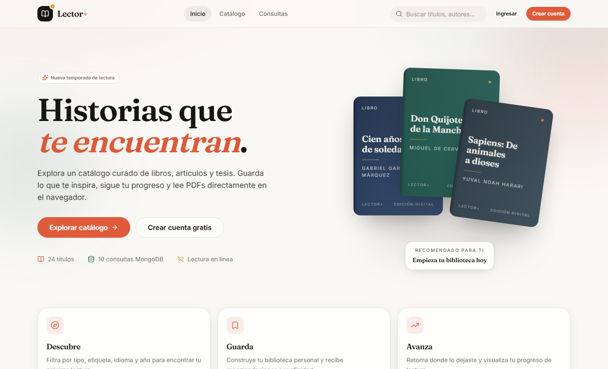
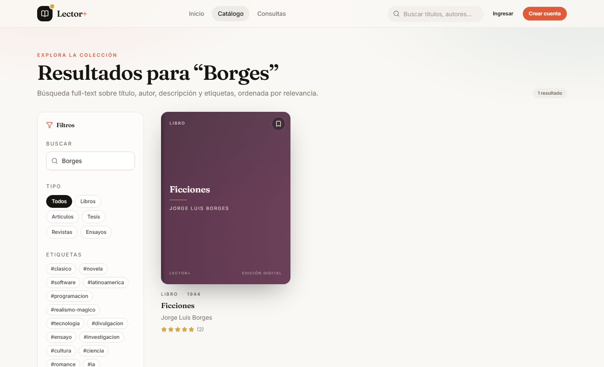
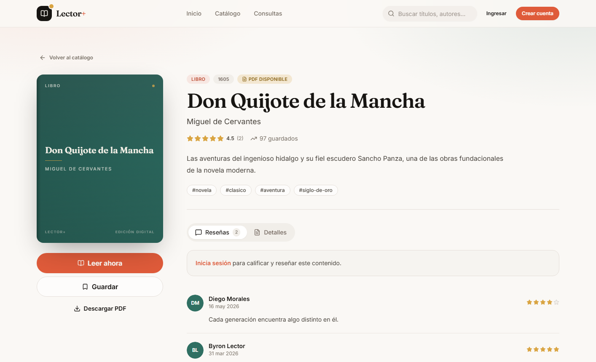
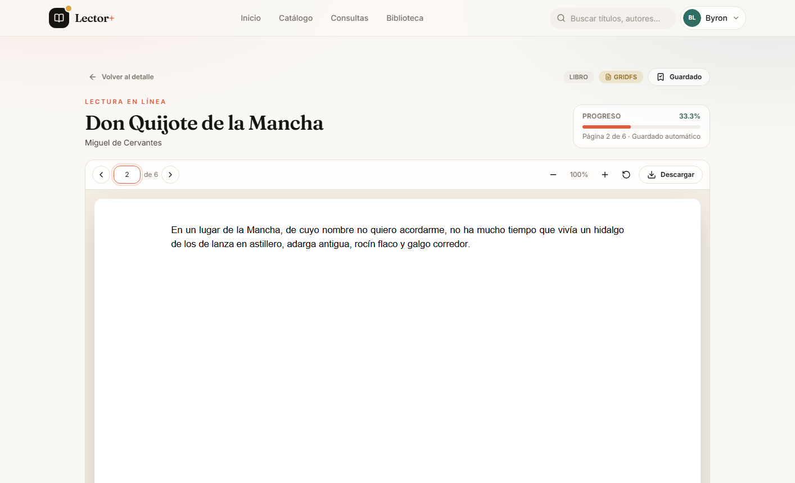
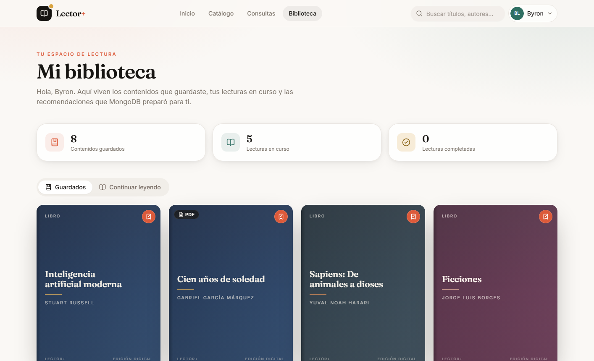
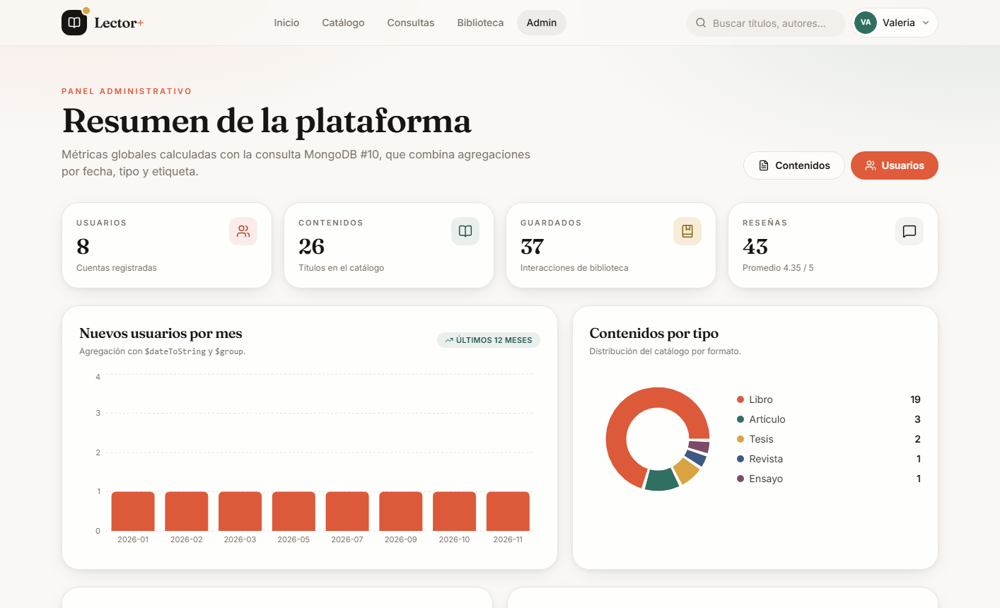

# Lector+ — Plataforma de lectura digital con MongoDB

**Entrega 2 — Informe de actualización y documentación de la API**

| Campo | Detalle |
|---|---|
| Grupo | 17 |
| Integrantes | Byron Thomas Oñate Delgado · Rodrigo Ignacio Sances Nuñez |
| Fecha | 17 de noviembre de 2026 |
| Repositorio backend | https://github.com/Plataforma-Lector-Api/Backend |
| Repositorio frontend | https://github.com/Plataforma-Lector-Api/Frontend |
| Demo | https://frontend-nine-nu-92.vercel.app |
| API | https://lector-api-k2ak.onrender.com |
| Swagger | https://lector-api-k2ak.onrender.com/docs |

---

## Resumen ejecutivo

Lector+ es una plataforma web de lectura digital que permite descubrir, guardar, reseñar y leer libros, artículos, tesis, revistas y ensayos. La Entrega 2 actualiza la propuesta original de la Etapa 1, que estaba planteada sobre MySQL, Flask y JavaScript vanilla, hacia una arquitectura moderna basada en **MongoDB Atlas, FastAPI y React**.

El sistema implementado incluye autenticación con JWT y roles, catálogo con búsqueda full-text y filtros, biblioteca personal, reseñas y calificaciones, progreso de lectura, lectura de PDFs reales almacenados en **GridFS**, panel administrativo y **10 consultas MongoDB** ejecutables desde el frontend y documentadas en Swagger. El backend y el frontend están desplegados en Render y Vercel, respectivamente, con MongoDB Atlas como base de datos.

La migración de SQL a NoSQL no fue un cambio cosmético: implicó rediseñar el modelo de datos, reemplazar joins por `$lookup`, reemplazar `GROUP BY` por `$group`, incorporar `$facet` para paginación y agregaciones, y usar GridFS para archivos binarios. El resultado es un sistema funcional, verificable y documentado, con 26 pruebas automatizadas aprobadas y un flujo completo probado en producción.

---

## 1. Introducción

En la era digital actual, el acceso a la información creció exponencialmente, pero esa abundancia trajo consigo un problema de dispersión: los contenidos académicos y literarios están repartidos entre plataformas, repositorios y archivos personales. Estudiantes, investigadores y lectores deben invertir tiempo en localizar textos, organizar sus lecturas y recordar qué material ya consultaron.

Lector+ nace para resolver esa fragmentación. La propuesta consiste en un repositorio centralizado, dinámico y escalable que optimiza la búsqueda, la clasificación y la retención de usuarios. La plataforma permite:

- Explorar un catálogo curado con búsqueda full-text y filtros por tipo, etiqueta, idioma y año.
- Guardar contenidos en una biblioteca personal.
- Escribir reseñas y calificaciones.
- Registrar el progreso de lectura.
- Leer PDFs directamente en el navegador.
- Administrar contenidos, usuarios y métricas desde un panel administrativo.

El objetivo de la Entrega 2 es demostrar que la propuesta evolucionó de un esquema relacional a un esquema NoSQL, que las consultas fueron transformadas y que la API REST está documentada de forma completa.

---

## 2. Actualización respecto a la propuesta de la Etapa 1

### 2.1 Lo que se propuso en la Etapa 1

La Etapa 1 definió un sistema con las siguientes características:

- **Frontend:** HTML5, CSS3 y JavaScript vanilla.
- **Backend:** Python 3 con Flask.
- **Base de datos:** MySQL, con un modelo relacional normalizado.
- **Autenticación:** credenciales y roles básicos.
- **Despliegue:** Render para el backend.
- **Consultas:** 13 sentencias SQL entre DML y DDL, más 3 consultas de selección con álgebra relacional.

El modelo relacional incluía las entidades `Usuario`, `Contenido`, `Etiqueta`, `Contenido_Etiqueta` y `Coleccion_Usuario`. La propuesta cubría los requerimientos funcionales RF01–RF05, los no funcionales RNF01–RNF06 y los casos de uso CU01–CU03.

### 2.2 Cambios realizados en la Entrega 2

| Aspecto | Etapa 1 | Entrega 2 | Justificación |
|---|---|---|---|
| Base de datos | MySQL (relacional) | MongoDB Atlas (documental) | Flexibilidad de esquema, documentos embebidos, agregaciones y GridFS. |
| Backend | Flask | FastAPI + Pydantic v2 | Tipado, validación automática, OpenAPI/Swagger y mejor rendimiento asíncrono. |
| Driver | PyMySQL / SQLAlchemy | PyMongo Async | Acceso nativo a MongoDB y pipelines de agregación. |
| Frontend | HTML/CSS/JS vanilla | React 19 + TypeScript + Vite + Tailwind | Componentes reutilizables, estado del servidor con TanStack Query y mejor experiencia de usuario. |
| Autenticación | JWT básico | JWT access + refresh, Argon2, RBAC | Seguridad, rotación de tokens y control de roles `reader`/`admin`. |
| PDFs | Enlaces o placeholder | GridFS + `react-pdf` | Archivos reales almacenados en MongoDB y lectura en el navegador. |
| Consultas | 13 SQL | 10 aggregation pipelines | Se cubren los casos de negocio con `$match`, `$group`, `$lookup`, `$facet`, `$text`, `$unwind`, etc. |
| Documentación | No había Swagger | Swagger UI + ReDoc + README | La API es demostrable y consumible por terceros. |
| Despliegue | Render | Atlas + Render + Vercel | Separación backend/frontend y base de datos gestionada. |
| Pruebas | No había pruebas automatizadas | 26 tests Pytest + smoke test | Verificación de regresiones y del flujo end-to-end. |

### 2.3 Alcance cumplido

La Entrega 2 no es un MVP: implementa el alcance completo solicitado.

- Autenticación, registro, refresh y logout.
- Catálogo, búsqueda, filtros, paginación y ordenamiento.
- Biblioteca personal con guardado y eliminación.
- Reseñas y calificaciones con una reseña por usuario/contenido.
- Progreso de lectura con porcentaje y página actual.
- PDFs reales en GridFS con visor, zoom y navegación.
- Panel administrativo con métricas, CRUD de contenidos y gestión de usuarios.
- 10 consultas MongoDB demostrables desde `/consultas` y Swagger.
- Despliegue gratuito y público.

---

## 3. Continuidad con la primera entrega

Esta sección conserva y actualiza los contenidos de la Etapa 1. El documento original se mantiene como anexo y sigue siendo la base de la propuesta.

### 3.1 Problema y objetivo de negocio

El problema original se mantiene: la información académica y literaria está dispersa y los lectores pierden tiempo buscando, organizando y recordando sus lecturas. El objetivo de negocio sigue siendo proveer un repositorio centralizado, dinámico y escalable que optimice los tiempos de búsqueda, clasificación y retención de usuarios.

La solución actualizada es Lector+, una aplicación web con API REST, base de datos NoSQL y frontend separado.

### 3.2 Requerimientos funcionales

| Código | Requerimiento original | Implementación en la Entrega 2 | Estado |
|---|---|---|---|
| RF01 | Búsqueda y filtrado avanzado de contenidos | `GET /contents/search` con `$text` y `GET /contents` con filtros y `$facet`. | Cumplido |
| RF02 | Gestión de colecciones personales | `POST/DELETE /collections/{content_id}` y `GET /collections/me`. | Cumplido |
| RF03 | Gestión y mantenedor de cuentas | `GET/PATCH /admin/users` con roles y estado. | Cumplido |
| RF04 | Gestión y mantenedor del catálogo | CRUD administrativo en `/contents` y subida de PDFs. | Cumplido |
| RF05 | Autenticación y control de acceso por roles | JWT + Argon2 + RBAC `reader`/`admin`. | Cumplido |

### 3.3 Requerimientos no funcionales

| Código | Requerimiento original | Implementación en la Entrega 2 | Estado |
|---|---|---|---|
| RNF01 | Rendimiento de búsqueda | Índice de texto con pesos y consultas optimizadas; respuesta en menos de 2 s en el entorno de demo. | Cumplido |
| RNF02 | Seguridad de contraseñas | Argon2 mediante `pwdlib`; nunca se almacena texto plano. | Cumplido |
| RNF03 | Control de acceso por roles | Dependencias `get_current_user` y `require_admin`. | Cumplido |
| RNF04 | Integridad de las operaciones | Índices únicos y operaciones atómicas en MongoDB; guardados y reseñas idempotentes. | Cumplido |
| RNF05 | Interoperabilidad de la API | REST/JSON sobre HTTPS, métodos GET/POST/PATCH/PUT/DELETE y OpenAPI. | Cumplido |
| RNF06 | Privacidad de las colecciones | El usuario se obtiene del token, nunca del body; un lector solo accede a su biblioteca. | Cumplido |

### 3.4 Casos de uso

| Código | Caso de uso original | Implementación actual |
|---|---|---|
| CU01 | Consultar contenido (buscador) | Catálogo con búsqueda full-text, filtros, paginación y detalle. |
| CU02 | Gestionar colección personal | Guardar/quitar contenidos y ver la biblioteca con progreso. |
| CU03 | Mantener usuarios y contenidos | Panel admin con dashboard, CRUD de contenidos y gestión de usuarios. |

### 3.5 Prototipos de interfaz

Los prototipos de la Etapa 1 evolucionaron a una interfaz React con un sistema de diseño propio: paleta papel/tinta, terracota, pino y dorado; tipografías Fraunces e Inter; componentes accesibles basados en Radix UI; y estados de carga, error y vacío en todas las pantallas.

Las capturas de la interfaz final se incluyen en la sección 8 y en los anexos.

### 3.6 Modelo de datos y diccionario

El modelo relacional original se transformó en colecciones documentales. El detalle se desarrolla en las secciones 5 y 6. El diccionario original se conserva como referencia y se actualiza con los campos nuevos: `role`, `status`, `cover_url`, `file_id`, `tags`, `language`, `published_at`, `popularity`, `rating_average`, `rating_count`, etc.

### 3.7 Consultas SQL originales

La Etapa 1 incluía 13 sentencias SQL: 3 `INSERT`, 2 `UPDATE`, 2 `DELETE`, 2 `ALTER`, 1 `DROP` y 3 `SELECT` con álgebra relacional. Todas se conservan en el anexo y se usan como punto de partida para la transformación a MongoDB de la sección 6.

### 3.8 Repositorio y despliegue original

La Etapa 1 apuntaba a un repositorio y a un despliegue en Render. La Entrega 2 separa el proyecto en dos repositorios públicos y agrega MongoDB Atlas y Vercel:

- Backend: https://github.com/Plataforma-Lector-Api/Backend
- Frontend: https://github.com/Plataforma-Lector-Api/Frontend
- Demo: https://frontend-nine-nu-92.vercel.app
- API: https://lector-api-k2ak.onrender.com

---

## 4. Arquitectura y stack tecnológico

### 4.1 Visión general

```
┌─────────────────────────────┐
│  React 19 + Vite + TS       │
│  Vercel                     │
└──────────────┬──────────────┘
               │ HTTPS / JSON
┌──────────────▼──────────────┐
│  FastAPI + Pydantic v2      │
│  Render                     │
└──────────────┬──────────────┘
               │ PyMongo Async
┌──────────────▼──────────────┐
│  MongoDB Atlas M0           │
│  lector_plus + GridFS       │
└─────────────────────────────┘
```

El backend sigue una arquitectura por capas:

```
endpoint → service → repository → MongoDB
```

- **Endpoints:** validan entrada con Pydantic y aplican dependencias de autenticación/RBAC.
- **Services:** contienen reglas de negocio.
- **Repositories:** contienen las consultas y pipelines.
- **Core:** configuración, seguridad, errores, rate limiting y base de datos.

### 4.2 Backend

| Componente | Tecnología |
|---|---|
| Lenguaje | Python 3.12 |
| Framework | FastAPI |
| Validación | Pydantic v2 |
| Driver | PyMongo Async (`AsyncMongoClient`) |
| Autenticación | JWT (PyJWT) + Argon2 (`pwdlib`) |
| Rate limiting | SlowAPI |
| Documentación | Swagger UI + ReDoc |
| Calidad | Ruff + Pytest |

### 4.3 Frontend

| Componente | Tecnología |
|---|---|
| Framework | React 19 |
| Build | Vite 8 |
| Lenguaje | TypeScript 6 |
| Estilos | Tailwind CSS 3.4 |
| Componentes | Radix UI / estilo shadcn |
| Estado del servidor | TanStack Query 5 |
| Rutas | React Router 7 |
| Formularios | React Hook Form + Zod |
| Gráficas | Recharts |
| PDFs | react-pdf 11 + pdfjs-dist 6 |
| Tipografías | Fraunces + Inter |

### 4.4 Base de datos

MongoDB Atlas, clúster M0 gratuito, base `lector_plus`. Las colecciones principales son:

| Colección | Propósito |
|---|---|
| `users` | Usuarios, roles y estado |
| `contents` | Catálogo de libros, artículos, tesis, revistas y ensayos |
| `collections` | Biblioteca personal (guardados) |
| `reviews` | Reseñas y calificaciones |
| `reading_progress` | Progreso de lectura |
| `refresh_tokens` | Refresh tokens con TTL y revocación |
| `pdfs.files` / `pdfs.chunks` | PDFs reales en GridFS |

### 4.5 Almacenamiento de PDFs

Los PDFs no se guardan en el sistema de archivos del servidor ni en un bucket externo: se almacenan en **GridFS**, dentro de MongoDB. Esto permite conservar el archivo junto a sus metadatos, validar la firma `%PDF-`, limitar el tamaño a 15 MB y servirlo con autenticación.

El frontend descarga el archivo con `GET /contents/{id}/file` y lo renderiza con `react-pdf`, con navegación de páginas y zoom.

### 4.6 Despliegue

| Servicio | Plataforma | Plan |
|---|---|---|
| Base de datos | MongoDB Atlas | M0 Free |
| Backend | Render | Free |
| Frontend | Vercel | Hobby |

Variables principales del backend: `MONGO_URI`, `MONGO_DB`, `JWT_SECRET`, `CORS_ORIGINS`, `ENV=production`, `MAX_PDF_MB=15`.

Variable principal del frontend: `VITE_API_URL=https://lector-api-k2ak.onrender.com/api/v1`.

### 4.7 Seguridad

- Contraseñas con Argon2.
- Access tokens de 60 minutos y refresh tokens de 7 días con rotación y revocación.
- Refresh tokens almacenados como hash SHA-256, con índice TTL.
- Autorización por roles `reader`/`admin`.
- Validación estricta con Pydantic v2.
- Rate limiting en login y endpoints sensibles.
- CORS restringido por variable de entorno.
- PDFs validados por extensión, firma `%PDF-` y tamaño máximo.
- Respuestas de error uniformes con `request_id`.

---

## 5. Modelo de datos NoSQL

### 5.1 ¿Por qué MongoDB?

La propuesta original usaba MySQL porque el modelo era relacional y normalizado. Para Lector+ se eligió MongoDB por razones concretas:

1. **Esquema flexible:** los contenidos tienen campos variables (tipo, idioma, portada, PDF, etiquetas) y no todos comparten la misma estructura.
2. **Etiquetas embebidas:** un contenido puede tener un arreglo de etiquetas, lo que simplifica las lecturas y evita una tabla intermedia.
3. **Agregaciones:** MongoDB permite resolver búsqueda full-text, joins, agrupaciones, paginación y estadísticas con pipelines.
4. **GridFS:** los PDFs se almacenan en la misma base de datos, sin depender de un servicio externo.
5. **Escalabilidad y costo:** Atlas M0 es gratuito y adecuado para el alcance académico.

### 5.2 Colecciones y campos principales

#### `users`

| Campo | Tipo | Descripción |
|---|---|---|
| `_id` | ObjectId | Identificador |
| `name` | string | Nombre |
| `email` | string | Correo único |
| `password_hash` | string | Hash Argon2 |
| `role` | string | `reader` o `admin` |
| `status` | string | `active` o `disabled` |
| `avatar_url` | string/null | Avatar |
| `bio` | string | Biografía |
| `created_at` | datetime | Registro |
| `last_login` | datetime/null | Último acceso |

#### `contents`

| Campo | Tipo | Descripción |
|---|---|---|
| `_id` | ObjectId | Identificador |
| `title` | string | Título |
| `author` | string | Autor |
| `type` | string | `book`, `article`, `thesis`, `magazine`, `essay` |
| `description` | string | Descripción |
| `tags` | string[] | Etiquetas |
| `language` | string | Idioma |
| `published_at` | datetime/null | Fecha de publicación |
| `cover_url` | string/null | Portada |
| `popularity` | int | Guardados |
| `rating_average` | float | Promedio de reseñas |
| `rating_count` | int | Cantidad de reseñas |
| `file_id` | ObjectId/null | Referencia al PDF en GridFS |
| `status` | string | `published` o `draft` |
| `created_at` | datetime | Creación |

#### `collections`

| Campo | Tipo | Descripción |
|---|---|---|
| `_id` | ObjectId | Identificador |
| `user_id` | ObjectId | Referencia a `users` |
| `content_id` | ObjectId | Referencia a `contents` |
| `added_at` | datetime | Fecha de guardado |

Índice único compuesto `(user_id, content_id)` para evitar duplicados.

#### `reviews`

| Campo | Tipo | Descripción |
|---|---|---|
| `_id` | ObjectId | Identificador |
| `user_id` | ObjectId | Referencia a `users` |
| `content_id` | ObjectId | Referencia a `contents` |
| `rating` | int | Calificación 1–5 |
| `comment` | string | Reseña |
| `created_at` | datetime | Creación |
| `updated_at` | datetime | Actualización |

Índice único `(user_id, content_id)`.

#### `reading_progress`

| Campo | Tipo | Descripción |
|---|---|---|
| `_id` | ObjectId | Identificador |
| `user_id` | ObjectId | Referencia a `users` |
| `content_id` | ObjectId | Referencia a `contents` |
| `current_page` | int | Página actual |
| `total_pages` | int | Total de páginas |
| `percentage` | float | Porcentaje |
| `updated_at` | datetime | Última actualización |

Índice único `(user_id, content_id)`.

#### `refresh_tokens`

| Campo | Tipo | Descripción |
|---|---|---|
| `_id` | ObjectId | Identificador |
| `user_id` | ObjectId | Referencia a `users` |
| `token_hash` | string | Hash SHA-256 |
| `expires_at` | datetime | Expiración |
| `revoked_at` | datetime/null | Revocación |
| `created_at` | datetime | Creación |

Índice TTL sobre `expires_at`.

### 5.3 Relaciones

MongoDB no usa claves foráneas obligatorias. Lector+ modela las relaciones con referencias por `ObjectId` y las resuelve con `$lookup`:

- `collections.user_id` → `users._id`
- `collections.content_id` → `contents._id`
- `reviews.user_id` → `users._id`
- `reviews.content_id` → `contents._id`
- `reading_progress.user_id` → `users._id`
- `reading_progress.content_id` → `contents._id`
- `contents.file_id` → `pdfs.files._id`

Las etiquetas se mantienen embebidas en `contents.tags` porque son parte del documento y se consultan con índices multikey.

### 5.4 Índices

| Colección | Índice | Propósito |
|---|---|---|
| `contents` | Texto con pesos sobre `title`, `author`, `description`, `tags` | Búsqueda full-text |
| `contents` | `type + published_at` | Filtros por tipo y año |
| `contents` | `popularity: -1` | Populares |
| `contents` | `tags: 1` (multikey) | Filtros por etiqueta |
| `collections` | `user_id + added_at` | Biblioteca personal |
| `collections` | único `user_id + content_id` | Evitar duplicados |
| `reviews` | `content_id + rating` | Promedios y listados |
| `reviews` | único `user_id + content_id` | Una reseña por usuario/contenido |
| `reading_progress` | único `user_id + content_id` | Un progreso por usuario/contenido |
| `refresh_tokens` | TTL `expires_at` | Limpieza automática |

---

## 6. Migración de SQL a NoSQL

### 6.1 Del modelo relacional al documental

| Modelo relacional (Etapa 1) | Modelo documental (Entrega 2) | Decisión |
|---|---|---|
| `Usuario` | `users` | Documento con rol, estado y perfil. |
| `Contenido` | `contents` | Documento con etiquetas embebidas y métricas. |
| `Etiqueta` | `contents.tags` | Arreglo embebido; se consulta con índice multikey. |
| `Contenido_Etiqueta` | — | Se elimina la tabla intermedia. |
| `Coleccion_Usuario` | `collections` | Colección con referencias a usuario y contenido. |
| `Resena` | `reviews` | Colección con índice único por usuario/contenido. |
| `Progreso` | `reading_progress` | Colección con índice único por usuario/contenido. |
| `PDF` | `pdfs.files` / `pdfs.chunks` | GridFS. |

### 6.2 Equivalencias SQL → MongoDB

| SQL | MongoDB | Observación |
|---|---|---|
| `WHERE` | `$match` | Filtrado de documentos. |
| `INNER JOIN` | `$lookup` + `$unwind` | Resolución de referencias. |
| `GROUP BY` | `$group` | Agrupación y métricas. |
| `ORDER BY` | `$sort` | Ordenamiento. |
| `LIMIT` / `OFFSET` | `$limit` / `$skip` | Paginación. |
| `COUNT(*)` | `$count` o `$sum: 1` | Conteos. |
| `AVG()` | `$avg` | Promedios. |
| `MATCH ... AGAINST` | `$text` + `$meta: textScore` | Búsqueda full-text. |
| `UNION ALL` / subconsultas | `$facet` | Varias agregaciones en una sola consulta. |
| `DATE_FORMAT` | `$dateToString` | Agrupación por mes. |

### 6.3 Las 10 consultas de la Entrega 2

| # | Pregunta de negocio | SQL equivalente (resumen) | Pipeline MongoDB | Endpoint |
|---|---|---|---|---|
| 1 | Buscar contenidos por relevancia | `MATCH ... AGAINST` + `ORDER BY relevance` | `$text`, `$meta: textScore`, `$sort`, `$facet` | `GET /contents/search?q=mongodb` |
| 2 | Catálogo filtrado y paginado | `WHERE tipo = ? AND etiqueta IN (...)` + `LIMIT/OFFSET` | `$match`, `$in`, `$facet`, `$sort`, `$skip`, `$limit` | `GET /contents?tags=matematicas&type=book` |
| 3 | Contenidos populares | `ORDER BY popularidad DESC LIMIT 10` | `$sort`, `$limit` | `GET /contents/popular` |
| 4 | Mejor valorados | `JOIN resenas GROUP BY contenido HAVING COUNT >= 2` | `$group`, `$avg`, `$sum`, `$match`, `$sort`, `$lookup`, `$unwind` | `GET /contents/top-rated?min_reviews=2` |
| 5 | Agrupados por autor | `GROUP BY autor COUNT(*) AVG(popularidad)` | `$group`, `$sum`, `$avg`, `$push`, `$sort`, `$project` | `GET /contents/by-author` |
| 6 | Estadísticas por etiqueta | `JOIN etiquetas GROUP BY etiqueta` | `$unwind`, `$group`, `$avg`, `$sum`, `$sort` | `GET /stats/tags` |
| 7 | Más guardados | `JOIN colecciones GROUP BY contenido ORDER BY COUNT DESC` | `$group`, `$sum`, `$sort`, `$limit`, `$lookup`, `$unwind` | `GET /stats/most-saved` |
| 8 | Mi biblioteca | `JOIN contenidos WHERE usuario = ? ORDER BY fecha DESC` | `$match`, `$sort`, `$facet`, `$lookup`, `$unwind`, `$project` | `GET /collections/me` |
| 9 | Recomendaciones | `INTERSECT` de etiquetas + `NOT IN` guardados | `$lookup` con pipeline, `$setIntersection`, `$size`, `$addToSet`, `$reduce`, `$expr` | `GET /collections/me/recommendations` |
| 10 | Dashboard administrativo | Varios `COUNT`, `AVG`, `GROUP BY` | `$facet`, `$group`, `$dateToString`, `$count`, `$lookup` | `GET /admin/dashboard` |

### 6.4 Ejemplos de pipelines

#### Consulta 1 — Búsqueda full-text

```javascript
[
  { $match: { $text: { $search: "mongodb" }, status: "published" } },
  { $addFields: { score: { $meta: "textScore" } } },
  { $sort: { score: -1, popularity: -1 } },
  {
    $facet: {
      data: [{ $skip: 0 }, { $limit: 12 }],
      meta: [{ $count: "total" }]
    }
  }
]
```

#### Consulta 7 — Contenidos más guardados

```javascript
[
  { $group: { _id: "$content_id", saved: { $sum: 1 } } },
  { $sort: { saved: -1 } },
  { $limit: 10 },
  {
    $lookup: {
      from: "contents",
      localField: "_id",
      foreignField: "_id",
      as: "content"
    }
  },
  { $unwind: "$content" },
  { $project: { _id: 0, saved: 1, content: 1 } }
]
```

#### Consulta 10 — Dashboard administrativo

```javascript
[
  {
    $facet: {
      users: [{ $count: "total" }],
      contents: [{ $count: "total" }],
      collections: [{ $count: "total" }],
      reviews: [{ $count: "total" }],
      average_rating: [{ $group: { _id: null, avg: { $avg: "$rating" } } }],
      users_per_month: [
        {
          $group: {
            _id: { $dateToString: { format: "%Y-%m", date: "$created_at" } },
            count: { $sum: 1 }
          }
        },
        { $sort: { _id: 1 } }
      ],
      contents_by_type: [{ $group: { _id: "$type", count: { $sum: 1 } } }],
      top_tags: [
        { $unwind: "$tags" },
        { $group: { _id: "$tags", count: { $sum: 1 } } },
        { $sort: { count: -1 } },
        { $limit: 5 }
      ]
    }
  }
]
```

### 6.5 Índices y rendimiento

Las consultas se apoyan en índices creados automáticamente al arrancar la API (`app/scripts/indexes.py`). Los índices más importantes son:

- Índice de texto con pesos sobre `title`, `author`, `description` y `tags`.
- Índices compuestos para filtros (`type + published_at`, `popularity`).
- Índice multikey para `tags`.
- Índices únicos para evitar guardados, reseñas y progresos duplicados.
- Índice TTL para refresh tokens.

En producción, la consulta #1 respondió en ~865 ms, la #8 en ~2028 ms y la #10 en ~1526 ms; el resto se mantuvo entre ~437 y ~791 ms. Estas mediciones incluyen la latencia de red y el plan gratuito de Render.

---

## 7. Documentación de la API REST

### 7.1 Introducción

La API está construida con FastAPI y expone JSON sobre HTTPS. La versión actual es `v1` y el prefijo es `/api/v1`.

- **Base URL local:** `http://localhost:8000/api/v1`
- **Base URL producción:** `https://lector-api-k2ak.onrender.com/api/v1`
- **Swagger UI:** `https://lector-api-k2ak.onrender.com/docs`
- **ReDoc:** `https://lector-api-k2ak.onrender.com/redoc`
- **OpenAPI JSON:** `https://lector-api-k2ak.onrender.com/openapi.json`
- **Health check:** `GET /health`

Todas las respuestas usan `Content-Type: application/json`, excepto la descarga de PDFs, que devuelve `application/pdf`.

### 7.2 Endpoints

| Método | Ruta | Autenticación | Rol | Descripción |
|---|---|---|---|---|
| `POST` | `/auth/register` | No | — | Registro de lector |
| `POST` | `/auth/login` | No | — | Login y emisión de tokens |
| `POST` | `/auth/refresh` | Refresh token | — | Renovar access token |
| `POST` | `/auth/logout` | Access token | Lector/Admin | Revocar refresh token |
| `GET` | `/auth/me` | Access token | Lector/Admin | Usuario autenticado |
| `GET` | `/users/me` | Access token | Lector/Admin | Ver perfil |
| `PATCH` | `/users/me` | Access token | Lector/Admin | Actualizar perfil |
| `GET` | `/users/me/progress` | Access token | Lector/Admin | Listar progreso |
| `GET` | `/users/me/progress/{content_id}` | Access token | Lector/Admin | Progreso de un contenido |
| `PUT` | `/users/me/progress/{content_id}` | Access token | Lector/Admin | Guardar progreso |
| `GET` | `/contents` | No | — | Catálogo filtrado y paginado |
| `GET` | `/contents/search` | No | — | Búsqueda full-text |
| `GET` | `/contents/popular` | No | — | Populares |
| `GET` | `/contents/top-rated` | No | — | Mejor valorados |
| `GET` | `/contents/by-author` | No | — | Agrupados por autor |
| `GET` | `/contents/{id}` | No | — | Detalle |
| `POST` | `/contents` | Access token | Admin | Crear contenido |
| `PATCH` | `/contents/{id}` | Access token | Admin | Actualizar contenido |
| `DELETE` | `/contents/{id}` | Access token | Admin | Eliminar contenido |
| `POST` | `/contents/{id}/file` | Access token | Admin | Subir PDF a GridFS |
| `GET` | `/contents/{id}/file/metadata` | Access token | Lector/Admin | Metadatos del PDF |
| `GET` | `/contents/{id}/file` | Access token | Lector/Admin | Descargar/visualizar PDF |
| `DELETE` | `/contents/{id}/file` | Access token | Admin | Eliminar PDF |
| `GET` | `/contents/{id}/reviews` | No | — | Listar reseñas |
| `POST` | `/contents/{id}/reviews` | Access token | Lector/Admin | Crear/actualizar reseña |
| `DELETE` | `/contents/{id}/reviews/me` | Access token | Lector/Admin | Eliminar mi reseña |
| `GET` | `/collections/me` | Access token | Lector/Admin | Mi biblioteca |
| `GET` | `/collections/me/recommendations` | Access token | Lector/Admin | Recomendaciones |
| `POST` | `/collections/{content_id}` | Access token | Lector/Admin | Guardar contenido |
| `DELETE` | `/collections/{content_id}` | Access token | Lector/Admin | Quitar contenido |
| `GET` | `/stats/tags` | No | — | Estadísticas por etiqueta |
| `GET` | `/stats/most-saved` | No | — | Más guardados |
| `GET` | `/admin/dashboard` | Access token | Admin | Dashboard |
| `GET` | `/admin/users` | Access token | Admin | Listar usuarios |
| `PATCH` | `/admin/users/{id}` | Access token | Admin | Cambiar rol/estado |
| `GET` | `/admin/contents` | Access token | Admin | Listar contenidos |
| `GET` | `/queries` | No | — | Catálogo de las 10 consultas |

### 7.3 Autenticación y autorización

La API usa **JWT** con dos tokens:

1. **Access token:** 60 minutos, se envía en `Authorization: Bearer <token>`.
2. **Refresh token:** 7 días, se usa en `POST /auth/refresh` para renovar el access token.

Flujo:

1. `POST /auth/login` con correo y contraseña.
2. La API verifica la contraseña con Argon2.
3. Devuelve `access_token`, `refresh_token` y `user`.
4. El frontend guarda los tokens y los adjunta a las peticiones.
5. Si el access token expira, el cliente llama a `/auth/refresh` y reintenta.
6. `POST /auth/logout` revoca el refresh token.

Roles:

- `reader`: catálogo, biblioteca, reseñas, progreso, PDFs.
- `admin`: todo lo anterior más dashboard, CRUD de contenidos, usuarios y PDFs.

Ejemplo de login:

```bash
curl -X POST https://lector-api-k2ak.onrender.com/api/v1/auth/login \
  -H "Content-Type: application/json" \
  -d '{"email":"admin@lector.com","password":"Admin123!"}'
```

Respuesta:

```json
{
  "access_token": "eyJ...",
  "refresh_token": "eyJ...",
  "token_type": "bearer",
  "user": {
    "id": "6aefd5d566fdc930d4750998",
    "name": "Valeria Admin",
    "email": "admin@lector.com",
    "role": "admin",
    "status": "active"
  }
}
```

### 7.4 Errores

Todos los errores usan el mismo formato:

```json
{
  "error": {
    "code": "CONTENT_NOT_FOUND",
    "message": "El contenido no existe",
    "details": null,
    "request_id": "3f6c2a1e-..."
  }
}
```

Códigos principales:

| Código HTTP | Código de error | Cuándo ocurre |
|---|---|---|
| 400 | `INVALID_ID` | ObjectId inválido |
| 400 | `INVALID_FILE_TYPE` | El archivo no es PDF |
| 400 | `INVALID_PDF` | El archivo no tiene firma `%PDF-` |
| 401 | `INVALID_CREDENTIALS` | Correo o contraseña incorrectos |
| 401 | `INVALID_TOKEN` | Token inválido o expirado |
| 401 | `INVALID_REFRESH_TOKEN` | Refresh token inválido |
| 401 | `REFRESH_TOKEN_REVOKED` | Refresh token revocado |
| 401 | `UNAUTHORIZED` | Falta autenticación |
| 403 | `FORBIDDEN` | Se requiere admin |
| 403 | `USER_DISABLED` | Cuenta deshabilitada |
| 404 | `CONTENT_NOT_FOUND` | Contenido inexistente |
| 404 | `USER_NOT_FOUND` | Usuario inexistente |
| 404 | `REVIEW_NOT_FOUND` | Reseña inexistente |
| 404 | `FILE_NOT_FOUND` | PDF inexistente |
| 404 | `NOT_SAVED` | El contenido no está guardado |
| 409 | `EMAIL_EXISTS` | Correo ya registrado |
| 409 | `ALREADY_SAVED` | Contenido ya guardado |
| 413 | `FILE_TOO_LARGE` | PDF mayor a 15 MB |
| 422 | `VALIDATION_ERROR` | Datos inválidos |
| 429 | `RATE_LIMITED` | Demasiadas solicitudes |
| 500 | `INTERNAL_ERROR` | Error no controlado |

Cada respuesta incluye `request_id` para trazabilidad. En producción, `details` no expone información sensible.

### 7.5 Ejemplos

#### Buscar contenidos

```bash
curl "https://lector-api-k2ak.onrender.com/api/v1/contents/search?q=Borges"
```

```json
{
  "data": [
    {
      "id": "6aefd5d766fdc930d47509a5",
      "title": "Ficciones",
      "author": "Jorge Luis Borges",
      "type": "book",
      "rating_average": 4.5,
      "rating_count": 2,
      "has_file": true
    }
  ],
  "meta": { "page": 1, "limit": 12, "total": 1, "total_pages": 1 }
}
```

#### Guardar en la biblioteca

```bash
curl -X POST https://lector-api-k2ak.onrender.com/api/v1/collections/6aefd5d666fdc930d47509a0 \
  -H "Authorization: Bearer $TOKEN"
```

```json
{ "message": "Contenido guardado en tu biblioteca" }
```

#### Guardar progreso de lectura

```bash
curl -X PUT https://lector-api-k2ak.onrender.com/api/v1/users/me/progress/6aefd5d666fdc930d47509a0 \
  -H "Authorization: Bearer $TOKEN" \
  -H "Content-Type: application/json" \
  -d '{"current_page":2,"total_pages":6}'
```

```json
{
  "content_id": "6aefd5d666fdc930d47509a0",
  "current_page": 2,
  "total_pages": 6,
  "percentage": 33.3
}
```

#### Descargar un PDF

```bash
curl -L https://lector-api-k2ak.onrender.com/api/v1/contents/6aefd5d666fdc930d47509a0/file \
  -H "Authorization: Bearer $TOKEN" \
  -o don-quijote.pdf
```

### 7.6 Límites y cuotas

| Recurso | Límite |
|---|---|
| Login | 10 solicitudes por minuto por IP |
| Access token | 60 minutos |
| Refresh token | 7 días |
| Tamaño máximo de PDF | 15 MB |
| Paginación de catálogo | `limit` entre 1 y 50; `page >= 1` |
| Paginación de reseñas | `limit` entre 1 y 50 |
| Recomendaciones | `limit` entre 1 y 30 |
| Usuarios admin | `limit` entre 1 y 100 |
| Rate limiting | Configurable con `RATE_LIMIT_ENABLED` |

Cuando se supera el límite de login, la API responde `429 RATE_LIMITED`.

### 7.7 Consideraciones de seguridad

- **Contraseñas:** Argon2, nunca texto plano.
- **Tokens:** access de corta duración y refresh con rotación/revocación.
- **Almacenamiento de refresh tokens:** hash SHA-256, no el token en claro.
- **RBAC:** dependencias `get_current_user` y `require_admin`.
- **Validación:** Pydantic v2 en todos los cuerpos y parámetros.
- **CORS:** lista blanca por `CORS_ORIGINS`; no se usa `*`.
- **Rate limiting:** SlowAPI en login y endpoints sensibles.
- **PDFs:** extensión `.pdf`, firma `%PDF-` y tamaño máximo.
- **Secretos:** `JWT_SECRET` y `MONGO_URI` por variables de entorno; `.env` fuera del repositorio.
- **Errores:** mensajes uniformes con `request_id`; en producción no se filtran trazas.
- **Transporte:** HTTPS en Render y Vercel.

### 7.8 OpenAPI y Swagger

FastAPI genera automáticamente el esquema OpenAPI 3.1. Swagger UI permite:

- Ver todos los endpoints y schemas.
- Autenticarse con `Authorize` y el access token.
- Probar peticiones directamente.
- Revisar códigos de respuesta.

La documentación está disponible en `/docs` y `/redoc`, y el JSON en `/openapi.json`.

---

## 8. Funcionalidades implementadas

### 8.1 Sitio público

- **Home:** hero, populares, etiquetas, estadísticas y CTA.
- **Catálogo:** búsqueda full-text, filtros por tipo, etiqueta, idioma y año; paginación y ordenamiento.
- **Detalle:** portada, metadatos, rating, reseñas, guardar, leer y descargar PDF.
- **Consultas:** las 10 consultas con ejecución real, HTTP status y tiempo.

### 8.2 Autenticación

- Registro, login, refresh y logout.
- Persistencia de sesión en `localStorage`.
- Rutas protegidas y redirección a login.
- Roles `reader`/`admin`.

### 8.3 Biblioteca personal

- Guardar/quitar contenidos.
- Ver guardados, lecturas en curso y completadas.
- Recomendaciones por afinidad de etiquetas.

### 8.4 Reseñas y calificaciones

- Una reseña por usuario/contenido.
- Rating de 1 a 5.
- Actualización y eliminación.
- Promedio y cantidad en el detalle.

### 8.5 Progreso y lector de PDFs

- Visor `react-pdf` con navegación y zoom.
- Guardado automático del progreso con debounce.
- Persistencia en `reading_progress`.
- Descarga autenticada desde GridFS.

### 8.6 Panel administrativo

- Dashboard con métricas, usuarios por mes, contenidos por tipo, top etiquetas, más guardados y reseñas recientes.
- CRUD de contenidos.
- Subida y eliminación de PDFs.
- Gestión de usuarios (rol/estado).

### 8.7 Capturas de la aplicación

Las siguientes capturas fueron tomadas de la aplicación desplegada en producción el 9 de noviembre de 2026.

<table class="gallery">
<tr>
<td><br><em>Figura 1. Home y catálogo destacado.</em></td>
<td><br><em>Figura 2. Búsqueda full-text de Borges.</em></td>
</tr>
<tr>
<td><br><em>Figura 3. Detalle de Don Quijote.</em></td>
<td><br><em>Figura 4. Lector PDF y progreso.</em></td>
</tr>
<tr>
<td><br><em>Figura 5. Biblioteca personal.</em></td>
<td><br><em>Figura 6. Dashboard administrativo.</em></td>
</tr>
</table>

La página de las 10 consultas y Swagger UI se muestran en la presentación y se pueden abrir directamente en la demo y en `/docs`.

---

## 9. Pruebas y verificación

### 9.1 Pruebas automatizadas

El backend cuenta con 26 pruebas Pytest que cubren autenticación, catálogo, búsqueda, biblioteca, reseñas, progreso, admin, archivos y consultas.

```text
26 passed
```

### 9.2 Smoke test

Se ejecutó un smoke test end-to-end contra la API en producción que verificó:

- Health check.
- Login de admin y lector.
- Búsqueda full-text.
- Detalle de contenido.
- Guardado en biblioteca.
- Reseña.
- Progreso.
- Descarga de PDF.
- Dashboard.
- Las 10 consultas.

### 9.3 Verificación en producción

| Flujo | Resultado |
|---|---|
| Home con 24 títulos | Sí |
| Login admin | Sí |
| Búsqueda `Borges` | Sí — 1 resultado |
| Detalle `Don Quijote` | Sí |
| Lector PDF | Sí — 6 páginas, GridFS |
| Navegación a página 2 | Sí |
| Progreso persistido | Sí — 33.3% |
| Dashboard admin | Sí — 8 usuarios, 26 contenidos, 37 guardados, 43 reseñas, promedio 4.35 |
| Consulta #1 | Sí — HTTP 200, ~865 ms |
| Consulta #8 | Sí — HTTP 200, ~2028 ms |
| Consulta #10 | Sí — HTTP 200, ~1526 ms |
| CORS Vercel | Sí |

### 9.4 Limitaciones conocidas

- Render free suspende el servicio tras ~15 minutos sin tráfico; la primera petición puede tardar ~50 s.
- El plan M0 de Atlas tiene 512 MB; los PDFs de demo ocupan ~142 MB.
- La vista previa de Vercel para PRs puede no tener `VITE_API_URL` si solo está configurada en Production.

---

## 10. Despliegue

### 10.1 MongoDB Atlas

- Clúster M0 en AWS São Paulo.
- Base `lector_plus`.
- Usuario de base de datos con permisos de lectura/escritura.
- Network Access `0.0.0.0/0` para Render free.

### 10.2 Render

- Servicio `lector-api`.
- Python 3.12.8.
- Build: `pip install -r requirements.txt`.
- Start: `uvicorn app.main:app --host 0.0.0.0 --port $PORT`.
- Variables: `MONGO_URI`, `MONGO_DB`, `JWT_SECRET`, `CORS_ORIGINS`, `ENV=production`.
- Health check: `/health`.

### 10.3 Vercel

- Proyecto `frontend`.
- Framework Vite.
- Build `npm run build`, output `dist`.
- Variable `VITE_API_URL` en Production.
- Rewrite SPA en `vercel.json`.

### 10.4 URLs

- Frontend: https://frontend-nine-nu-92.vercel.app
- API: https://lector-api-k2ak.onrender.com
- Swagger: https://lector-api-k2ak.onrender.com/docs
- ReDoc: https://lector-api-k2ak.onrender.com/redoc

---

## 11. Conclusiones

La Entrega 2 cumple el objetivo de actualizar la propuesta original y demostrar una migración real de SQL a NoSQL. Lector+ no solo cambió de motor de base de datos: rediseñó su modelo, transformó las consultas a pipelines de agregación, incorporó GridFS para archivos reales y documentó la API con OpenAPI.

El sistema es funcional, está desplegado y fue verificado en producción. Las 10 consultas cubren búsqueda, filtros, agregaciones, joins, recomendaciones y dashboard. La separación backend/frontend, el uso de JWT con roles y la validación con Pydantic aportan una base sólida para futuras iteraciones.

Como trabajo futuro se propone:

- Agregar pruebas E2E automatizadas en el frontend.
- Incorporar CI/CD con GitHub Actions.
- Optimizar el bundle de `pdfjs-dist` con imports dinámicos.
- Agregar recuperación de contraseña y verificación de correo.
- Implementar notificaciones y listas de lectura públicas.

---

## 12. Referencias

- FastAPI. Documentación oficial. https://fastapi.tiangolo.com/
- MongoDB. Manual de MongoDB y Aggregation Framework. https://www.mongodb.com/docs/
- React. Documentación oficial. https://react.dev/
- Vite. Documentación oficial. https://vite.dev/
- TanStack Query. Documentación oficial. https://tanstack.com/query
- react-pdf. Documentación oficial. https://github.com/wojtekmaj/react-pdf
- Render. Documentación oficial. https://render.com/docs
- Vercel. Documentación oficial. https://vercel.com/docs
- MongoDB Atlas. Documentación oficial. https://www.mongodb.com/docs/atlas/

---

## 13. Anexos

### Anexo A — Credenciales de demostración

| Rol | Correo | Contraseña |
|---|---|---|
| Admin | `admin@lector.com` | `Admin123!` |
| Lector | `lector@lector.com` | `Lector123!` |

> Son cuentas de demostración creadas por el seed; no corresponden a usuarios reales.

### Anexo B — Enlaces

- Backend: https://github.com/Plataforma-Lector-Api/Backend
- Frontend: https://github.com/Plataforma-Lector-Api/Frontend
- Demo: https://frontend-nine-nu-92.vercel.app
- Swagger: https://lector-api-k2ak.onrender.com/docs
- Informe: `docs/entrega-2/Grupo17-plataforma-lector-api.pdf`
- Presentación: `docs/entrega-2/Grupo17-plataforma-lector-api-entrega2.pptx`
- Tags: `entrega-2` (código) y `entrega-2-final` (informe y presentación) en ambos repositorios.

### Anexo C — Documento de la Etapa 1

El documento original de la Etapa 1 se conserva en el repositorio como referencia histórica y base de la continuidad:

`docs/entrega-1/Grupo17-plataforma-lector-api-etapa1.pdf`

### Anexo D — Estructura del repositorio

```
Backend/
├── app/
│   ├── api/v1/endpoints/     # auth, users, contents, collections, reviews, stats, admin
│   ├── core/                 # config, database, security, errors, rate limit
│   ├── repositories/         # acceso a MongoDB y pipelines
│   ├── schemas/              # modelos Pydantic
│   ├── services/             # reglas de negocio
│   └── scripts/              # índices y seed
├── tests/                    # 26 pruebas
├── docs/entrega-2/           # informe, presentación y anexos
├── render.yaml
└── README.md
```

---

### Anexo E — Glosario

| Término | Definición |
|---|---|
| Documento | Unidad de datos de MongoDB; equivale a una fila, pero puede contener arreglos y subdocumentos. |
| Colección | Agrupación de documentos; equivale a una tabla, sin esquema rígido. |
| Pipeline | Secuencia de etapas de agregación que transforma documentos. |
| `$match` | Filtra documentos; equivale a `WHERE`. |
| `$lookup` | Resuelve referencias entre colecciones; equivale a `JOIN`. |
| `$group` | Agrupa y calcula métricas; equivale a `GROUP BY`. |
| `$facet` | Ejecuta varias agregaciones en paralelo sobre el mismo conjunto. |
| GridFS | Sistema de almacenamiento de archivos grandes dentro de MongoDB. |
| JWT | Token firmado que transporta la identidad y el rol del usuario. |
| RBAC | Control de acceso basado en roles (`reader` / `admin`). |
| Índice multikey | Índice sobre un campo arreglo; acelera los filtros por etiqueta. |
| TTL | Índice que elimina documentos después de un tiempo; se usa en refresh tokens. |

**Fin del informe.**
