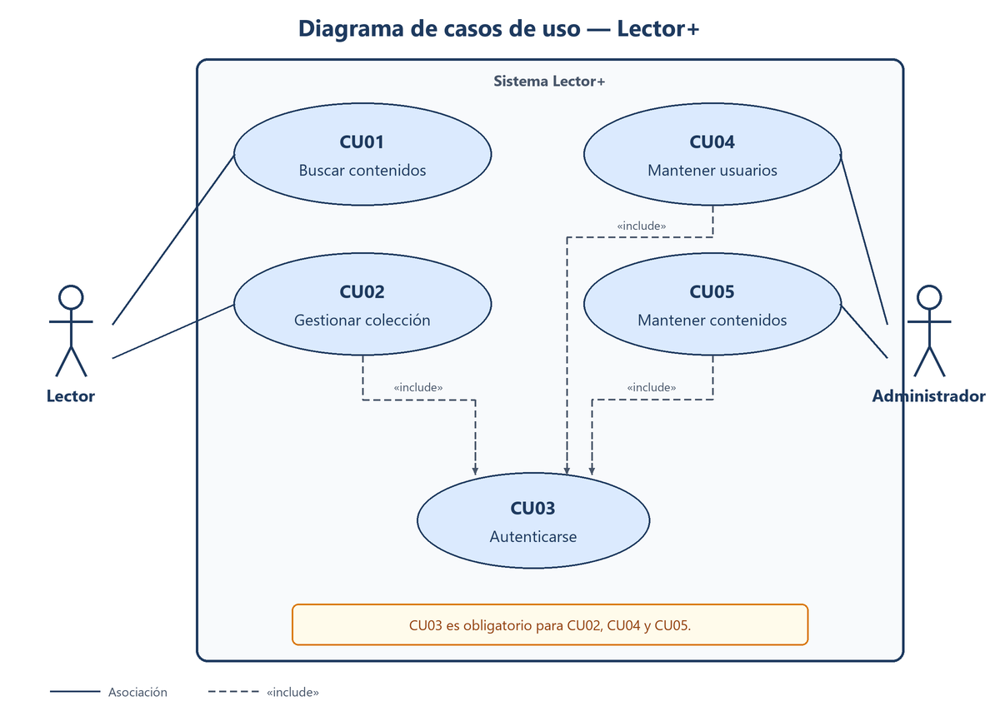
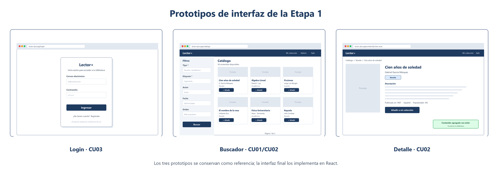
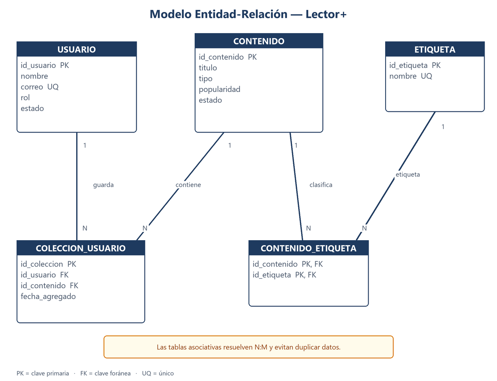
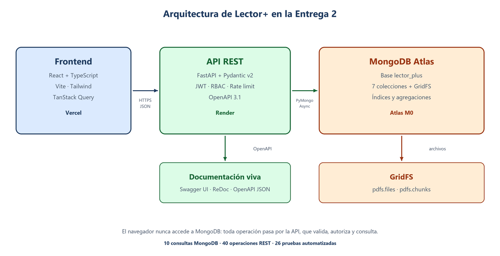
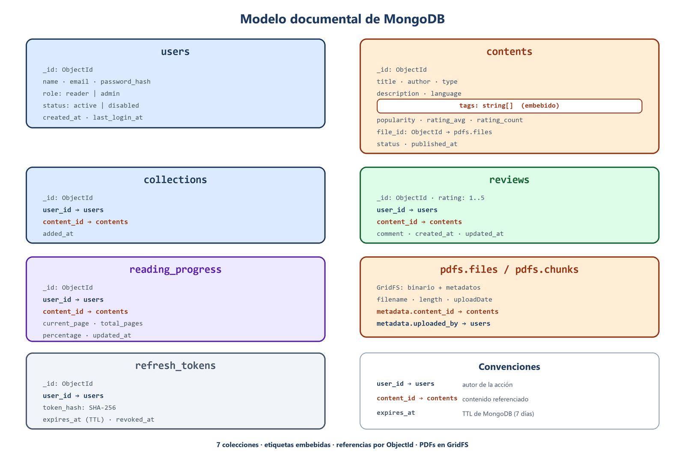
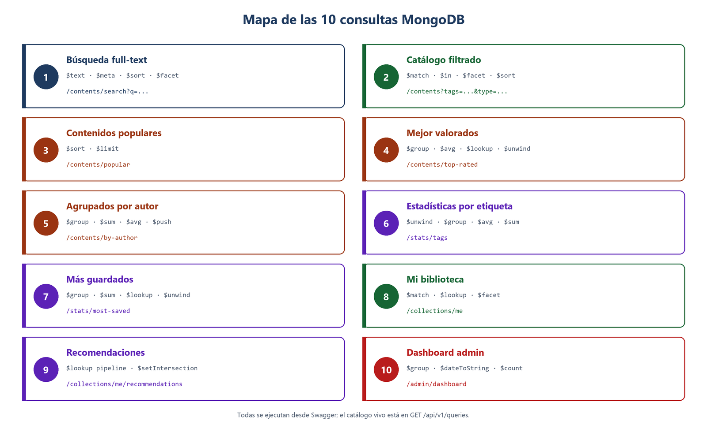
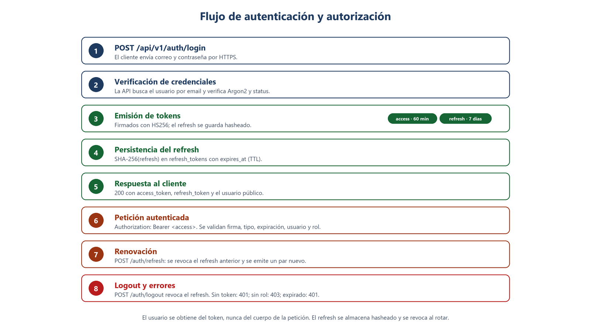
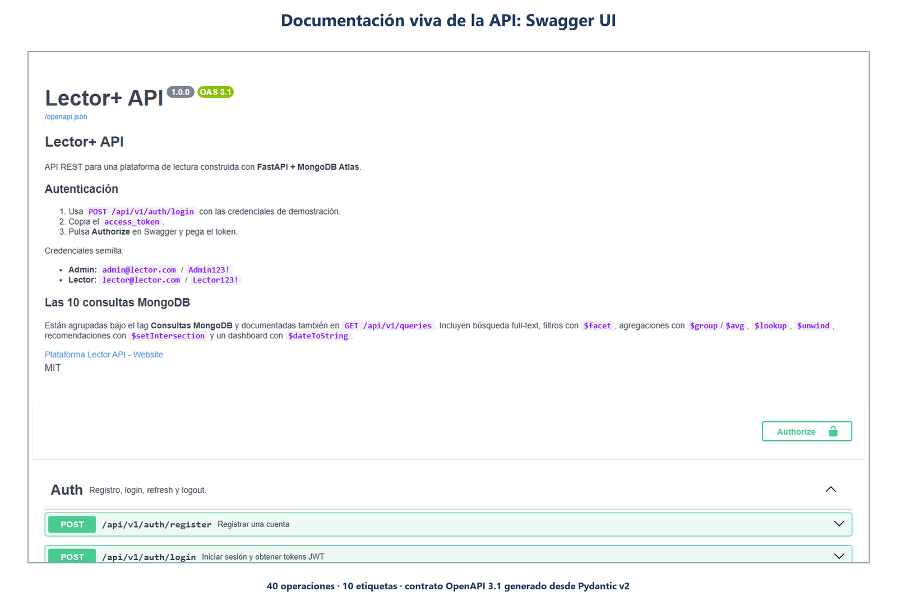
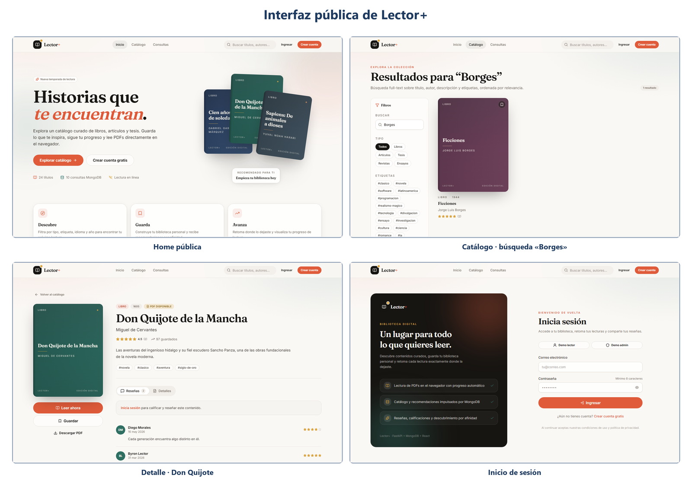
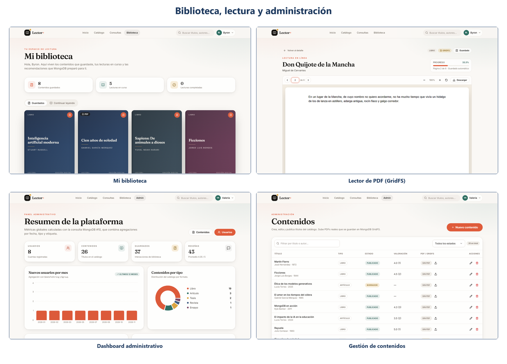

# Resumen ejecutivo

Lector+ es una plataforma web para descubrir, guardar, reseñar y leer libros, artículos, tesis, revistas y ensayos. La Etapa 1 definió el problema, los requerimientos, los casos de uso, los prototipos y un modelo relacional normalizado sobre MySQL. La Entrega 2 conserva esa definición y la lleva a una implementación real: **FastAPI, MongoDB Atlas y React**, con autenticación JWT, biblioteca personal, reseñas, progreso de lectura, PDFs en GridFS, panel administrativo y **10 consultas MongoDB** ejecutables.

El cambio de base de datos no fue una sustitución de motor, sino una transformación del modelo y de las consultas. Las cinco tablas relacionales se convirtieron en siete colecciones documentales; la tabla de etiquetas desapareció porque se embeben en el contenido, y la biblioteca personal se mantuvo independiente para evitar arreglos sin límite y conservar unicidad y paginación. Las 13 sentencias SQL se conservan en el anexo A y se transformaron en operaciones `find`, `insert_one`, `update_one`, `delete_one` y pipelines de agregación. Las 10 consultas cubren búsqueda full-text, filtros combinados, rankings, estadísticas, biblioteca, recomendaciones y dashboard.

La API expone **39 operaciones REST sobre 30 rutas**, documentadas automáticamente con OpenAPI 3.1 en Swagger UI y ReDoc. La documentación cubre los siete aspectos solicitados: introducción, endpoints, autenticación y autorización, errores, ejemplos, límites y cuotas, y seguridad. El sistema se verificó en producción con 9 usuarios, 26 contenidos, 37 guardados y 44 reseñas; las 10 consultas responden HTTP 200 y la suite pasa 26 pruebas en 2,43 s.

La Entrega 2 no reemplaza el informe anterior: lo actualiza. Los requerimientos, casos de uso, prototipos, MER, modelo relacional, diccionario, índices y las 13 consultas SQL se mantienen y se vinculan con la implementación mediante matrices de trazabilidad.

# 1. Introducción

## 1.1 Propósito del documento

Este informe documenta la Entrega 2 de Lector+ y cumple tres funciones. Primero, **actualiza** la propuesta enviada para la etapa: explica qué se propuso, qué se implementó y por qué difieren ambos estados. Segundo, **conserva** los contenidos de la primera entrega para que el documento sea incremental y no un reemplazo. Tercero, **documenta** la migración a NoSQL y la API REST con el nivel de detalle necesario para reproducir el sistema.

El documento está dirigido a la evaluación académica y a un lector técnico que necesite entender, ejecutar o extender el proyecto. Por eso cada decisión relevante se acompaña de su justificación, su efecto en el modelo de datos y la forma de verificarla.

## 1.2 Alcance de la Entrega 2

| Dentro del alcance | Fuera del alcance |
|---|---|
| Migración del modelo relacional a MongoDB y transformación de las consultas | Migración de datos históricos de MySQL a MongoDB |
| API REST con autenticación, autorización y documentación OpenAPI | Aplicación móvil nativa |
| Catálogo, búsqueda, biblioteca, reseñas, progreso y PDFs en GridFS | Pasarela de pagos, suscripciones o compras |
| Panel administrativo con dashboard y mantenedores | Mensajería, notificaciones push o correo transaccional |
| 10 consultas MongoDB y 26 pruebas automatizadas | Infraestructura de alta disponibilidad o multi-región |

*Tabla 1 — Alcance de la Entrega 2.*

## 1.3 Convenciones

Los identificadores `RF`, `RNF`, `CU` y `SQL` provienen de la Etapa 1 y se conservan sin renumerar. Las consultas MongoDB se numeran del 1 al 10 y se identifican como Q1–Q10. Los fragmentos de código usan la sintaxis de `mongosh` y de PyMongo; los pipelines se presentan como arreglos de etapas. Las rutas de la API se muestran sin el prefijo `/api/v1` cuando el contexto lo aclara.

# 2. Actualización respecto a la propuesta enviada

## 2.1 Lo que se propuso para la Etapa 2

La definición de la Etapa 2 propuso migrar desde MySQL hacia MongoDB, mantener Flask y JavaScript vanilla, reemplazar la biblioteca relacional por un arreglo embebido en el documento del usuario, usar `$push` y `$inc` para guardar contenidos, proteger las rutas con JWT y desplegar el backend en Render. También fijó cinco requerimientos funcionales, tres pantallas mínimas y cinco endpoints principales.

Esa propuesta describía correctamente el destino —NoSQL, JWT, frontend interactivo— pero subestimaba tres problemas que aparecieron al implementar: el arreglo embebido de biblioteca crece sin límite y no se puede paginar con índices; el frontend requería más de tres pantallas para cubrir reseñas, progreso y administración; y la documentación de una API de 39 operaciones no se podía mantener a mano. La implementación resolvió esos problemas con decisiones explícitas que se detallan a continuación.

## 2.2 Cambios realizados y su justificación

**Backend.** Se reemplazó Flask por FastAPI. La razón principal es que FastAPI genera el esquema OpenAPI 3.1 a partir de los tipos de Pydantic v2, lo que convierte la documentación en un artefacto verificable y no en un anexo desactualizado. Además, el servidor es asíncrono de forma nativa, lo que permite ejecutar las diez métricas del dashboard en paralelo con `asyncio.gather` y mantener el driver `AsyncMongoClient` sin bloquear el event loop.

**Frontend.** Se reemplazó JavaScript vanilla por React 19 con TypeScript y Vite. La interfaz final tiene nueve pantallas —inicio, catálogo, detalle, login, registro, biblioteca, lector, dashboard y contenidos— y un visor de PDF basado en `react-pdf`. Un DOM manipulado a mano no era sostenible para ese alcance ni para el manejo de sesión, caché de consultas y estados de error.

**Biblioteca personal.** La propuesta pedía embeber un arreglo `coleccion` dentro de `users` y actualizarlo con `$push`. Se optó por una colección `collections` con documentos `{user_id, content_id, added_at}` y un índice único compuesto. El arreglo embebido tiene tres defectos para este caso: crece sin límite y acerca el documento al límite de 16 MB; no permite paginar ni ordenar la biblioteca con un índice; y no puede garantizar unicidad de forma atómica sin leer y reescribir el arreglo. La colección independiente resuelve los tres problemas, permite `$lookup` para traer los contenidos y conserva la operación atómica a nivel de documento. Las **etiquetas sí se mantienen embebidas**, como proponía la Etapa 2, porque son un conjunto acotado (máximo 10) y se consultan con un índice multikey.

**Seguridad.** La propuesta usaba el hash de Werkzeug y un único JWT. La implementación usa Argon2 con `pwdlib`, un access token de 60 minutos y un refresh token de 7 días con rotación, revocación y almacenamiento del hash SHA-256 en una colección con índice TTL. Un solo token de larga duración no permite cerrar sesión de forma efectiva ni limitar el daño de una filtración.

**Alcance funcional.** Se agregaron reseñas con recálculo de promedio, progreso de lectura por usuario, recomendaciones por afinidad de etiquetas, PDFs reales en GridFS, dashboard administrativo y un catálogo de consultas ejecutable desde Swagger. Estas capacidades no estaban en la propuesta, pero son las que permiten demostrar el uso de agregaciones, índices y `$lookup` que la rúbrica de la etapa exige.

**Operación.** Se agregaron 26 pruebas automatizadas, un script de seed reproducible, índices idempotentes al arranque, manejo uniforme de errores con `request_id`, rate limiting en login y validación de PDFs por extensión, firma y tamaño.

## 2.3 Matriz de actualización

| Elemento | Propuesta Etapa 2 | Implementación entregada | Motivo del cambio |
|---|---|---|---|
| Framework backend | Flask | FastAPI + Pydantic v2 | OpenAPI automático, tipado y async nativo |
| Frontend | HTML, CSS y JS vanilla | React 19 + TypeScript + Vite | Nueve pantallas, sesión, caché y visor PDF |
| Driver de datos | PyMongo síncrono | PyMongo Async | No bloquear el event loop |
| Hash de contraseñas | Werkzeug | Argon2 (`pwdlib`) | Algoritmo recomendado y con parámetros actualizables |
| Sesión | Un JWT | Access 60 min + refresh 7 días con rotación | Revocación y menor exposición |
| Persistencia del refresh | No definida | Hash SHA-256 + TTL | Un robo de base no entrega tokens utilizables |
| Autorización | Rol en el token | RBAC `reader` / `admin` con dependencias | Verificación en cada operación |
| Etiquetas | Arreglo embebido | Arreglo embebido con índice multikey | Se mantiene la propuesta y se agrega soporte de consulta |
| Biblioteca | Arreglo dentro de `users` con `$push` | Colección `collections` con índice único | Arreglos sin límite, paginación y unicidad |
| PDFs | No definidos | GridFS con validación y descarga autenticada | Almacenar binario y metadatos en la misma base |
| Reseñas | No definidas | Colección `reviews` + promedio recalculado | Demostrar `$group`, `$avg` y `$lookup` |
| Progreso | No definido | Colección `reading_progress` | Continuidad de lectura por usuario |
| Recomendaciones | No definidas | `$lookup` con pipeline y `$setIntersection` | Personalización con agregaciones |
| Panel admin | Mantenedor básico | Dashboard + CRUD de contenidos y usuarios | Métricas y operación real |
| Consultas | 5 endpoints principales | 39 operaciones sobre 30 rutas | Cobertura completa del dominio |
| Errores | 5 códigos HTTP | 21 códigos de error uniformes | Diagnóstico y trazabilidad |
| Documentación | Tabla manual | OpenAPI 3.1 + Swagger + ReDoc | La documentación se genera del código |
| Pruebas | No definidas | 26 pruebas (7 de integración, 19 unitarias) | Verificación reproducible |
| Despliegue | Render | Atlas M0 + Render + Vercel | Separación de datos, API y frontend |
| Git | Ramas y commits | `main`, ramas `docs/*`, etiquetas `entrega-2` y `entrega-2-final` | Historial verificable |
| Pantallas | 3 mínimas | 9 pantallas funcionales | Cubrir todos los casos de uso |

*Tabla 2 — Matriz de actualización entre la propuesta de la Etapa 2 y la implementación.*

## 2.4 Métricas de la entrega

| Indicador | Valor | Verificación |
|---|---|---|
| Operaciones REST | 39 (23 GET, 8 POST, 3 PATCH, 1 PUT, 4 DELETE) | `GET /openapi.json` |
| Rutas documentadas | 30 | Swagger UI |
| Colecciones MongoDB | 7 principales + 2 de GridFS | Base `lector_plus` |
| Índices | 21 | `app/scripts/indexes.py` |
| Consultas MongoDB | 10 | `GET /api/v1/queries` |
| Pruebas automatizadas | 26 | `pytest -q` |
| Códigos de error | 21 | `app/core/exceptions.py` y endpoints |
| Pantallas | 10 | Frontend en producción |
| Contenidos de demostración | 26 (24 publicados) | Dashboard |
| Usuarios de demostración | 7 en el seed; 9 en producción al cierre | Dashboard |

*Tabla 3 — Métricas verificables de la Entrega 2.*

# 3. Continuidad con la primera entrega

## 3.1 Problema, objetivo y alcance

La Etapa 1 identificó un problema de dispersión: los lectores acumulan PDFs, enlaces y referencias en correos, carpetas y plataformas distintas, y pierden tiempo buscando textos que ya conocían. La consecuencia institucional es que el catálogo no se aprovecha y no existen métricas de uso. El objetivo de negocio se mantiene: **un repositorio centralizado, dinámico y escalable que reduzca los tiempos de búsqueda, clasificación y retención**.

El alcance funcional de la Etapa 1 también se mantiene: autenticación, búsqueda y filtrado, colección personal y mantenedores de usuarios y contenidos. La Entrega 2 agrega reseñas, progreso, PDFs y dashboard, pero no elimina ninguno de los cinco requerimientos originales.

## 3.2 Requerimientos funcionales

| ID | Requerimiento | Descripción | Criterio de aceptación |
|---|---|---|---|
| RF01 | Búsqueda y filtrado avanzado | Permite buscar material bibliográfico con filtros obligatorios (tipo y etiqueta) y opcionales (autor, fecha y orden). Los resultados se muestran en una grilla paginada. | Con tipo y etiqueta válidos, la API responde 200 en ≤2 s y devuelve una página de resultados; si falta un filtro obligatorio, responde 400 con un mensaje claro. |
| RF02 | Gestión de colecciones personales | Permite al lector agregar o remover contenidos de su biblioteca personal. Al guardar, vincula usuario y contenido y actualiza la popularidad. | Agregar un contenido crea una fila en COLECCION_USUARIO, incrementa popularidad en 1 y responde 201; si ya existe, responde 409 sin modificar datos. |
| RF03 | Mantenedor de cuentas de usuario | Permite al administrador crear, listar, editar y desactivar perfiles, gestionando credenciales y roles. | El administrador completa el CRUD y la desactivación deja estado=0; un lector recibe 403 en las rutas administrativas. |
| RF04 | Mantenedor del catálogo de contenidos | Permite registrar, editar, categorizar con etiquetas y eliminar lógicamente contenidos. | El administrador crea y edita contenidos, asigna etiquetas y desactiva con estado=0; las filas no se borran físicamente. |
| RF05 | Autenticación y control de acceso por roles | Exige credenciales válidas y restringe los mantenedores al rol Administrador. | Credenciales válidas emiten un JWT con rol y expiración; sin token o con rol insuficiente, la API responde 401 o 403. |

*Tabla 4 — Requerimientos funcionales conservados de la Etapa 1.*

Los cinco requerimientos se mantienen con su identificador y su criterio. La implementación los cumple en la API actual: RF01 con `GET /contents` y `GET /contents/search`; RF02 con `POST` y `DELETE /collections/{content_id}`; RF03 con `GET` y `PATCH /admin/users`; RF04 con el CRUD de `/contents`; RF05 con login, refresh y las dependencias de autorización. La verificación se detalla en la sección 9.

## 3.3 Requerimientos no funcionales

| ID | Requerimiento | Métrica o criterio | Verificación |
|---|---|---|---|
| RNF01 | Rendimiento de búsqueda | ≤2 s para 10.000 contenidos registrados | Prueba con 10.000 filas y plan de ejecución con índices |
| RNF02 | Seguridad de contraseñas | Hash bcrypt o Argon2; nunca texto plano | Revisión de la columna `password` y prueba de login |
| RNF03 | Control de acceso por roles | Lector solo su colección; Administrador mantenedores | Pruebas de 403 en rutas administrativas y de acceso cruzado |
| RNF04 | Integridad de las operaciones | Todo o nada en la colección | Fallo inducido en INSERT/UPDATE y verificación de ROLLBACK |
| RNF05 | Interoperabilidad de la API | REST/JSON/HTTPS con GET, POST, PUT y DELETE | Colección de pruebas con códigos HTTP y Content-Type |
| RNF06 | Privacidad de las colecciones | Solo el dueño o un administrador autorizado | Prueba de acceso a la colección de otro usuario; 403 |

*Tabla 5 — Requerimientos no funcionales conservados de la Etapa 1.*

La Entrega 2 reinterpreta RNF04 en el modelo documental: ya no hay una transacción que abarque dos tablas, porque la biblioteca y la popularidad viven en colecciones distintas. La integridad se sostiene con el índice único `(user_id, content_id)`, que impide duplicados incluso bajo concurrencia, y con un `$inc` posterior al `insert_one`. Si el incremento fallara, el guardado sigue siendo válido y la popularidad se puede recalcular; no existe un estado intermedio que viole una restricción. Esta diferencia se explica en la sección 6.5.

## 3.4 Actores y casos de uso

| Actor | Descripción | Intereses |
|---|---|---|
| Lector | Usuario registrado que busca y guarda contenidos | Encontrar rápido y conservar su biblioteca |
| Administrador | Usuario con rol administrativo | Mantener usuarios, contenidos y etiquetas con integridad |

*Tabla 6 — Actores del sistema.*



El diagrama se conserva sin cambios. El lector participa en CU01 y CU02; el administrador en CU04 y CU05; ambos en CU03. Los casos CU02, CU04 y CU05 incluyen CU03 porque requieren una sesión válida.

| Código | Caso de uso | Estado en la Entrega 2 | Evidencia |
|---|---|---|---|
| CU01 | Buscar contenidos | Implementado y ampliado con búsqueda full-text | Catálogo, detalle y `GET /contents/search` |
| CU02 | Gestionar la colección personal | Implementado | Biblioteca, recomendaciones y `/collections` |
| CU03 | Autenticarse | Implementado con access y refresh token | Login, registro y `/auth` |
| CU04 | Mantener usuarios | Implementado | Panel de usuarios y `/admin/users` |
| CU05 | Mantener contenidos | Implementado con PDFs en GridFS | Panel de contenidos y CRUD de `/contents` |

*Tabla 7 — Casos de uso conservados y su implementación.*

| CU | RF | Tablas originales | Colecciones actuales | Pantalla |
|---|---|---|---|---|
| CU01 | RF01 | CONTENIDO, CONTENIDO_ETIQUETA, ETIQUETA | `contents` | Catálogo y detalle |
| CU02 | RF02 | COLECCION_USUARIO, CONTENIDO | `collections`, `contents` | Biblioteca y detalle |
| CU03 | RF05 | USUARIO | `users`, `refresh_tokens` | Login y registro |
| CU04 | RF03 | USUARIO | `users` | Panel de usuarios |
| CU05 | RF04 | CONTENIDO, ETIQUETA, CONTENIDO_ETIQUETA | `contents` | Panel de contenidos |

*Tabla 8 — Trazabilidad entre casos de uso, requerimientos y colecciones.*

## 3.5 Especificación de los casos de uso

Las cinco especificaciones se conservan con sus flujos principal y alternativo. Los endpoints se actualizan al prefijo `/api/v1`, pero la lógica descrita sigue siendo la misma.

| Campo | Descripción |
|---|---|
| Código | CU01 |
| Nombre | Buscar contenidos |
| Actor principal | Lector |
| Objetivo | Localizar contenidos por tipo, etiqueta y filtros opcionales |
| Precondiciones | Ninguna para consultar; sesión iniciada para guardar |
| Flujo principal | 1. El lector abre el catálogo.<br>2. El sistema muestra los filtros.<br>3. El lector selecciona tipo y etiqueta, y opcionalmente autor, fecha y orden.<br>4. El frontend valida y envía `GET /api/v1/contents`.<br>5. La API valida, consulta MongoDB y devuelve JSON paginado.<br>6. El frontend renderiza la grilla. |
| Flujos alternativos | 4a. Falta un filtro obligatorio: mensaje y 400.<br>5a. Sin coincidencias: estado vacío con sugerencia.<br>5b. Error de base de datos: 500 y mensaje genérico. |
| Postcondiciones | Resultados visibles; filtros conservados en la URL |
| Requerimientos | RF01, RNF01, RNF05 |

*Tabla 9 — Especificación de CU01.*

| Campo | Descripción |
|---|---|
| Código | CU02 |
| Nombre | Gestionar la colección personal |
| Actor principal | Lector |
| Objetivo | Guardar o remover un contenido de la biblioteca personal |
| Precondiciones | Sesión iniciada; contenido existente y activo |
| Flujo principal | 1. El lector abre el detalle.<br>2. Pulsa «+ Añadir a mi colección».<br>3. El frontend envía `POST /api/v1/collections/{id}` con el JWT.<br>4. La API valida token y payload.<br>5. Verifica duplicado e inserta el documento.<br>6. Incrementa la popularidad del contenido.<br>7. Devuelve 201.<br>8. El frontend muestra un toast. |
| Flujos alternativos | 4a. Token inválido: 401.<br>5a. Ya existe: 409 `ALREADY_SAVED`, sin cambios.<br>6a. Falla el incremento: se registra y se reintenta; el guardado se conserva. |
| Postcondiciones | Documento creado, popularidad +1, biblioteca actualizada |
| Requerimientos | RF02, RNF04, RNF06 |

*Tabla 10 — Especificación de CU02.*

| Campo | Descripción |
|---|---|
| Código | CU03 |
| Nombre | Autenticarse |
| Actores | Lector y Administrador |
| Objetivo | Validar credenciales y emitir tokens de sesión |
| Precondiciones | Cuenta existente y activa |
| Flujo principal | 1. El usuario abre el login.<br>2. Ingresa correo y contraseña.<br>3. El frontend envía `POST /api/v1/auth/login`.<br>4. La API busca por correo, verifica Argon2 y el estado.<br>5. Emite access y refresh token.<br>6. Devuelve 200 con los tokens y el usuario.<br>7. El frontend los almacena y redirige. |
| Flujos alternativos | 4a. Credenciales inválidas: 401.<br>4b. Cuenta inactiva: 403 `USER_DISABLED`.<br>4c. Campos inválidos: 422 `VALIDATION_ERROR`.<br>4d. Más de 10 intentos por minuto: 429 `RATE_LIMITED`. |
| Postcondiciones | Sesión iniciada; `last_login_at` actualizado; refresh hasheado y persistido |
| Requerimientos | RF05, RNF02, RNF03 |

*Tabla 11 — Especificación de CU03.*

| Campo | Descripción |
|---|---|
| Código | CU04 |
| Nombre | Mantener usuarios |
| Actor principal | Administrador |
| Objetivo | Crear, listar, editar y desactivar cuentas |
| Precondiciones | Sesión con rol Administrador |
| Flujo principal | 1. El administrador abre el panel.<br>2. Selecciona Usuarios.<br>3. El sistema lista las cuentas.<br>4. Crea, edita o desactiva una cuenta.<br>5. La API valida rol y payload.<br>6. Persiste el cambio.<br>7. Confirma la operación. |
| Flujos alternativos | 5a. Correo duplicado: 409.<br>5b. Rol insuficiente: 403.<br>5c. Usuario inexistente: 404. |
| Postcondiciones | Cuenta actualizada; desactivación con `status: disabled` |
| Requerimientos | RF03, RNF03 |

*Tabla 12 — Especificación de CU04.*

| Campo | Descripción |
|---|---|
| Código | CU05 |
| Nombre | Mantener contenidos |
| Actor principal | Administrador |
| Objetivo | Crear, editar, categorizar, adjuntar PDF y desactivar contenidos |
| Precondiciones | Sesión con rol Administrador |
| Flujo principal | 1. El administrador abre el panel.<br>2. Selecciona Contenidos.<br>3. Lista o busca.<br>4. Crea, edita o desactiva.<br>5. Asigna etiquetas y, si corresponde, sube un PDF.<br>6. La API valida y persiste.<br>7. Confirma. |
| Flujos alternativos | 5a. Etiqueta inválida: 422.<br>5b. Título vacío: 422.<br>5c. PDF inválido o mayor a 15 MB: 400 o 413.<br>5d. Rol insuficiente: 403. |
| Postcondiciones | Contenido actualizado; etiquetas embebidas; PDF en GridFS |
| Requerimientos | RF04, RNF03 |

*Tabla 13 — Especificación de CU05.*

## 3.6 Prototipos de interfaz



Los tres prototipos se conservan como referencia de diseño. La interfaz final los implementa en React y agrega estados de carga, error, vacío y éxito en todas las pantallas.

| Pantalla | CU | Elementos clave | Estados |
|---|---|---|---|
| Login | CU03 | Correo, contraseña, ingresar, registro | Vacío, error, cargando, éxito |
| Buscador | CU01, CU02 | Filtros, tarjetas, paginación, añadir | Cargando, resultados, sin resultados, error |
| Detalle | CU02 | Metadatos, descripción, añadir/quitar, toast | Disponible, ya guardado, error |

*Tabla 14 — Correspondencia entre prototipos y casos de uso.*

## 3.7 Modelo relacional conservado



El modelo original tiene tres entidades fuertes y dos asociativas. Se conserva como documento de referencia y como origen de la transformación documental.

| Relación | Atributos | PK | FK | Restricciones |
|---|---|---|---|---|
| USUARIO | id_usuario, nombre, correo, password, rol, fecha_registro, ultimo_login, estado | id_usuario | — | correo UNIQUE; rol IN ('Lector','Administrador'); estado DEFAULT 1 |
| CONTENIDO | id_contenido, titulo, autor, tipo, popularidad, fecha_publicacion, estado | id_contenido | — | popularidad ≥ 0; estado DEFAULT 1; índice en fecha_publicacion |
| ETIQUETA | id_etiqueta, nombre, descripcion | id_etiqueta | — | nombre UNIQUE |
| CONTENIDO_ETIQUETA | id_contenido, id_etiqueta | (id_contenido, id_etiqueta) | id_contenido → CONTENIDO; id_etiqueta → ETIQUETA | FK con política RESTRICT |
| COLECCION_USUARIO | id_coleccion, id_usuario, id_contenido, fecha_agregado | id_coleccion | id_usuario → USUARIO; id_contenido → CONTENIDO | UNIQUE(id_usuario, id_contenido); fecha DEFAULT CURRENT_TIMESTAMP |

*Tabla 15 — Modelo relacional y restricciones de la Etapa 1.*

## 3.8 Diccionario de datos relacional

Las cinco tablas del modelo original se conservan con sus tipos, nulabilidad, claves y valores por defecto. Este diccionario es el contrato que se transformó al modelo documental de la sección 5.

| Campo | Tipo | Nulo | Clave | Default | Descripción |
|---|---|---|---|---|---|
| id_usuario | INT | No | PK | AUTO_INCREMENT | Identificador único del usuario |
| nombre | VARCHAR(100) | No | — | — | Nombre completo o alias |
| correo | VARCHAR(150) | No | UQ | — | Correo para autenticación |
| password | VARCHAR(255) | No | — | — | Hash de la contraseña |
| rol | VARCHAR(20) | No | — | 'Lector' | Lector o Administrador |
| fecha_registro | DATETIME | No | — | CURRENT_TIMESTAMP | Fecha de creación |
| ultimo_login | DATETIME | Sí | — | NULL | Último acceso exitoso |
| estado | TINYINT(1) | No | — | 1 | 1 activo; 0 desactivado |

*Tabla 16 — Diccionario de datos de USUARIO.*

| Campo | Tipo | Nulo | Clave | Default | Descripción |
|---|---|---|---|---|---|
| id_contenido | INT | No | PK | AUTO_INCREMENT | Identificador del material |
| titulo | VARCHAR(200) | No | — | — | Nombre de la obra o artículo |
| autor | VARCHAR(150) | No | — | — | Creador del contenido |
| tipo | VARCHAR(50) | No | — | — | Clasificación principal |
| popularidad | INT | No | — | 0 | Veces que fue guardado |
| fecha_publicacion | DATE | Sí | — | NULL | Fecha original de publicación |
| estado | TINYINT(1) | No | — | 1 | 1 activo; 0 desactivado |

*Tabla 17 — Diccionario de datos de CONTENIDO.*

| Campo | Tipo | Nulo | Clave | Default | Descripción |
|---|---|---|---|---|---|
| id_etiqueta | INT | No | PK | AUTO_INCREMENT | Identificador del descriptor |
| nombre | VARCHAR(50) | No | UQ | — | Nombre de la etiqueta |
| descripcion | VARCHAR(255) | Sí | — | NULL | Alcance de la etiqueta |

*Tabla 18 — Diccionario de datos de ETIQUETA.*

| Campo | Tipo | Nulo | Clave | Default | Descripción |
|---|---|---|---|---|---|
| id_contenido | INT | No | PK, FK | — | Referencia a CONTENIDO |
| id_etiqueta | INT | No | PK, FK | — | Referencia a ETIQUETA |

*Tabla 19 — Diccionario de datos de CONTENIDO_ETIQUETA.*

| Campo | Tipo | Nulo | Clave | Default | Descripción |
|---|---|---|---|---|---|
| id_coleccion | INT | No | PK | AUTO_INCREMENT | Identificador de la fila |
| id_usuario | INT | No | FK | — | Referencia a USUARIO |
| id_contenido | INT | No | FK | — | Referencia a CONTENIDO |
| fecha_agregado | DATETIME | No | — | CURRENT_TIMESTAMP | Fecha en que se guardó |

*Tabla 20 — Diccionario de datos de COLECCION_USUARIO.*

## 3.9 Índices del modelo relacional

| Índice | Tabla | Columnas | Propósito |
|---|---|---|---|
| PRIMARY | Todas | Clave primaria | Acceso directo por identificador |
| correo | USUARIO | correo | Login y unicidad |
| nombre | ETIQUETA | nombre | Búsqueda por etiqueta y unicidad |
| idx_fecha | CONTENIDO | fecha_publicacion | Filtro y orden por fecha |
| FK | CONTENIDO_ETIQUETA | id_contenido, id_etiqueta | Join y filtro por etiqueta |
| FK | COLECCION_USUARIO | id_usuario, id_contenido | Colección por usuario y control de duplicados |

*Tabla 21 — Índices del modelo relacional.*

## 3.10 Las 13 consultas SQL originales

La Etapa 1 entregó 13 sentencias: 3 `INSERT`, 2 `UPDATE`, 2 `DELETE`, 2 `ALTER`, 1 `DROP` y 3 `SELECT` con álgebra relacional. Se conservan completas en el anexo A y se usan como punto de partida de la transformación de la sección 6.4.

| N° | Tipo | Tabla(s) | Propósito | Requerimiento |
|---|---|---|---|---|
| 1 | INSERT | USUARIO | Alta de lector | RF03 |
| 2 | INSERT | CONTENIDO | Alta de contenido | RF04 |
| 3 | INSERT | COLECCION_USUARIO | Guardar en colección | RF02 |
| 4 | UPDATE | CONTENIDO | Incrementar popularidad | RF02 |
| 5 | UPDATE | USUARIO | Registrar último acceso | RF05 |
| 6 | DELETE | COLECCION_USUARIO | Remover de colección | RF02 |
| 7 | DELETE | CONTENIDO_ETIQUETA | Corregir categorización | RF04 |
| 8 | ALTER | USUARIO | Borrado lógico | RF03 |
| 9 | ALTER | CONTENIDO | Ampliar título | RF04 |
| 10 | DROP | CONTENIDO | Evaluar el costo de un índice no utilizado | RNF01 |
| 11 | SELECT | CONTENIDO, ETIQUETA | Buscar por etiqueta | RF01 |
| 12 | SELECT | USUARIO, COLECCION_USUARIO, CONTENIDO | Ver colección | RF02 |
| 13 | SELECT | CONTENIDO | Reporte de populares | RF01 |

*Tabla 22 — Cobertura de las 13 consultas SQL.*

## 3.11 Matriz de continuidad

| Contenido de la Etapa 1 | Estado en este informe | Ubicación |
|---|---|---|
| Problema, objetivo y alcance | Conservado | Sección 3.1 |
| RF01–RF05 | Conservados con su criterio original | Sección 3.2 |
| RNF01–RNF06 | Conservados con su métrica original | Sección 3.3 |
| Actores y diagrama de casos de uso | Conservados | Sección 3.4 |
| CU01–CU05 con flujos | Conservados y actualizados a MongoDB | Sección 3.5 |
| Prototipos de interfaz | Conservados | Sección 3.6 |
| MER y modelo relacional | Conservados | Sección 3.7 |
| Diccionario de datos | Conservado completo | Sección 3.8 |
| Índices del modelo | Conservados | Sección 3.9 |
| 13 consultas SQL | Conservadas completas | Anexo A |
| Trazabilidad RF–CU–tablas | Conservada y ampliada | Secciones 3.4 y 9.3 |
| Restricciones y supuestos | Conservados | Secciones 3.1 y 9.4 |

*Tabla 23 — Matriz de continuidad entre la Etapa 1 y la Entrega 2.*

# 4. Arquitectura de la solución

## 4.1 Visión general



La arquitectura tiene tres capas desplegadas por separado. El **frontend** es una aplicación React que se sirve desde Vercel y consume JSON por HTTPS. La **API** es un servicio FastAPI en Render que valida, autoriza y ejecuta las consultas. La **base de datos** es un clúster MongoDB Atlas M0 que contiene las colecciones y los PDFs en GridFS. El navegador nunca accede a MongoDB: todas las operaciones pasan por la API, que aplica las reglas de negocio y el control de acceso.

## 4.2 Capas del backend

| Capa | Responsabilidad | Artefactos |
|---|---|---|
| API | Recibir la petición, validar parámetros, aplicar dependencias de autenticación y serializar la respuesta | `app/api/v1/endpoints/*.py`, `app/api/deps.py` |
| Servicios | Reglas de negocio, orquestación, cálculo de métricas y decoración de respuestas | `app/services/*.py` |
| Repositorios | Consultas, pipelines de agregación y acceso a colecciones | `app/repositories/*.py` |
| Núcleo | Configuración, conexión, seguridad, errores, rate limiting y serialización | `app/core/*.py`, `app/utils/*.py` |
| Scripts | Creación idempotente de índices y carga de datos demo | `app/scripts/indexes.py`, `app/scripts/seed.py` |

*Tabla 24 — Capas del backend.*

El flujo de una petición es `endpoint → service → repository → MongoDB`. El endpoint no conoce MongoDB y el repositorio no conoce HTTP: esa separación permite probar la seguridad y la paginación sin levantar el servidor, y permite cambiar un pipeline sin tocar el contrato de la API.

## 4.3 Stack tecnológico

| Capa | Tecnología | Función en Lector+ |
|---|---|---|
| Lenguaje backend | Python 3.12 | Implementación de la API |
| Framework backend | FastAPI | Rutas, inyección de dependencias y OpenAPI |
| Validación | Pydantic v2 | Esquemas de entrada, salida y configuración |
| Driver | PyMongo Async (`AsyncMongoClient`) | Acceso asíncrono a MongoDB |
| Autenticación | PyJWT + `pwdlib` (Argon2) | Tokens y hash de contraseñas |
| Rate limiting | SlowAPI | Límite de intentos de login |
| Documentación | Swagger UI, ReDoc, OpenAPI 3.1 | Documentación viva de la API |
| Frontend | React 19 + TypeScript + Vite | Interfaz de usuario |
| Estilos | Tailwind CSS + Radix UI | Sistema de diseño y accesibilidad |
| Datos del cliente | TanStack Query | Caché, reintentos y estados de carga |
| PDF | `react-pdf` + `pdfjs-dist` | Visualización de PDFs de GridFS |
| Base de datos | MongoDB Atlas M0 | Persistencia documental y GridFS |
| Despliegue | Render + Vercel + Atlas | API, frontend y datos |
| Calidad | Ruff + Pytest | Lint y 26 pruebas automatizadas |

*Tabla 25 — Stack tecnológico de la Entrega 2.*

## 4.4 Entornos y despliegue

| Entorno | Configuración |
|---|---|
| Local | MongoDB 7 en Docker (`localhost:27017`); API con `uvicorn app.main:app --reload` en `localhost:8000`; frontend con Vite en `localhost:5173` |
| Pruebas | Base `lector_plus_test`; `RATE_LIMIT_ENABLED=false`; secreto JWT de prueba; datos creados y borrados por fixture |
| Producción | MongoDB Atlas M0; API en Render con HTTPS; frontend en Vercel con `VITE_API_URL` apuntando a la API |

*Tabla 26 — Entornos de ejecución.*

| Servicio | Plataforma | URL |
|---|---|---|
| API | Render | https://lector-api-k2ak.onrender.com |
| Swagger UI | Render | https://lector-api-k2ak.onrender.com/docs |
| ReDoc | Render | https://lector-api-k2ak.onrender.com/redoc |
| OpenAPI JSON | Render | https://lector-api-k2ak.onrender.com/openapi.json |
| Frontend | Vercel | https://frontend-nine-nu-92.vercel.app |
| Base de datos | MongoDB Atlas | Clúster M0, base `lector_plus` |

*Tabla 27 — Recursos desplegados.*

## 4.5 Estructura del repositorio

| Ruta | Contenido |
|---|---|
| `app/api/v1/endpoints/` | Ocho módulos de rutas: auth, users, contents, collections, reviews, stats, admin y queries |
| `app/services/` | Lógica de negocio y orquestación de consultas |
| `app/repositories/` | Pipelines y acceso a las colecciones |
| `app/schemas/` | Modelos Pydantic de entrada y salida |
| `app/core/` | Configuración, base de datos, seguridad, errores y rate limiting |
| `app/scripts/` | `indexes.py` y `seed.py` |
| `tests/` | 26 pruebas unitarias y de integración |
| `docs/` | Informes, figuras y capturas de las dos etapas |
| `render.yaml` | Infraestructura de despliegue en Render |
| `docker-compose.yml` | MongoDB y API para desarrollo local |

*Tabla 28 — Estructura del repositorio backend.*

# 5. Modelo de datos NoSQL

## 5.1 Criterios de migración

La migración siguió cuatro criterios. **Primero**, cada entidad fuerte se convirtió en una colección. **Segundo**, las relaciones N:M se resolvieron según su cardinalidad y su patrón de acceso: las etiquetas —acotadas y siempre leídas con el contenido— se embebieron; la biblioteca, las reseñas y el progreso —ilimitadas y consultadas por usuario o contenido— se separaron con referencias. **Tercero**, las métricas derivadas (`popularity`, `rating_avg`, `rating_count`) se mantuvieron en el documento del contenido para evitar agregaciones costosas en cada lectura. **Cuarto**, los binarios se derivaron a GridFS para no acercar los documentos al límite de 16 MB.

## 5.2 Colecciones y campos principales



| Colección | Propósito | Documentos aproximados en producción |
|---|---|---|
| `users` | Cuentas, rol, estado y perfil | 9 |
| `contents` | Catálogo de libros, artículos, tesis, revistas y ensayos | 26 |
| `collections` | Biblioteca personal (guardados) | 37 |
| `reviews` | Reseñas y calificaciones | 44 |
| `reading_progress` | Progreso de lectura por usuario y contenido | 17 |
| `refresh_tokens` | Refresh tokens hasheados con TTL | Variable |
| `pdfs.files` / `pdfs.chunks` | PDFs reales en GridFS | 3 archivos |

*Tabla 29 — Colecciones de MongoDB.*

| Campo | Tipo | Descripción |
|---|---|---|
| `_id` | ObjectId | Identificador |
| `name` | string | Nombre |
| `email` | string | Correo único |
| `password_hash` | string | Hash Argon2 |
| `role` | string | `reader` o `admin` |
| `status` | string | `active` o `disabled` |
| `avatar_url` | string/null | Avatar |
| `bio` | string/null | Biografía |
| `created_at` | datetime | Registro |
| `updated_at` | datetime | Última actualización |
| `last_login_at` | datetime/null | Último acceso |

*Tabla 30 — Diccionario de `users`.*

| Campo | Tipo | Descripción |
|---|---|---|
| `_id` | ObjectId | Identificador |
| `title` | string | Título |
| `author` | string | Autor |
| `type` | string | `book`, `article`, `thesis`, `magazine` u `other` |
| `description` | string | Descripción |
| `cover_url` | string/null | Portada |
| `external_url` | string/null | Enlace externo |
| `tags` | string[] | Etiquetas embebidas (máximo 10) |
| `language` | string | Idioma |
| `published_at` | datetime/null | Fecha de publicación |
| `status` | string | `published`, `draft` o `archived` |
| `popularity` | int | Veces guardado |
| `rating_avg` | float | Promedio de reseñas |
| `rating_count` | int | Cantidad de reseñas |
| `file_id` | ObjectId/null | Referencia al PDF en GridFS |
| `created_by` | ObjectId | Administrador que lo creó |
| `created_at` | datetime | Creación |
| `updated_at` | datetime | Actualización |

*Tabla 31 — Diccionario de `contents`.*

| Campo | Tipo | Descripción |
|---|---|---|
| `_id` | ObjectId | Identificador |
| `user_id` | ObjectId | Referencia a `users` |
| `content_id` | ObjectId | Referencia a `contents` |
| `added_at` | datetime | Fecha de guardado |

*Tabla 32 — Diccionario de `collections`.*

| Campo | Tipo | Descripción |
|---|---|---|
| `_id` | ObjectId | Identificador |
| `user_id` | ObjectId | Referencia a `users` |
| `content_id` | ObjectId | Referencia a `contents` |
| `rating` | int | Calificación de 1 a 5 |
| `comment` | string/null | Reseña |
| `created_at` | datetime | Creación |
| `updated_at` | datetime | Actualización |

*Tabla 33 — Diccionario de `reviews`.*

| Campo | Tipo | Descripción |
|---|---|---|
| `_id` | ObjectId | Identificador |
| `user_id` | ObjectId | Referencia a `users` |
| `content_id` | ObjectId | Referencia a `contents` |
| `current_page` | int | Página actual |
| `total_pages` | int | Total de páginas |
| `percentage` | float | Porcentaje leído |
| `updated_at` | datetime | Última actualización |

*Tabla 34 — Diccionario de `reading_progress`.*

| Campo | Tipo | Descripción |
|---|---|---|
| `_id` | ObjectId | Identificador |
| `user_id` | ObjectId | Referencia a `users` |
| `token_hash` | string | SHA-256 del refresh token |
| `expires_at` | datetime | Expiración (índice TTL) |
| `revoked_at` | datetime/null | Fecha de revocación |
| `created_at` | datetime | Creación |

*Tabla 35 — Diccionario de `refresh_tokens`.*

| Campo | Tipo | Descripción |
|---|---|---|
| `_id` | ObjectId | Identificador del archivo |
| `filename` | string | Nombre original |
| `length` | long | Tamaño en bytes |
| `uploadDate` | datetime | Fecha de carga |
| `metadata.content_id` | ObjectId | Contenido asociado |
| `metadata.uploaded_by` | ObjectId | Administrador que subió el archivo |
| `chunkSize` | int | Tamaño de fragmento (255 KB por defecto) |

*Tabla 36 — Diccionario de `pdfs.files` (GridFS).*

## 5.3 Relaciones e integridad

| Referencia | Cardinalidad | Resolución | Integridad |
|---|---|---|---|
| `collections.user_id` → `users._id` | N:1 | `$lookup` | Índice único `(user_id, content_id)` |
| `collections.content_id` → `contents._id` | N:1 | `$lookup` | Índice simple `content_id` |
| `reviews.user_id` → `users._id` | N:1 | `$lookup` | Índice único `(user_id, content_id)` |
| `reviews.content_id` → `contents._id` | N:1 | `$lookup` | Índice `(content_id, rating)` |
| `reading_progress.user_id` → `users._id` | N:1 | `$lookup` | Índice único `(user_id, content_id)` |
| `contents.file_id` → `pdfs.files._id` | 1:1 | `GridFSBucket.open_download_stream` | Índice `metadata.content_id` |
| `contents.tags` | 1:N embebido | Índice multikey | Validación de máximo 10 en el servicio |

*Tabla 37 — Relaciones e integridad del modelo documental.*

MongoDB no impone claves foráneas. La integridad se sostiene en tres niveles: la API verifica que el contenido exista antes de guardar, reseñar o registrar progreso; los índices únicos impiden duplicados; y las operaciones de borrado de contenido eliminan en cascada sus guardados, reseñas y progresos. Esa cascada es explícita en `ContentService.delete`, no una consecuencia automática del motor.

## 5.4 Índices

| Colección | Índice | Tipo | Propósito |
|---|---|---|---|
| `users` | `email` | Único | Login y unicidad |
| `users` | `(role, status)` | Compuesto | Filtros administrativos |
| `contents` | `title, author, description, tags` | Texto con pesos 10/5/3/1 | Búsqueda full-text |
| `contents` | `tags` | Multikey | Filtro por etiqueta |
| `contents` | `popularity: -1` | Simple | Populares |
| `contents` | `(type, published_at: -1)` | Compuesto | Filtro por tipo y año |
| `contents` | `author` | Simple | Búsqueda por autor |
| `contents` | `(rating_avg: -1, rating_count: -1)` | Compuesto | Mejor valorados |
| `contents` | `(status, created_at: -1)` | Compuesto | Catálogo publicado |
| `collections` | `(user_id, content_id)` | Único | Evitar duplicados |
| `collections` | `(user_id, added_at: -1)` | Compuesto | Biblioteca ordenada |
| `collections` | `content_id` | Simple | Más guardados y borrado en cascada |
| `reviews` | `(user_id, content_id)` | Único | Una reseña por usuario y contenido |
| `reviews` | `(content_id, rating: -1)` | Compuesto | Promedios y listados |
| `reviews` | `created_at: -1` | Simple | Reseñas recientes |
| `reading_progress` | `(user_id, content_id)` | Único | Un progreso por usuario y contenido |
| `reading_progress` | `(user_id, updated_at: -1)` | Compuesto | Continuar lectura |
| `refresh_tokens` | `token_hash` | Único | Validación del refresh |
| `refresh_tokens` | `expires_at` | TTL | Limpieza automática |
| `refresh_tokens` | `user_id` | Simple | Revocación por usuario |
| `pdfs.files` | `metadata.content_id` | Simple | Localizar el PDF de un contenido |

*Tabla 38 — Índices de MongoDB y su propósito.*

## 5.5 Decisiones de modelado

| Decisión | Alternativa descartada | Criterio | Efecto |
|---|---|---|---|
| Etiquetas embebidas | Tabla `tags` + asociativa | Conjunto acotado, lectura junto al contenido | Se elimina un `$lookup` en catálogo y búsqueda |
| Biblioteca en colección aparte | Arreglo `coleccion` en `users` | Arreglo sin límite, paginación y unicidad | Se agrega un `$lookup` en la biblioteca |
| Reseñas en colección aparte | Arreglo de reseñas en `contents` | Crecimiento ilimitado y una por usuario | Índice único y promedio recalculado |
| Métricas en `contents` | Calcular en cada lectura | Lecturas mucho más frecuentes que escrituras | `rating_avg` y `popularity` denormalizados |
| PDFs en GridFS | Sistema de archivos o bucket externo | Misma base, respaldo y metadatos | Descarga autenticada por streaming |
| Referencias por ObjectId | Documentos anidados completos | Evitar duplicación y permitir actualización independiente | `$lookup` en las lecturas que lo requieren |

*Tabla 39 — Decisiones de modelado y sus alternativas.*

## 5.6 Almacenamiento de PDFs

Un PDF se guarda en GridFS con `AsyncGridFSBucket`, en el bucket `pdfs`. El archivo se valida tres veces antes de persistirse: la extensión debe ser `.pdf`, el contenido debe empezar con la firma `%PDF-` y el tamaño no puede superar 15 MB. Los metadatos incluyen `content_id` y `uploaded_by`; el documento de contenido guarda el `file_id` resultante. La descarga se hace por streaming en fragmentos de 64 KB con `Content-Disposition: inline`, lo que permite visualizarlo en el navegador sin exponer la base de datos. Al reemplazar o eliminar un PDF, el archivo anterior se borra de GridFS para no dejar huérfanos.

# 6. Transformación de consultas SQL a MongoDB

## 6.1 Equivalencias entre SQL y MongoDB

| SQL | MongoDB | Observación |
|---|---|---|
| `WHERE` | `$match` | Filtrado de documentos |
| `INNER JOIN` | `$lookup` + `$unwind` | Resolución de referencias |
| `GROUP BY` | `$group` | Agrupación y métricas |
| `ORDER BY` | `$sort` | Ordenamiento |
| `LIMIT` / `OFFSET` | `$limit` / `$skip` | Paginación |
| `COUNT(*)` | `$count` o `$sum: 1` | Conteos |
| `AVG()` | `$avg` | Promedios |
| `MATCH ... AGAINST` | `$text` + `$meta: textScore` | Búsqueda full-text |
| Subconsultas y `UNION ALL` | `$facet` | Varias salidas en una sola consulta |
| `DATE_FORMAT` | `$dateToString` | Agrupación por mes |
| `INTERSECT` | `$setIntersection` | Afinidad entre conjuntos |
| `INSERT` | `insert_one` / `insert_many` | Inserción de documentos |
| `UPDATE` | `update_one` con `$set`, `$inc` o `$pull` | Actualización de campos |
| `DELETE` | `delete_one` / `delete_many` | Eliminación de documentos |
| `ALTER TABLE` | `$set` o cambio de esquema | El esquema es flexible |
| `DROP INDEX` | `drop_index` | Eliminación de un índice |

*Tabla 40 — Equivalencias entre SQL y MongoDB.*

La diferencia conceptual más importante es que SQL normaliza y reconstruye con `JOIN`, mientras que MongoDB decide por documento. En Lector+ esa decisión se tomó por patrón de acceso: lo que se lee junto se guarda junto (etiquetas y métricas en `contents`), y lo que crece sin límite se separa (biblioteca, reseñas y progreso).

## 6.2 Las 10 consultas de la Entrega 2



| # | Pregunta de negocio | Equivalente SQL | Operadores MongoDB | Endpoint |
|---|---|---|---|---|
| 1 | Buscar contenidos por relevancia | `MATCH ... AGAINST` + `ORDER BY` | `$text`, `$meta`, `$sort`, `$facet` | `GET /contents/search?q=...` |
| 2 | Catálogo filtrado y paginado | `WHERE` + `IN` + `LIMIT/OFFSET` | `$match`, `$in`, `$gte`, `$lte`, `$facet`, `$sort`, `$skip`, `$limit` | `GET /contents?tags=...&type=...` |
| 3 | Contenidos populares | `ORDER BY popularidad DESC LIMIT 10` | `$sort`, `$limit` | `GET /contents/popular` |
| 4 | Mejor valorados | `JOIN` + `GROUP BY` + `HAVING` | `$group`, `$avg`, `$sum`, `$match`, `$sort`, `$lookup`, `$unwind`, `$replaceRoot` | `GET /contents/top-rated` |
| 5 | Agrupados por autor | `GROUP BY autor` + `COUNT` + `AVG` | `$group`, `$sum`, `$avg`, `$push`, `$sort`, `$project`, `$slice` | `GET /contents/by-author` |
| 6 | Estadísticas por etiqueta | `JOIN` + `GROUP BY etiqueta` | `$unwind`, `$group`, `$avg`, `$sum`, `$sort`, `$project` | `GET /stats/tags` |
| 7 | Más guardados | `JOIN` + `GROUP BY` + `ORDER BY COUNT` | `$group`, `$sum`, `$sort`, `$limit`, `$lookup`, `$unwind` | `GET /stats/most-saved` |
| 8 | Mi biblioteca | `JOIN` + `WHERE usuario` + `ORDER BY` | `$match`, `$sort`, `$facet`, `$lookup`, `$unwind`, `$project` | `GET /collections/me` |
| 9 | Recomendaciones | `INTERSECT` + `NOT IN` | `$lookup` con pipeline, `$setIntersection`, `$size`, `$addToSet`, `$reduce`, `$expr` | `GET /collections/me/`<br>`recommendations` |
| 10 | Dashboard administrativo | Varios `COUNT`, `AVG` y `GROUP BY` | `$count`, `$group`, `$avg`, `$dateToString`, `$lookup` | `GET /admin/dashboard` |

*Tabla 41 — Las 10 consultas MongoDB, su equivalente SQL y su endpoint.*

## 6.3 Pipelines representativos

**Q1 — Búsqueda full-text.** El índice de texto pondera título (10), autor (5), etiquetas (3) y descripción (1). `$meta: textScore` expone la relevancia y `$facet` devuelve la página y el total en una sola operación.

```javascript
[
  { $match: { $text: { $search: "borges" }, status: "published" } },
  { $addFields: { score: { $meta: "textScore" } } },
  { $sort: { score: -1, popularity: -1 } },
  { $facet: {
      data: [{ $skip: 0 }, { $limit: 12 }],
      meta: [{ $count: "total" }]
  } }
]
```

**Q9 — Recomendaciones.** Se cargan los contenidos guardados, se unen sus etiquetas con `$reduce` y `$setUnion`, y se buscan contenidos publicados que no estén guardados y compartan al menos una etiqueta. El `$lookup` con pipeline permite filtrar y ordenar dentro de la subconsulta.

```javascript
[
  { $match: { user_id: ObjectId("6aefd5d566fdc930d4750999") } },
  { $lookup: { from: "contents", localField: "content_id",
               foreignField: "_id", as: "saved_content" } },
  { $unwind: "$saved_content" },
  { $group: { _id: null,
              saved_ids: { $addToSet: "$content_id" },
              tags: { $addToSet: "$saved_content.tags" } } },
  { $project: { saved_ids: 1,
                tags: { $reduce: { input: "$tags", initialValue: [],
                        in: { $setUnion: ["$$value", "$$this"] } } } } },
  { $lookup: {
      from: "contents",
      let: { tags: "$tags", saved: "$saved_ids" },
      pipeline: [
        { $match: { $expr: { $and: [
            { $eq: ["$status", "published"] },
            { $not: { $in: ["$_id", "$$saved"] } },
            { $gt: [{ $size: { $setIntersection: ["$tags", "$$tags"] } }, 0] }
        ] } } },
        { $addFields: { match_score:
            { $size: { $setIntersection: ["$tags", "$$tags"] } } } },
        { $sort: { match_score: -1, popularity: -1 } },
        { $limit: 10 }
      ],
      as: "recommendations" } },
  { $unwind: "$recommendations" },
  { $replaceRoot: { newRoot: "$recommendations" } }
]
```

**Q10 — Dashboard.** No es un único `$facet`: las métricas viven en cuatro colecciones distintas y se ejecutan en paralelo con `asyncio.gather`. Cada una usa el operador que le corresponde.

```javascript
// 1. Totales (cuatro count_documents en paralelo)
users_count = await users.count_documents({})
contents_count = await contents.count_documents({})

// 2. Promedio global de reseñas
[{ $group: { _id: null, avg: { $avg: "$rating" } } }]

// 3. Usuarios por mes
[{ $group: { _id: { $dateToString: { format: "%Y-%m", date: "$created_at" } },
             count: { $sum: 1 } } },
 { $sort: { _id: 1 } }]

// 4. Etiquetas más frecuentes
[{ $match: { status: "published" } },
 { $unwind: "$tags" },
 { $group: { _id: "$tags", total: { $sum: 1 }, avg_rating: { $avg: "$rating_avg" } } },
 { $sort: { total: -1 } },
 { $limit: 5 }]
```

El resto de las métricas —contenidos por tipo, más guardados y reseñas recientes— usa `$group`, `$lookup` y `$unwind`; los pipelines completos están en el anexo B.

## 6.4 Transformación de las 13 sentencias SQL

| N° | Sentencia original | Operación MongoDB | Observación |
|---|---|---|---|
| 1 | `INSERT INTO Usuario` | `users.insert_one({...})` | El hash se calcula en el servicio, no en la base |
| 2 | `INSERT INTO Contenido` | `contents.insert_one({...})` | Etiquetas como arreglo; métricas en cero |
| 3 | `INSERT INTO Coleccion_Usuario` | `collections.insert_one({...})` | El índice único reemplaza la verificación manual |
| 4 | `UPDATE Contenido SET popularidad + 1` | `update_one` con `$inc` | Se ejecuta después del guardado |
| 5 | `UPDATE Usuario SET ultimo_login` | `update_one` con `$set` | Se ejecuta en cada login exitoso |
| 6 | `DELETE FROM Coleccion_Usuario` | `collections.delete_one` | Devuelve 404 `NOT_SAVED` si no existía |
| 7 | `DELETE FROM Contenido_Etiqueta` | `$pull` sobre `contents.tags` | Ya no existe tabla intermedia |
| 8 | `ALTER TABLE Usuario ADD estado` | Campo `status` en el documento | El esquema flexible no requiere migración |
| 9 | `ALTER TABLE Contenido MODIFY titulo` | Validación `max_length=200` en Pydantic | El tipo no cambia en MongoDB |
| 10 | `DROP INDEX idx_fecha` | `contents.drop_index(`<br>`"contents_type_published")` | Se conserva el índice porque RNF01 lo usa |
| 11 | `SELECT ... WHERE etiqueta` | `find({ tags: "ingenieria" })` | Índice multikey |
| 12 | `SELECT ... JOIN colección` | `$match` + `$lookup` + `$unwind` | Biblioteca paginada con `$facet` |
| 13 | `SELECT ... ORDER BY popularidad` | `find().sort({ popularity: -1 }).limit(10)` | Índice `popularity: -1` |

*Tabla 42 — Transformación de las 13 sentencias SQL de la Etapa 1.*

La transacción de CU02 (`START TRANSACTION`, verificación, `INSERT`, `UPDATE`, `COMMIT`) no tiene un equivalente directo en MongoDB porque afectaba dos tablas. En el modelo documental el guardado es un `insert_one` protegido por el índice único, seguido de un `$inc` en el contenido. No hay una ventana en la que un guardado exista sin contenido o un contenido apunte a un usuario inexistente; la única operación no atómica es el incremento de popularidad, que se puede recalcular con `count_documents` si fuera necesario. Esta es la lectura correcta de RNF04 en NoSQL: la integridad se garantiza por restricción, no por bloqueo de dos tablas.

## 6.5 Índices y rendimiento

| Operación | Tiempo (ms) | Índice principal |
|---|---|---|
| Login | 2354 | `users.email` único |
| Q1 — Búsqueda `Borges` | 721 | `contents_text_index` |
| Q2 — Catálogo paginado | 886 | `contents_status_created`, `contents_tags` |
| Q3 — Populares | 742 | `contents_popularity` |
| Q4 — Mejor valorados | 736 | `contents_rating`, `reviews_content_rating` |
| Q5 — Por autor | 365 | `contents_author` |
| Q6 — Estadísticas por etiqueta | 364 | `contents_tags` |
| Q7 — Más guardados | 1080 | `collections_content` |
| Q8 — Mi biblioteca | 1242 | `collections_user_added` |
| Q9 — Recomendaciones | 712 | `contents_tags` |
| Q10 — Dashboard | 2408 | Varios índices y diez operaciones en paralelo |

*Tabla 43 — Tiempos de respuesta medidos en producción el 17 de noviembre de 2026.*

Las mediciones se tomaron desde un cliente en Chile contra la API desplegada en Oregon, en una sola ejecución por endpoint. Incluyen la latencia de red, el arranque del plan gratuito de Render y el tiempo de serialización. No son un benchmark: sirven para verificar que ninguna consulta queda fuera del umbral de RNF01 y que las consultas con `$lookup` (Q7–Q10) siguen siendo utilizables. El login es el más lento porque Argon2 está diseñado para ser costoso; ese costo es una propiedad de seguridad, no un defecto.

## 6.6 Verificación de resultados

Las 10 consultas se ejecutaron contra la base de producción y devolvieron HTTP 200. Los resultados coinciden con los datos del seed y con lo que muestra el frontend: 24 contenidos publicados de 26, 37 guardados, 44 reseñas, promedio global 4,34 y una búsqueda de «Borges» que devuelve un único resultado, `Ficciones`, con `score` 3,33. La consulta de estadísticas por etiqueta devuelve `clasico` con 10 contenidos y 814 de popularidad acumulada; la de autores devuelve a Gabriel García Márquez con 2 títulos y popularidad promedio 92,5. Estos valores se usan como casos de prueba en la sección 9.

# 7. Documentación de la API REST

## 7.1 Introducción

La API de Lector+ es una API REST que intercambia JSON sobre HTTPS. La versión actual es `v1` y el prefijo de todas las rutas de negocio es `/api/v1`. Las rutas de infraestructura `/health` y `/ready` quedan fuera del prefijo.

| Recurso | URL |
|---|---|
| Base local | `http://localhost:8000/api/v1` |
| Base producción | `https://lector-api-k2ak.onrender.com/api/v1` |
| Swagger UI | `https://lector-api-k2ak.onrender.com/docs` |
| ReDoc | `https://lector-api-k2ak.onrender.com/redoc` |
| OpenAPI 3.1 | `https://lector-api-k2ak.onrender.com/openapi.json` |
| Liveness | `GET /health` |
| Readiness | `GET /ready` |

*Tabla 44 — Recursos de la API.*

Todas las respuestas usan `Content-Type: application/json`, excepto la descarga de PDFs, que devuelve `application/pdf` con `Content-Disposition: inline`. Las colecciones paginadas usan un sobre uniforme: `data` con los elementos y `meta` con `page`, `limit`, `total` y `total_pages`. Los errores usan un sobre distinto, `error`, que se documenta en 7.4.

El contrato se genera desde el código: los modelos Pydantic definen los esquemas de entrada y salida, y los decoradores de ruta definen códigos, resúmenes y descripciones. Por eso Swagger, ReDoc y el JSON de OpenAPI siempre coinciden con la implementación.

## 7.2 Endpoints

La API tiene **39 operaciones sobre 30 rutas**: 23 `GET`, 8 `POST`, 3 `PATCH`, 1 `PUT` y 4 `DELETE`. La columna «Auth» indica el mecanismo requerido y «Rol» el rol mínimo.

| Método | Ruta | Auth | Rol | Descripción |
|---|---|---|---|---|
| GET | `/health` | No | — | Liveness probe |
| GET | `/ready` | No | — | Readiness probe con MongoDB |
| POST | `/auth/register` | No | — | Registrar una cuenta |
| POST | `/auth/login` | No | — | Iniciar sesión y obtener tokens |
| POST | `/auth/refresh` | Refresh | — | Renovar el access token |
| POST | `/auth/logout` | Access | Lector/Admin | Revocar el refresh token |
| GET | `/auth/me` | Access | Lector/Admin | Usuario autenticado |
| GET | `/users/me` | Access | Lector/Admin | Ver mi perfil |
| PATCH | `/users/me` | Access | Lector/Admin | Actualizar mi perfil |
| GET | `/users/me/progress` | Access | Lector/Admin | Ver mi progreso |
| GET | `/users/me/progress/{content_id}` | Access | Lector/Admin | Progreso de un contenido |
| PUT | `/users/me/progress/{content_id}` | Access | Lector/Admin | Guardar mi progreso |
| GET | `/contents` | Opcional | — | Catálogo filtrado y paginado (Q2) |
| POST | `/contents` | Access | Admin | Crear contenido |
| GET | `/contents/search` | Opcional | — | Búsqueda full-text (Q1) |
| GET | `/contents/popular` | Opcional | — | Populares (Q3) |
| GET | `/contents/top-rated` | Opcional | — | Mejor valorados (Q4) |
| GET | `/contents/by-author` | No | — | Agrupados por autor (Q5) |
| GET | `/contents/{content_id}` | Opcional | — | Detalle de un contenido |
| PATCH | `/contents/{content_id}` | Access | Admin | Actualizar contenido |
| DELETE | `/contents/{content_id}` | Access | Admin | Eliminar contenido |
| GET | `/contents/{content_id}/file` | Access | Lector/Admin | Descargar o visualizar PDF |
| POST | `/contents/{content_id}/file` | Access | Admin | Subir o reemplazar PDF |
| DELETE | `/contents/{content_id}/file` | Access | Admin | Eliminar PDF |
| GET | `/contents/{content_id}/file/metadata` | Access | Lector/Admin | Metadatos del PDF |
| GET | `/collections/me` | Access | Lector/Admin | Mi biblioteca (Q8) |
| GET | `/collections/me/recommendations` | Access | Lector/Admin | Recomendaciones (Q9) |
| POST | `/collections/{content_id}` | Access | Lector/Admin | Guardar contenido |
| DELETE | `/collections/{content_id}` | Access | Lector/Admin | Quitar contenido |
| GET | `/contents/{content_id}/reviews` | No | — | Reseñas de un contenido |
| POST | `/contents/{content_id}/reviews` | Access | Lector/Admin | Crear o actualizar mi reseña |
| DELETE | `/contents/{content_id}/reviews/me` | Access | Lector/Admin | Eliminar mi reseña |
| GET | `/stats/tags` | No | — | Estadísticas por etiqueta (Q6) |
| GET | `/stats/most-saved` | No | — | Más guardados (Q7) |
| GET | `/admin/dashboard` | Access | Admin | Dashboard (Q10) |
| GET | `/admin/users` | Access | Admin | Listar usuarios |
| PATCH | `/admin/users/{user_id}` | Access | Admin | Actualizar rol o estado |
| GET | `/admin/contents` | Access | Admin | Listar contenidos, incluidos borradores |
| GET | `/queries` | No | — | Catálogo de las 10 consultas |

*Tabla 45 — Endpoints de la API.*

Las rutas `/contents`, `/contents/search` y `/contents/popular` aceptan un access token **opcional**: si está presente, cada contenido incluye `is_saved`; si no, el valor es `false`. Esa es la única variación de contrato por autenticación en las rutas públicas.

## 7.3 Autenticación y autorización



La API usa **JWT firmados con HS256**. El access token dura 60 minutos y se envía en `Authorization: Bearer <token>`. El refresh token dura 7 días, se usa solo en `POST /auth/refresh` y se guarda en la colección `refresh_tokens` como hash SHA-256 con `expires_at`; un índice TTL elimina los vencidos. En cada refresh se revoca el token anterior y se emite un par nuevo. En logout se marca `revoked_at`.

| Rol | Catálogo | Biblioteca y reseñas | Progreso | PDFs | Dashboard y mantenedores |
|---|---|---|---|---|---|
| Público | Lectura | No | No | No | No |
| `reader` | Lectura | Propias | Propio | Lectura | No |
| `admin` | Lectura y CRUD | Propias | Propio | Lectura, carga y borrado | Sí |

*Tabla 46 — Matriz de autorización por rol.*

La autorización se implementa con tres dependencias: `get_optional_user` para rutas públicas que enriquecen la respuesta, `get_current_user` para rutas privadas y `require_admin` para mantenedores. El usuario se obtiene del `sub` del token y se vuelve a consultar en la base; si está deshabilitado, la petición falla con 401 aunque el token siga vigente. El cliente nunca envía su `user_id` en el cuerpo: lo que se autoriza es el token, no un campo manipulable.

## 7.4 Errores

Todos los errores usan el mismo sobre:

```json
{
  "error": {
    "code": "CONTENT_NOT_FOUND",
    "message": "El contenido no existe",
    "details": null,
    "request_id": "dbe10b7ffadc"
  }
}
```

| HTTP | Código | Cuándo ocurre |
|---|---|---|
| 400 | `INVALID_ID` | ObjectId con formato inválido |
| 400 | `INVALID_FILE_TYPE` | El archivo no tiene extensión `.pdf` |
| 400 | `INVALID_PDF` | El archivo no empieza con `%PDF-` |
| 401 | `UNAUTHORIZED` | Falta el token en una ruta privada |
| 401 | `INVALID_TOKEN` | Token inválido, expirado o de tipo incorrecto |
| 401 | `INVALID_CREDENTIALS` | Correo o contraseña incorrectos |
| 401 | `INVALID_REFRESH_TOKEN` | Refresh inválido o expirado |
| 401 | `REFRESH_TOKEN_REVOKED` | Refresh ya revocado |
| 403 | `FORBIDDEN` | El rol no alcanza para la operación |
| 403 | `USER_DISABLED` | La cuenta está deshabilitada |
| 404 | `CONTENT_NOT_FOUND` | El contenido no existe o no está publicado |
| 404 | `USER_NOT_FOUND` | El usuario no existe |
| 404 | `REVIEW_NOT_FOUND` | La reseña no existe |
| 404 | `FILE_NOT_FOUND` | El contenido no tiene PDF |
| 404 | `NOT_SAVED` | El contenido no está en la biblioteca |
| 409 | `EMAIL_EXISTS` | El correo ya está registrado |
| 409 | `ALREADY_SAVED` | El contenido ya está guardado |
| 413 | `FILE_TOO_LARGE` | El PDF supera los 15 MB |
| 422 | `VALIDATION_ERROR` | Falla la validación de Pydantic |
| 429 | `RATE_LIMITED` | Se supera el límite de login |
| 500 | `INTERNAL_ERROR` | Error no controlado |

*Tabla 47 — Códigos de error de la API.*

El `request_id` se genera por petición y se registra en el log, de modo que un usuario puede reportar un error y el equipo puede encontrarlo. En producción, `details` no incluye trazas ni nombres de colecciones; en 422 incluye la lista de campos inválidos, que es información útil para el cliente y no compromete al servidor.

## 7.5 Ejemplos

**Login.**

```bash
curl -X POST https://lector-api-k2ak.onrender.com/api/v1/auth/login \
  -H "Content-Type: application/json" \
  -d '{"email":"lector@lector.com","password":"Lector123!"}'
```

```json
{
  "access_token": "eyJhbGciOiJIUzI1NiIs...",
  "refresh_token": "eyJhbGciOiJIUzI1NiIs...",
  "token_type": "bearer",
  "user": {
    "id": "6aefd5d566fdc930d4750999",
    "name": "Byron Lector",
    "email": "lector@lector.com",
    "role": "reader",
    "status": "active"
  }
}
```

**Búsqueda full-text.**

```bash
curl "https://lector-api-k2ak.onrender.com/api/v1/contents/search?q=Borges"
```

```json
{
  "data": [
    {
      "id": "6aefd5d766fdc930d47509a5",
      "title": "Ficciones",
      "author": "Jorge Luis Borges",
      "type": "book",
      "rating_avg": 4.5,
      "rating_count": 2,
      "has_file": false,
      "is_saved": false,
      "score": 3.333333333333333
    }
  ],
  "meta": { "page": 1, "limit": 12, "total": 1, "total_pages": 1 }
}
```

**Guardar en la biblioteca.**

```bash
curl -X POST https://lector-api-k2ak.onrender.com/api/v1/collections/6aefd5d666fdc930d475099f \
  -H "Authorization: Bearer $TOKEN"
```

```json
{ "message": "Contenido agregado a tu biblioteca" }
```

**Registrar progreso.**

```bash
curl -X PUT https://lector-api-k2ak.onrender.com/api/v1/users/me/progress/6aefd5d666fdc930d475099f \
  -H "Authorization: Bearer $TOKEN" \
  -H "Content-Type: application/json" \
  -d '{"current_page":2,"total_pages":6}'
```

```json
{
  "content_id": "6aefd5d666fdc930d475099f",
  "current_page": 2,
  "total_pages": 6,
  "percentage": 33.3
}
```

**Error de autorización.**

```bash
curl -H "Authorization: Bearer $TOKEN_LECTOR" \
  https://lector-api-k2ak.onrender.com/api/v1/admin/dashboard
```

```json
{
  "error": {
    "code": "FORBIDDEN",
    "message": "Se requiere rol de administrador",
    "details": null,
    "request_id": "07eb4880f279"
  }
}
```

## 7.6 Límites y cuotas

| Recurso | Límite | Respuesta al exceder |
|---|---|---|
| Login | 10 solicitudes por minuto por IP | 429 `RATE_LIMITED` |
| Access token | 60 minutos | 401 `INVALID_TOKEN` |
| Refresh token | 7 días | 401 `INVALID_REFRESH_TOKEN` |
| Tamaño de PDF | 15 MB | 413 `FILE_TOO_LARGE` |
| Tipo de archivo | Solo `.pdf` con firma `%PDF-` | 400 `INVALID_FILE_TYPE` o `INVALID_PDF` |
| Catálogo | `page ≥ 1`; `limit` entre 1 y 50 | 422 `VALIDATION_ERROR` |
| Reseñas | `limit` entre 1 y 50 | 422 `VALIDATION_ERROR` |
| Recomendaciones | `limit` entre 1 y 30 | 422 `VALIDATION_ERROR` |
| Usuarios admin | `limit` entre 1 y 100 | 422 `VALIDATION_ERROR` |
| Etiquetas por contenido | Máximo 10, normalizadas a minúsculas | Se recortan en el servicio |

*Tabla 48 — Límites y cuotas.*

## 7.7 Consideraciones de seguridad

- **Contraseñas.** Argon2 con `pwdlib`; el hash nunca se expone en las respuestas.
- **Tokens.** Access de 60 minutos y refresh de 7 días con rotación y revocación; el refresh se guarda como SHA-256, no en claro.
- **Autorización.** RBAC verificado en cada operación; el usuario se relee de la base para detectar cuentas deshabilitadas.
- **Validación.** Pydantic v2 en cuerpos, parámetros y variables de entorno; los ObjectId se validan antes de consultar.
- **CORS.** Lista blanca por `CORS_ORIGINS`; no se usa `*`.
- **Rate limiting.** SlowAPI en login, con 10 intentos por minuto por IP.
- **PDFs.** Extensión, firma `%PDF-` y tamaño máximo; descarga con `X-Content-Type-Options: nosniff`.
- **Secretos.** `JWT_SECRET` y `MONGO_URI` por variables de entorno; `.env` fuera del repositorio.
- **Errores.** Mensajes uniformes con `request_id`; en producción no se filtran trazas.
- **Transporte.** HTTPS en Render y Vercel; Atlas exige TLS.
- **Inyección NoSQL.** Los filtros se construyen con tipos de Pydantic y operadores fijos; no se concatena entrada del usuario en el pipeline.

*Tabla 49 — Consideraciones de seguridad.*

## 7.8 Documentación OpenAPI y Swagger

FastAPI genera el contrato **OpenAPI 3.1** a partir de los tipos de Pydantic v2 y de los decoradores de ruta. Eso convierte la documentación en un artefacto verificable: si un esquema cambia, el contrato cambia con él y Swagger, ReDoc y el JSON permanecen sincronizados. La documentación se publica en tres formatos: Swagger UI en `/docs`, ReDoc en `/redoc` y el contrato crudo en `/openapi.json`.



| Elemento | Origen | Contenido publicado |
|---|---|---|
| Información general | `FastAPI(title, version, description)` | Lector+ API 1.0.0; descripción con credenciales semilla y referencia a las 10 consultas |
| Etiquetas | `openapi_tags` | Diez grupos: Auth, Users, Contents, Collections, Reviews, Stats, Admin, Files, Consultas MongoDB y Health |
| Seguridad | `HTTPBearer` | Esquema de portador JWT y botón **Authorize** en Swagger |
| Operaciones | Decoradores de ruta | 39 operaciones con resumen, descripción y etiquetas |
| Parámetros | `Query` y `Path` | Tipo, obligatoriedad, valores por defecto y límites (`ge`, `le`) |
| Cuerpos | Modelos Pydantic | Esquema de entrada, campos obligatorios y restricciones |
| Respuestas | `response_model` | Esquema de éxito y códigos 200/201; errores 400/401/403/404/409/413/422/429/500 |
| Errores | `ErrorResponse` | Sobre `error` con `code`, `message`, `details` y `request_id` |
| Ejemplos | Esquema + Swagger | Swagger genera un cuerpo de ejemplo; los ejemplos completos están en 7.5 |

*Tabla 50 — Contenido de la documentación OpenAPI.*

| Etiqueta | Operaciones | Contenido |
|---|---|---|
| Auth | 5 | Registro, login, refresh, logout y usuario autenticado |
| Users | 5 | Perfil y progreso de lectura |
| Contents | 9 | Catálogo, búsqueda, rankings y CRUD |
| Files | 4 | Descarga, carga, borrado y metadatos de PDFs |
| Collections | 4 | Biblioteca personal y recomendaciones |
| Reviews | 3 | Listado, alta o actualización y borrado de reseñas |
| Stats | 2 | Estadísticas por etiqueta y más guardados |
| Admin | 4 | Dashboard, usuarios y contenidos |
| Consultas MongoDB | 1 | Catálogo `GET /queries`; además agrupa Q1–Q10 junto a su etiqueta funcional |
| Health | 2 | Liveness y readiness |

*Tabla 51 — Etiquetas de Swagger y operaciones.*

Para autenticarse en Swagger se ejecuta `POST /api/v1/auth/login`, se copia el `access_token` y se pega en **Authorize**; desde entonces **Try it out** envía el token en las rutas protegidas.

# 8. Funcionalidades implementadas

La interfaz final tiene nueve pantallas y cubre los cinco casos de uso de la Etapa 1. Las capturas de las figuras 9 y 10 se tomaron de la aplicación desplegada el 9 de noviembre de 2026.

## 8.1 Catálogo, búsqueda y detalle

La página de inicio muestra contenidos populares, etiquetas y estadísticas. El catálogo permite buscar por texto, filtrar por tipo, etiqueta, idioma y año, ordenar y paginar. El detalle presenta metadatos, promedio de reseñas, reseñas, botón de guardado y acceso al PDF cuando existe. La búsqueda usa el índice de texto con pesos y devuelve el `score` de relevancia.

## 8.2 Autenticación y sesión

El registro crea una cuenta con rol `reader`. El login devuelve access y refresh token; el frontend persiste la sesión, adjunta el access token a las peticiones y renueva el par cuando expira. Las rutas privadas redirigen al login y el panel administrativo exige rol `admin`.

## 8.3 Biblioteca y recomendaciones

La biblioteca lista los contenidos guardados con su fecha de incorporación y permite quitar cada uno. El lector ve sus lecturas en curso y completadas a partir de `reading_progress`. La sección de recomendaciones sugiere contenidos publicados que comparten etiquetas con la biblioteca y que el usuario todavía no guardó.

## 8.4 Reseñas, progreso y PDFs

Cada usuario puede registrar una reseña por contenido, con calificación de 1 a 5 y comentario; al guardarla se recalcula el promedio del contenido. El lector de PDF usa `react-pdf`, guarda la página actual con debounce y muestra el porcentaje leído. El archivo se descarga por streaming desde GridFS y solo con sesión válida.

## 8.5 Panel administrativo

El dashboard reúne diez métricas: totales de usuarios, contenidos, guardados y reseñas; promedio global; usuarios por mes; contenidos por tipo; etiquetas principales; más guardados; y reseñas recientes. El administrador puede crear, editar y desactivar contenidos, subir o reemplazar PDFs y cambiar el rol o el estado de un usuario.

## 8.6 Consultas y documentación

Las diez consultas se ejecutan y documentan desde Swagger UI y `GET /queries`, que devuelve el catálogo con nombre, endpoint, operadores e índice de cada una. La aplicación mantiene los enlaces a Swagger y ReDoc en el pie de página y en el README, de modo que la demostración técnica queda disponible sin exponerla como una sección pública. La antigua pantalla `/consultas` se retiró para que la navegación del lector se concentre en el catálogo, la biblioteca y el perfil.

## 8.7 Pantallas y capturas

| Pantalla | Ruta | Caso de uso | Requerimiento |
|---|---|---|---|
| Inicio | `/` | CU01 | RF01 |
| Catálogo | `/catalogo` | CU01, CU02 | RF01, RF02 |
| Detalle | `/contenidos/:id` | CU01, CU02 | RF01, RF02 |
| Login | `/login` | CU03 | RF05 |
| Registro | `/registro` | CU03 | RF05 |
| Biblioteca | `/biblioteca` | CU02 | RF02 |
| Lector | `/leer/:id` | CU01, CU02 | RF01, RF02 |
| Dashboard | `/admin` | CU04, CU05 | RF03, RF04 |
| Contenidos | `/admin/contenidos` | CU05 | RF04 |

*Tabla 52 — Pantallas implementadas y su cobertura.*





Las capturas muestran 8 usuarios y 43 reseñas porque se tomaron antes de las últimas pruebas. Al cierre de este informe la base registra **9 usuarios y 44 reseñas**; la diferencia proviene de cuentas y reseñas creadas para verificar los flujos y no altera ninguna consulta.

# 9. Pruebas y verificación

## 9.1 Pruebas automatizadas

La suite se ejecuta con `pytest -q` sobre una base aislada `lector_plus_test`, con rate limiting desactivado y un secreto JWT de prueba. El resultado de la última ejecución fue **26 pruebas aprobadas en 2,43 s**.

| Módulo | Pruebas | Cobertura |
|---|---|---|
| `test_integration.py` | 7 | Health y OpenAPI, login y perfil, catálogo/búsqueda/top-rated, biblioteca y recomendaciones, dashboard y permisos, catálogo de consultas y formato de error 422 |
| `test_pagination.py` | 3 | Cálculo de `total_pages` con división exacta, redondeo y resultado vacío |
| `test_query_catalog.py` | 5 | Diez consultas, numeración secuencial, campos completos, endpoints únicos y operadores MongoDB |
| `test_security.py` | 6 | Hash de contraseña, payload de access y refresh, unicidad de tokens, hash determinista y token inválido |
| `test_serializers.py` | 5 | ObjectId, serialización de fechas, documentos anidados, listas y nulos |
| **Total** | **26** | Integración y unitarias |

*Tabla 53 — Pruebas automatizadas.*

## 9.2 Smoke test y verificación en producción

El repositorio incluye `tests/smoke_live.py`, un smoke test de 46 comprobaciones que recorre salud, autenticación, Q1–Q10, CRUD de contenidos, GridFS, reseñas, progreso y logout. La verificación de cierre contra la API desplegada se resume en la tabla 54.

| Verificación | Resultado |
|---|---|
| `GET /health` y `GET /ready` | 200; estado `ok` y base conectada |
| Login de administrador | 200; access y refresh token; 2.354 ms |
| Login de lector | 200; access y refresh token |
| `GET /auth/me` | 200; correo del lector autenticado |
| Búsqueda `Borges` | 200; 1 resultado, `Ficciones`, score 3,33 |
| Catálogo paginado | 200; 24 contenidos publicados; 8 páginas con `limit=3` |
| Populares | 200; `Cien años de soledad` (105), `Don Quijote` (97), `Sapiens` (94) |
| Mejor valorados | 200; promedios 5,0 y 4,33 |
| Agrupación por autor | 200; Gabriel García Márquez con 2 títulos y popularidad promedio 92,5 |
| Estadísticas por etiqueta | 200; `clasico` con 10 contenidos y 814 de popularidad acumulada |
| Más guardados | 200; `Cien años de soledad` con 3 guardados |
| Biblioteca del lector demo | 200; 8 guardados en 2 páginas |
| Recomendaciones | 200; 4 títulos fuera de la biblioteca |
| Dashboard | 200; 9 usuarios, 26 contenidos, 37 guardados, 44 reseñas, promedio 4,34 |
| PDF en GridFS | 200; `cien-anos-fragmento.pdf`, 3.824 bytes, 6 páginas |
| Ruta protegida sin token | 401 `UNAUTHORIZED` |
| Dashboard con rol lector | 403 `FORBIDDEN` |
| Consultas Q1–Q10 | 200; tiempos entre 364 y 2.408 ms |

*Tabla 54 — Verificación de cierre en producción.*

## 9.3 Verificación de las diez consultas

| # | Endpoint | HTTP | Resultado verificado |
|---|---|---|---|
| Q1 | `/contents/search?q=Borges` | 200 | 1 resultado: `Ficciones`, con `score` |
| Q2 | `/contents?limit=3` | 200 | 24 publicados; página 1 de 8 |
| Q3 | `/contents/popular` | 200 | Orden descendente: 105, 97, 94 |
| Q4 | `/contents/top-rated` | 200 | Promedio calculado desde `reviews` |
| Q5 | `/contents/by-author` | 200 | García Márquez: 2 títulos, 92,5 |
| Q6 | `/stats/tags` | 200 | `clasico`: 10 contenidos, 814 |
| Q7 | `/stats/most-saved` | 200 | `Cien años de soledad`: 3 guardados |
| Q8 | `/collections/me` | 200 | 8 guardados, 2 páginas |
| Q9 | `/collections/me/recommendations` | 200 | 4 títulos no guardados |
| Q10 | `/admin/dashboard` | 200 | Totales, promedio 4,34 y siete métricas más |

*Tabla 55 — Resultados de las diez consultas en producción.*

Los tiempos de la tabla 43 corresponden a la misma ejecución. La búsqueda full-text —la operación que RNF01 limita a 2 s— respondió en 721 ms. El dashboard es la operación más lenta (2.408 ms) porque ejecuta diez operaciones en paralelo sobre cuatro colecciones; no forma parte del umbral de RNF01, que se refiere a la búsqueda.

## 9.4 Trazabilidad de requerimientos

| Requerimiento | Evidencia | Ubicación |
|---|---|---|
| RF01 | `GET /contents` y `GET /contents/search` con Q1 y Q2 | 7.2, 9.3 |
| RF02 | `POST` y `DELETE /collections/{id}`, `GET /collections/me` con Q8 | 5.3, 7.2 |
| RF03 | `GET` y `PATCH /admin/users` con `require_admin` | 7.2, 7.3 |
| RF04 | CRUD de `/contents` y PDFs en GridFS | 5.6, 7.2 |
| RF05 | Login, refresh, logout y dependencias de autorización | 7.3 |
| RNF01 | Índices de texto y compuestos; búsqueda en 721 ms | 5.4, 6.5 |
| RNF02 | Argon2 y pruebas de hash y verificación | 7.3, 9.1 |
| RNF03 | 401 sin token y 403 con rol insuficiente | 7.3, 9.2 |
| RNF04 | Índices únicos y operaciones atómicas por documento | 5.3, 6.4 |
| RNF05 | REST/JSON/HTTPS, 39 operaciones y OpenAPI 3.1 | 7.1, 7.8 |
| RNF06 | Usuario obtenido del token; `user_id` nunca en el cuerpo | 7.3, 7.7 |

*Tabla 56 — Trazabilidad entre requerimientos y evidencia.*

## 9.5 Limitaciones conocidas

| Limitación | Efecto | Mitigación actual |
|---|---|---|
| Render gratuito suspende el servicio tras unos minutos sin tráfico | La primera petición puede tardar cerca de 50 s | Health check y reintento del cliente; la demo se calienta antes de presentar |
| Atlas M0 tiene 512 MB | Los PDFs consumen el espacio disponible | Límite de 15 MB por PDF y solo tres archivos de demostración |
| Rate limiting en memoria | Con varias instancias, cada una lleva su propio contador | Una sola instancia en Render; el límite protege el login |
| Tokens en `localStorage` | Un XSS podría leerlos | React escapa la salida; el access token dura 60 minutos |
| Sin pruebas E2E de frontend ni CI/CD | La interfaz se verifica manualmente | Suite de API y smoke test reproducible; GitHub Actions es trabajo futuro |
| Sin recuperación de contraseña ni verificación de correo | El alta depende del administrador | Documentado como trabajo futuro |

*Tabla 57 — Limitaciones y mitigaciones.*

# 10. Conclusiones

La Entrega 2 cumplió el cambio de base de datos relacional a NoSQL y lo documentó como una transformación, no como un reemplazo de motor. Las cinco tablas de la Etapa 1 se convirtieron en siete colecciones; la tabla asociativa de etiquetas desapareció porque las etiquetas se embebieron; la biblioteca, las reseñas y el progreso se separaron para evitar arreglos sin límite. Las 13 sentencias SQL se conservan en el anexo A y su equivalente documental se explica en la tabla 42.

La API quedó desplegada y verificable: 39 operaciones sobre 30 rutas, autenticación JWT con access y refresh, autorización por roles, 21 códigos de error uniformes, rate limiting, PDFs en GridFS y documentación OpenAPI 3.1. Las diez consultas cubren búsqueda full-text, filtros combinados, rankings, agregaciones, `$lookup`, recomendaciones y dashboard, y todas responden HTTP 200 en producción.

La verificación fue reproducible: 26 pruebas automatizadas, un smoke test de 46 comprobaciones y mediciones reales de las diez consultas. La búsqueda cumple RNF01 con 721 ms; el dashboard tarda 2,4 s porque ejecuta diez operaciones en paralelo, un costo aceptable para una pantalla administrativa que no está sujeta a ese umbral.

El aprendizaje principal es que en MongoDB la decisión de embeber o referenciar depende del patrón de acceso y del crecimiento del dato, no de una regla única. Las etiquetas se leen con el contenido y son acotadas; la biblioteca y las reseñas crecen sin límite y se consultan por usuario o contenido. Esa distinción explica el modelo y también los pipelines.

Como trabajo futuro se propone: agregar pruebas E2E del frontend, incorporar CI/CD con GitHub Actions, migrar los tokens a cookies `httpOnly`, implementar recuperación de contraseña y verificación de correo, y añadir observabilidad con métricas de latencia por endpoint.

# 11. Referencias

- FastAPI. *FastAPI documentation*. https://fastapi.tiangolo.com/
- Pydantic. *Pydantic v2 documentation*. https://docs.pydantic.dev/
- MongoDB. *MongoDB Manual*. https://www.mongodb.com/docs/manual/
- MongoDB. *Aggregation Pipeline*. https://www.mongodb.com/docs/manual/core/aggregation-pipeline/
- MongoDB. *GridFS*. https://www.mongodb.com/docs/manual/core/gridfs/
- PyMongo. *Async API*. https://pymongo.readthedocs.io/en/stable/async/
- MongoDB Atlas. *Atlas documentation*. https://www.mongodb.com/docs/atlas/
- React. *React documentation*. https://react.dev/
- Vite. *Vite documentation*. https://vite.dev/
- TanStack Query. *TanStack Query documentation*. https://tanstack.com/query
- react-pdf. *react-pdf documentation*. https://github.com/wojtekmaj/react-pdf
- PyJWT. *PyJWT documentation*. https://pyjwt.readthedocs.io/
- OWASP. *JSON Web Token Cheat Sheet*. https://cheatsheetseries.owasp.org/cheatsheets/JSON_Web_Token_for_Java_Cheat_Sheet.html
- SlowAPI. *SlowAPI documentation*. https://github.com/laurentS/slowapi
- Render. *Render documentation*. https://render.com/docs
- Vercel. *Vercel documentation*. https://vercel.com/docs

# 12. Condición de entrega

El entregable cumple la condición de entrega: se llama **Grupo17-plataforma-lector-api.pdf**, está en `docs/entrega-2/`, se entrega en PDF A4 con portada, índice, numeración de páginas, 59 tablas y 10 figuras rotuladas, y mantiene la estructura incremental de 12 secciones más dos anexos. La fuente editable se entrega en el mismo directorio como `.docx`.

| Requisito | Cumplimiento |
|---|---|
| Nombre del archivo | `Grupo17-plataforma-lector-api.pdf` |
| Formato | PDF A4, texto seleccionable y figuras en alta resolución |
| Estructura | Resumen ejecutivo, 12 secciones y anexos A y B |
| Ubicación | `docs/entrega-2/` del repositorio Backend |
| Fuente editable | `Grupo17-plataforma-lector-api.docx` |
| Numeración | Páginas, 59 tablas y 10 figuras con rótulo |
| Integridad | Figuras y capturas incluidas en `docs/entrega-2/figuras/` y `capturas/` |
| Repositorio | https://github.com/Plataforma-Lector-Api/Backend |
| Demo | https://frontend-nine-nu-92.vercel.app |
| API | https://lector-api-k2ak.onrender.com |
| Swagger | https://lector-api-k2ak.onrender.com/docs |

*Tabla 58 — Condición de entrega.*

| Entregable | Ruta o URL |
|---|---|
| Informe en PDF | `docs/entrega-2/Grupo17-plataforma-lector-api.pdf` |
| Informe en DOCX | `docs/entrega-2/Grupo17-plataforma-lector-api.docx` |
| Figuras | `docs/entrega-2/figuras/` (10 archivos) |
| Capturas | `docs/entrega-2/capturas/` (10 archivos) |
| Backend | https://github.com/Plataforma-Lector-Api/Backend |
| Frontend | https://github.com/Plataforma-Lector-Api/Frontend |
| Etiquetas | `entrega-2` (código) y `entrega-2-final` (informe) |

*Tabla 59 — Entregables de la Entrega 2.*

Las credenciales de demostración son `admin@lector.com` / `Admin123!` y `lector@lector.com` / `Lector123!`. Son cuentas del seed y no corresponden a usuarios reales.

# Anexo A — Las 13 consultas SQL de la Etapa 1

Se conservan las trece sentencias de la primera entrega con su numeración original. La transformación a MongoDB se documenta en la tabla 42.

## A.1 Inserción (3 INSERT)

```sql
-- 1. Registro de un nuevo lector
INSERT INTO Usuario (nombre, correo, password, rol)
VALUES ('Juan Pérez', 'juan@email.com', 'hash_seguro_123', 'Lector');

-- 2. Ingreso de un nuevo material académico
INSERT INTO Contenido (titulo, autor, tipo, popularidad, fecha_publicacion)
VALUES ('Álgebra Lineal y sus Aplicaciones', 'David C. Lay', 'Académico', 0, '2015-05-20');

-- 3. El lector guarda un libro en su colección
INSERT INTO Coleccion_Usuario (id_usuario, id_contenido, fecha_agregado)
VALUES (1, 1, NOW());
```

## A.2 Actualización (2 UPDATE)

```sql
-- 4. Aumentar la popularidad al guardar un contenido
UPDATE Contenido SET popularidad = popularidad + 1 WHERE id_contenido = 1;

-- 5. Registrar el último acceso del usuario
UPDATE Usuario SET ultimo_login = NOW() WHERE id_usuario = 1;
```

## A.3 Eliminación (2 DELETE)

```sql
-- 6. El usuario remueve un contenido de su colección
DELETE FROM Coleccion_Usuario WHERE id_usuario = 1 AND id_contenido = 1;

-- 7. Se elimina una categorización errónea
DELETE FROM Contenido_Etiqueta WHERE id_contenido = 1 AND id_etiqueta = 5;
```

## A.4 Modificación de estructura (2 ALTER)

```sql
-- 8. Borrado lógico de usuarios
ALTER TABLE Usuario ADD estado BOOLEAN DEFAULT TRUE;

-- 9. Ampliar la capacidad del título
ALTER TABLE Contenido MODIFY titulo VARCHAR(255) NOT NULL;
```

En el esquema consolidado, `estado` ya existe; la sentencia 8 se conserva como ejemplo de evolución.

## A.5 Eliminación de estructura (1 DROP)

```sql
-- 10. Eliminar un índice que ya no se utiliza
DROP INDEX idx_fecha ON Contenido;
```

La sentencia 10 es ilustrativa. El esquema final conserva `idx_fecha` porque RNF01 lo requiere para filtros y orden por fecha.

## A.6 Selección y álgebra relacional (3 SELECT)

```sql
-- 11. Búsqueda por etiqueta
SELECT c.titulo, c.autor, e.nombre AS categoria
FROM Contenido c
INNER JOIN Contenido_Etiqueta ce ON c.id_contenido = ce.id_contenido
INNER JOIN Etiqueta e ON ce.id_etiqueta = e.id_etiqueta
WHERE e.nombre = 'Ingeniería';
```

Álgebra: `π(titulo, autor, categoria)(σ(nombre='Ingeniería')(Contenido ⨝ Contenido_Etiqueta ⨝ Etiqueta))`. En la implementación se añade `AND c.estado = 1` para excluir contenidos desactivados.

```sql
-- 12. Colección personal
SELECT u.nombre AS lector, c.titulo, cu.fecha_agregado
FROM Usuario u
INNER JOIN Coleccion_Usuario cu ON u.id_usuario = cu.id_usuario
INNER JOIN Contenido c ON cu.id_contenido = c.id_contenido
WHERE u.id_usuario = 1;
```

Álgebra: `π(lector, titulo, fecha_agregado)(σ(id_usuario=1)(Usuario ⨝ Coleccion_Usuario ⨝ Contenido))`.

```sql
-- 13. Contenidos más populares
SELECT titulo, tipo, popularidad
FROM Contenido
WHERE popularidad > 50
ORDER BY popularidad DESC;
```

Álgebra: `τ(popularidad DESC)(π(titulo, tipo, popularidad)(σ(popularidad>50)(Contenido)))`.

## A.7 Transacción completa de CU02

```sql
START TRANSACTION;
SELECT 1 FROM Coleccion_Usuario
 WHERE id_usuario = 1 AND id_contenido = 1 FOR UPDATE;
-- Si no existe:
INSERT INTO Coleccion_Usuario (id_usuario, id_contenido, fecha_agregado)
VALUES (1, 1, NOW());
UPDATE Contenido SET popularidad = popularidad + 1 WHERE id_contenido = 1;
COMMIT;
```

Si la verificación devuelve una fila, se ejecuta `ROLLBACK` y se responde 409. Si falla el `INSERT` o el `UPDATE`, se ejecuta `ROLLBACK` y se responde 500.

# Anexo B — Pipelines de las consultas Q2 a Q8

Los pipelines se transcriben tal como están implementados en `app/repositories/`. Q1, Q9 y Q10 se explican en la sección 6.3; el catálogo completo está en `GET /api/v1/queries`.

## B.1 Q2 — Catálogo filtrado

El `$match` se arma con los filtros presentes; `$facet` devuelve la página y el total en una sola operación.

```javascript
const match = { status: "published" };
if (tags) match.tags = { $in: tags };
if (contentType) match.type = contentType;
if (language) match.language = language;
if (yearFrom || yearTo) {
  match.published_at = {};
  if (yearFrom) match.published_at.$gte = new Date(`${yearFrom}-01-01T00:00:00Z`);
  if (yearTo) match.published_at.$lte = new Date(`${yearTo}-12-31T23:59:59Z`);
}

[
  { $match: match },
  {
    $facet: {
      data: [
        { $sort: sortSpec },
        { $skip: (page - 1) * limit },
        { $limit: limit }
      ],
      meta: [{ $count: "total" }]
    }
  }
]
```

Índices: `contents_status_created`, `contents_tags`, `contents_type_published`.

## B.2 Q3 — Contenidos populares

```python
cursor = contents.find({"status": "published"}).sort(
    [("popularity", -1), ("rating_avg", -1)]
).limit(limit)
```

Índice: `contents_popularity`.

## B.3 Q4 — Mejor valorados

```javascript
[
  {
    $group: {
      _id: "$content_id",
      avg_rating: { $avg: "$rating" },
      review_count: { $sum: 1 }
    }
  },
  { $match: { review_count: { $gte: minReviews } } },
  { $sort: { avg_rating: -1, review_count: -1 } },
  { $limit: limit },
  {
    $lookup: {
      from: "contents",
      localField: "_id",
      foreignField: "_id",
      as: "content"
    }
  },
  { $unwind: "$content" },
  { $match: { "content.status": "published" } },
  {
    $replaceRoot: {
      newRoot: {
        $mergeObjects: [
          "$content",
          {
            rating_avg: { $round: ["$avg_rating", 2] },
            rating_count: "$review_count"
          }
        ]
      }
    }
  }
]
```

Se ejecuta sobre `reviews`; índices: `reviews_content_rating` y `contents_rating`.

## B.4 Q5 — Contenidos por autor

```javascript
[
  { $match: { status: "published" } },
  {
    $group: {
      _id: "$author",
      total: { $sum: 1 },
      avg_popularity: { $avg: "$popularity" },
      titles: { $push: "$title" }
    }
  },
  { $sort: { total: -1, avg_popularity: -1 } },
  { $limit: limit },
  {
    $project: {
      _id: 0,
      author: "$_id",
      total: 1,
      avg_popularity: { $round: ["$avg_popularity", 1] },
      titles: { $slice: ["$titles", 5] }
    }
  }
]
```

Índice: `contents_author`.

## B.5 Q6 — Estadísticas por etiqueta

```javascript
[
  { $match: { status: "published" } },
  { $unwind: "$tags" },
  {
    $group: {
      _id: "$tags",
      total: { $sum: 1 },
      avg_rating: { $avg: "$rating_avg" },
      total_popularity: { $sum: "$popularity" }
    }
  },
  { $sort: { total: -1, total_popularity: -1 } },
  { $limit: limit },
  {
    $project: {
      _id: 0,
      tag: "$_id",
      total: 1,
      avg_rating: { $round: ["$avg_rating", 2] },
      total_popularity: 1
    }
  }
]
```

Índice: `contents_tags` (multikey).

## B.6 Q7 — Contenidos más guardados

```javascript
[
  { $group: { _id: "$content_id", saves: { $sum: 1 } } },
  { $sort: { saves: -1 } },
  { $limit: limit },
  {
    $lookup: {
      from: "contents",
      localField: "_id",
      foreignField: "_id",
      as: "content"
    }
  },
  { $unwind: "$content" },
  { $match: { "content.status": "published" } },
  { $project: { _id: 0, saves: 1, content: "$content" } }
]
```

Se ejecuta sobre `collections`; índice: `collections_content`.

## B.7 Q8 — Mi biblioteca

```javascript
[
  { $match: { user_id: ObjectId(userId) } },
  { $sort: { added_at: -1 } },
  {
    $facet: {
      data: [
        { $skip: (page - 1) * limit },
        { $limit: limit },
        {
          $lookup: {
            from: "contents",
            localField: "content_id",
            foreignField: "_id",
            as: "content"
          }
        },
        { $unwind: "$content" },
        {
          $project: {
            _id: 0,
            added_at: 1,
            content: "$content"
          }
        }
      ],
      meta: [{ $count: "total" }]
    }
  }
]
```

Índice: `collections_user_added`; el orden se resuelve antes del `$facet`.
